# Baguettes & Ballistics: developer handover

**In this pack:** `index.html` (the whole game), `README.md`, `DESIGN.md` (the plan), `HANDOVER.md` (this file), `shoot.js` (screenshot script), `shots/`. It's also on GitHub: `hrranford-afk/gods-eye-view-patch-town`, branch `game/micro-precinct`, folder `games/baguettes-and-ballistics/`.

*Mealtime Mayhem*, a Micro Machines-style toy war across a kitchen, for iPad.
This file is for the developers (human or AI) picking it up. Read this, then
[DESIGN.md](DESIGN.md) (where it's going), then `index.html`.

## 1. What it looks like now

| Title | Level 1 running |
|---|---|
|  |  |

Level 2 (Pencil case):    


*Near the table edge the camera now stays over the table. The green circle behind the car is the build ghost: green means a turret fits there and you can afford it, red means you can't.*

## 2. How to run it

- Open `index.html` in Safari on iPad or any desktop browser. It's one file,
  with no build step and no assets. three.js r128 comes from cdnjs.
- **Touch:** drag on the left half to drive, hold FIRE, use the build buttons
  on the right. The garage bar appears when you drive home.
- **Keys:** WASD or arrows to drive, Space to fire, M for sound on or off.

  | Key | Does |
  |---|---|
  | T | truck |
  | G | digger |
  | 1 | gun turret |
  | 2 | rocket turret |
  | U | upgrade |
  | 3 | drones |
  | B | gunboat (level 4 only) |
  | K | toaster launcher (level 5 only) |
  | L | laser turret (level 3 only) |
  | V | flare (level 3 only) |
  | 4–9 | vehicles, at home |

- **Screenshots:** `node shoot.js "$PWD/index.html"` (needs Playwright) writes `shots/`. Section 8 has the short version.

## 3. The game loop today (level 1, Breakfast table)

1. **Gather.**
   - Diggers dig cereal out of 7 spilled bowls.
   - Dump trucks haul it to your toy box, or to any bottle cap you hold. The 5 caps are depots, shown as the dots at the top.
   - The middle bowl refills at 0.6 a second, so it's the hot spot.
2. **Build.**
   - Gun turrets cost 25 and rocket turrets 40, and both upgrade to level 3.
   - Drones cost 20, trucks 15 and diggers 20.
   - There are six vehicles: Racer and Tank are free; Hover 30, Mech 40, Monster 50, Jet Bike 60.
3. **Fight.**
   - FIRE aims for you.
   - Wrecks spill cereal; drive over a spill to scoop it up.
   - Raid the enemy's trucks to starve it.
4. **Win.** Break the enemy toy box (1,200 health).
   - Cannons and missiles do 1.5× damage to boxes; machine guns only 0.3×.
   - Turrets can't sit within 36 units of the enemy box.

**The enemy commander** runs the same economy: it digs, hauls, builds turrets and upgrades.
- Its army cap goes 3, then 5, then 8–14 as the game goes on.
- Both sides get a free truck every 45 seconds.

## 4. Code map (`index.html`, about 2,540 lines; the line numbers below are the original ones from before levels 2 to 4, so use grep)

| Lines | What |
|---|---|
| 1–140 | HTML, CSS, HUD (cereal and clips, boss bar), title card with level buttons, end card |
| 145–150 | table size (150 × 96 toy units, 1 unit ≈ 1 cm), teams, colours |
| 165–280 | building the world: `mesh`, `woodTexture`, `matTexture`, `rulerTexture`, `block`, `makeEraser`, `pencilCaseDecor` |
| 232–260 | `tileTexture`, `waterTexture` (level 4); `sinkDecor` (~326) builds the sink: basin, water plane, ruler bridge, island, tap, drip pieces, ferries |
| 281–383 | **`LEVELS`** (see "Level format" below) and `buildLevel` |
| ~530 | **water helpers** (`inWaterX`, `onFerry`, `onIsland`, `bridgeLift`, `waterPush`); `ferries[]`, `sink` |
| 384–500 | **tuning tables:** `WEAPONS` (damage, rate, range, vsBase), `VEHICLES`, `ENEMY_TYPES`; `buildModel` (every vehicle, plus the Stapler, is made from shapes) |
| 504–600 | state, `makeBase`, `makeOutpost` (bottle caps), cereal piles (`loopsGroup`) and paperclip piles (`clipsGroup`), spills |
| 600–680 | economy: `WORKERS`, `workerThink` (dig, haul, unload; trucks stick to one resource per trip) |
| 680–785 | route finding: A* on a 2-unit grid (`navBuild`, `findPath`, `closedFat` for the big boss), `steer` |
| 784–830 | spawning, vehicles, `reset` (builds the current level), touch buttons |
| 830–950 | input, `sfx` (toy sounds in code, incl. raid siren, snap, roar, scrape) |
| 950–1090 | helpers, collisions (`collideObstacles` shoves erasers), `drive`, `fire`, `burst`, `hurt` (boss armour, boss death) |
| 1090–1205 | `TURRETS`, `build`, `canPlace`, `upgrade`, `drones`, garage and costs (`vehCost`, `clipsOf`) |
| 1205–1295 | **enemy commander** (`commanderBuild`, `commander`) and unit AI (`unitThink`, raiders) |
| ~1950–2085 | level 4 rules: boats (`BOATS`, `launchBoat`, `buyBoat`, `boatThink`, `enemyBoats`), `ferriesUpdate`, `dripsUpdate`, `dripSplash`, `islandScoop` |
| 1295–1370 | level 2 rules: `erasersUpdate`, `spawnRaid`, `spawnBoss`, `bossThink` |
| 1370–1610 | main loop: `step`, `update`, camera and `render` |
| 1610–1678 | progress and level select (`localStorage`), `endGame` (stars), `start` |

### Level format

`LEVELS` is an array of 6 entries. All six are playable (level 6 is the
finale, stage 1; see its section below). An entry holds:

| Field | Meaning |
|---|---|
| `name`, `time`, `blurb`, `tips` | title-card text |
| `tableColor`, `tableTex` | tint, and `'mat'` for the green cutting mat (default wood) |
| `blocks` | `[x, z, w, d, h, colour, kind]`; kinds: `pencil`, `book`, `mug`, `die`, `ruler`, or a plain box |
| `erasers` | `[x, z, w, d, colour]`: pushable blocks |
| `patches` | `{ x, z, r, kind: 'juice' \| 'cereal', color? }` |
| `outposts` | bottle-cap spots `[x, z]` |
| `piles`, `refill` | `[x, z, amount, res?]` (`res` is `'clips'` or default cereal); `refill` is `{ x, z, rate }` for piles that fill again |
| `start` | `{ cereal, clips, unlocked: [vehicles] }` |
| `resources` | `['cereal']` or `['cereal', 'clips']` (clips turn on the HUD counter and truck preferences) |
| `turretClips`, `vehicleCosts`, `heavyClips` | extra paperclip costs: turrets `{ rocket: 10 }`, vehicles `{ tank: { c, p } }`, the enemy's heavy tank |
| `rules` | `baseHp`, `raidEvery` (s), `raidSize` `[min, max]`, `boss: { at, hp, spill }` |
| `decor` | optional function that adds look-only shapes |
| `water` | level 4 only: `{ x0, x1, bridge: { z, w }, island: { x, z, r }, ferries: [{ color, inner, leg, start, stops: [{ x, z, wait }] }] }`; becomes `state.water` (null elsewhere) |
| `boats` | `true` shows the Boat button and lets the enemy launch boats |
| `outposts` | `[x, z]`, or `[x, z, y]` to lift a cap (the level 4 cap sits on the bridge) |
| `piles` | a fifth item `'island'` marks a pile only you can scoop (trucks and diggers skip it) |
| `tableTex` | also `'tile'` (white kitchen tiles) |
| `rules.boss` | `{ at, hp, spill, kind, name }`: `kind: 'duck'` spawns the Rubber Duck, `'rcar'` the Remote Car, otherwise the Stapler; `name` is the boss bar text |
| `dark` | level 3 only: `true` switches the lights down (`setLighting`), adds `darkRig`, and turns on the stealth rule. Every other level gets normal light back from `buildLevel` |
| `second`, `resources` | the second resource's name (`'batteries'`) and list. Its counter is stored in `state.clips` on every level, whatever it is called (`secondRes()`, `secondName()`) |
| `rules.sneaky` | `{ hijackFirst, hijackEvery, layerFirst, layerEvery }` in seconds: the sneaky enemy (earlier and more hijackers, sooner domino layer, raiders with no siren) |
| block kinds | `remote`, `battery`, `cable`, `charger`, `torch` (in `DRAWER_KINDS`); `tableTex: 'felt'` |
| `size`, `bases`, `finale`, `camZoom`, `trickle` | level 6 only: `size: [210, 130]` is the table (every other level is 150 x 96, see `setTableSize`), `bases: [[x, z], [x, z]]` puts the toy boxes (default is x ±62, z 0), `finale: true` turns on `state.finale` and all the build-up/war code, `camZoom` pulls the camera back, `trickle` is the free cereal a second (default 0.25). `water` also takes `z0, z1` (the channel only runs between them), so the sink can be part of an arm |
| `hob`, `oven`, `toaster` | level 5 only: `hob: { rings: [[x, z, r]], cool, warn, hot, safe, dmg, turretDmg, start }` becomes `state.hob`; `oven: { x0, x1, z0, z1, rw, rz1 }` becomes `state.ledge`; `toaster: true` shows the Toaster button. Also `tableTex: 'hob'`, block kind `pan`, `rules.rusher: { first, size, grow, max, gap }`, `boss.kind: 'toaster'` |

`reset()` calls `buildLevel(LEVELS[curLevel])`, which throws away the old
level's group and rebuilds blocks, erasers, patches and decor. Level 1's
numbers are the original ones.

**Progress:** `localStorage` key `bb-progress-v1`, `{"stars":{"1":3,"2":1}}`
(best stars per level number). Every playable level is open from the start
(Harry's call, 1 Nov): `isUnlocked` returns true. To bring locks back, make it
`(i) => i === 0 || starsOf(i - 1) > 0`. Every read and write is in try/catch, so the game
works without storage. Stars: 1 for a win, 1 for under 8 minutes
(`FAST_WIN`), 1 for no truck lost (`state.trucksLost`).

**Rules for the code**
- Keep it one HTML file with no image or sound files until level 2 ships. That keeps it light on an iPad.
- Tune numbers in the tables, not inside functions.
- Test on a real iPad, not only a desktop.

## Level 6, the finale: Baguettes & Ballistics (stage 1, 2 Nov 2026)

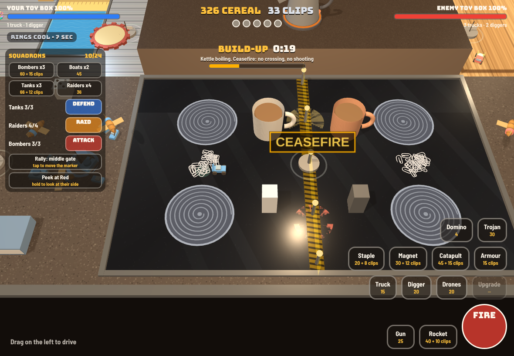 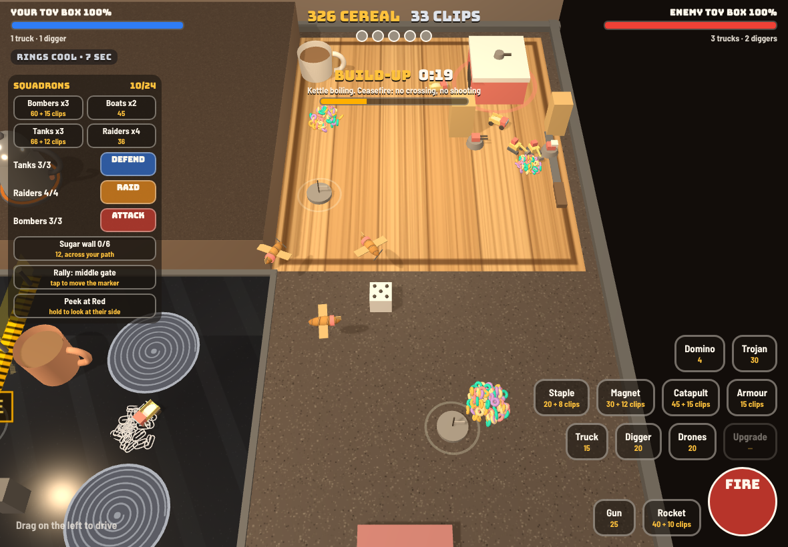 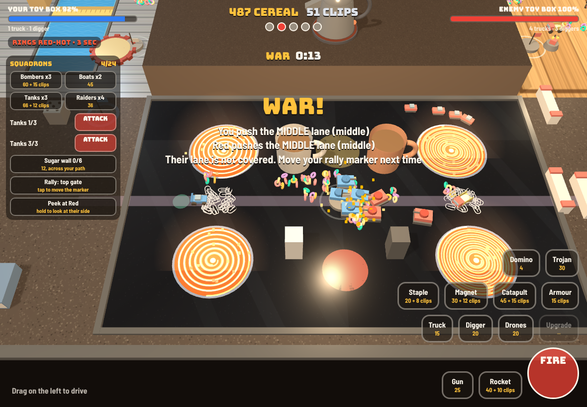 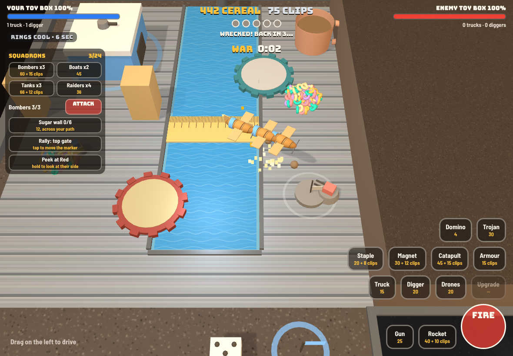

Harry's design: a big night worktop in a **U**; two minutes of getting ready, then war. **Stage 1 is this section; stage 2 (infantry, the Baguette train boss, the Great Domino Run, the fridge door, the ending screen) is built too: see "Level 6, the finale (stage 2)" below.** The hooks listed at the end of this section are now filled in. Data is `LEVELS[5]`; the code is one block headed "Level 6, the finale" just above `// ---------- Main loop ----------`, plus small hooks in shared code (listed below).

### The table-size decision (read this first)

**Per-level `W` and `D`.** `W`, `D`, `GW`, `GD`, `closed` and `closedFat` are now `let`. `buildLevel` calls `setTableSize(...(L.size || [150, 96]))` first: it swaps `W`/`D`, rebuilds the two route-grid arrays when the size changes, and scales the sun's shadow box. Why this and not "fit it in the old grid": everything already reads `W` and `D` live (edges, `collideObstacles`, camera clamps, domino bounds, cook, boats), so one assignment fixes all of it, and the grid is just two byte arrays. Scaling the level down to 150 x 96 would have made it too cramped for three zones plus a ceasefire line.
**Levels 1 to 5 are unchanged.** They ask for 150 x 96, which is what `W`/`D` already are. Checked by building each level in the old and the new `index.html` and comparing W, D, GW, GD, the count of closed route cells (both grids), every obstacle, cap, pile and base, the lighting numbers and the shadow box after 20 s of play: identical for all five.
The level-6 table is 210 x 130 (grid 105 x 65). Area: 27,300 minus the 90 x 70 cut-out = 21,000, which is **1.46x** the normal 14,400.

### The map (x right, z towards the camera)

| Part | Where | What |
|---|---|---|
| Cut-out | block x ±45, z -65 to 5, height 10 | the solid middle of the U (an ordinary `blocks` entry, first in the list; `finaleDecor` reads it). The **kettle** stands on top |
| Your arm, the sink | x -105 to -45, z -65 to 5 | steel draining board; water channel x -78 to -62, z to -4 (`water.z0/z1`); ruler bridge at z -28; two bottle-cap ferries (z -12 and -42); your toy box at (-92, -48) |
| Their arm, the breadboard | x 45 to 105, z -65 to 5 | wooden board texture, bread knife, loaf towers; their toy box at (92, -48) |
| The bend, the hob | z 5 to 65, whole width | black glass x ±45; four rings at (±26, 22) and (±26, 50), radius 8, the level 5 cycle; paperclips at (±26, 36) between them; the cook only drops pans here |
| Ceasefire line | x = 0, z 5 to 65 | hazard strip, amber curtain, five lamp posts, a "CEASEFIRE" sign (build-up only) |

Caps at (±53, -14), (±78, 36) and (0, 36) (on the line). Cereal piles beside each toy box, on the inner bank and in the bend; the bend ones refill. Start: 120 cereal, 30 clips, Racer and Tank. Base health 2500. `trickle: 0.7`. Resources `['cereal', 'clips']`, so every paperclip toy (Staple, Magnet, Catapult, Armour, rocket costs) works. No gumball, no toaster, no boss yet, no oven, no race, no raids (`rules.raidEvery` unset: squadrons replace them), no level domino runs (`buildLevelRun` returns null on this level).
**Night look** (`finaleLight`): hemisphere 0.7 warm, sun 0.5, three warm point lights (hob, sink, breadboard) = **5 real lights**, dark brown fog far away. Not the drawer's darkness: everything is readable. `finaleLight(false)` runs on every other level and puts the sun colour back. **Camera:** `camZoom` 1.75 on this level, plus 1.2 more while you hold Peek.

### Phase 1, the build-up (60 s, `FIN.build`)

`state.finale = { stage: 'buildup', ceasefire: true, left, squads, plan, cover, gate, rally, redGuess, marks, stage2 }` (`finaleInit`, made in `reset`, torn down by `finaleCleanup`). `state.phase` stays `'battle'`, so every button works; the kettle is only `state.finale.stage`.
- **Kettle** (`finaleDecor`, `finaleDraw`): shakes, its base ring glows redder, steam puffs grow, and `SOUNDS.kettle` (called from `finaleUpdate` with `kettleP` 0 to 1) is a hiss and whistle whose pitch and loudness rise, the beats getting closer together. The top HUD (`#finHud`) counts down. The last 5 s tick; at 10 s left the battle plan box opens.
- **The ceasefire line is a wall in four places:** `lineClamp` (called at the end of `collideObstacles`: blue stays at x <= -1.2 - r/2, red at x >= +1.2 + r/2), `nearestEnemy` (nobody picks a target on the other side, so turrets, units and boats don't even try), the shots loop (a shot that reaches x = 0 is removed; side remembered in `s.side`), and `navBuild` (cells with |x| < 3.4 closed, so routes never go over it). Bombers clamp themselves (x <= -2.5 / >= 2.5). Trucks and diggers only choose piles on their own side (`sideOk`). `canPlace` refuses building on the other side (`finaleCanPlace`) and within 6 of the line and on a hob ring (this rule is level 6 only). The Trojan is refused ("No tricks until the kettle clicks"); `enemyTricks` and the cook wait for the war.
- **The enemy builds on its side:** the commander uses `aiTime()`: the game clock plus 60 in the build-up (so it builds turrets straight away instead of its usual quiet minute) and plus 240 in the war (full aggression: upgrades, big army, turret ring). It buys no loose cars in the build-up. `finaleEnemy` buys squadrons from `AI_QUEUE` (bombers, tanks, raiders, bombers, tanks, tanks, bombers, raiders; the first it can afford; orders mostly attack, every third defend, raiders raid). The enemy's attack squadrons wait at the gate of the lane it is likely to use (`redGuess`): that is the **tell**. **Peek at Red** (hold the button in the squadron panel) swings the camera to their arm so you can see it all.

### Squadrons

Panel `#squadPanel` (left, JS-made): four buy buttons, then a row per squadron (`Tanks 3/3` and one big order button you tap to cycle **ATTACK, DEFEND, RAID**), a **Sugar wall** button (12 cereal, 6 at most, across your path; key B), a **Rally** button (cycles the rally marker over the top, middle and bottom gates on your side) and **Peek at Red**. Army cap `ARMY_CAP` 24 per side (cars, boats, bombers; workers and turrets not counted; drones count too). All numbers in `SQUADS` and `BOMBER`:

| Squadron | Cost | Units | Notes |
|---|---|---|---|
| Bombers | 60 cereal + 15 clips | 3 `bomber` | fly (`u.fly`), 80 hp, speed 16, radius 1.5 |
| Boats | 45 cereal | 2 gunboats (`launchBoat` with a position) | patrol the sink |
| Tanks | 66 cereal + 12 clips | 3 `sqtank` | 200 hp, cannon |
| Raiders | 36 cereal | 4 `sqraider` | speed 28, pop-guns |

Orders (`squadThink` for ground units, `bomberThink`, boats via `b.patrol`):
- **Attack:** go by the lane of your battle plan (`attackRoute`: out of your gate, along the lane across the bend, into their gate, then A* to their toy box), stopping to fight anything in weapon reach (boats and flyers are shot at while moving). Under the ceasefire everyone waits (`stagePoint`).
- **Defend:** wait at the rally marker (spread round it); anything of theirs within 30 of it is chased (ground) or bombed (bombers).
- **Raid:** hunt their trucks anywhere (`workersOf(foe, 'truck')`), then act like Attack. Bombers raid trucks too.
- **Boats:** Attack and Raid patrol z -32 to -9 (the south end of the channel, facing the bend); Defend patrols z -58 to -34 (round your toy box).

Squadron members are `kind: 'unit'` (boats `kind: 'boat'`) with `u.sq` pointing at the squadron `{ id, team, kind, order, units, n }`. `finaleUpdate` drops dead members and empty squadrons. **Shared shapes:** `squadModel(kind, team)` builds tank, raider and bomber from `sgeo`/`smat` (one geometry and one material per key, ever, through `shared()`), 4 or 5 meshes each; only the body casts shadows. Bomber crust is one canvas texture (`finTex.baguette`) with the slash marks painted on. Model parts for the sink's ferries use the same helpers.

**Bombers.** Fly at height 9 (render only; `u.alt` ramps up after take-off), ignore walls and water, turn at 2.2 rad/s, slow to 62% near the target so they always get over it, and release when the bomb's landing spot (position + velocity x 0.775 s) is within 3.4 of the target: a crumb bomb (`bombs[]`, shared sphere, gravity 30) that splashes radius 5.5 for 50, x1.8 on turrets, 0.6 on toy boxes (`bombBlast`, `WEAPONS.bomb`). Attack targets the nearest turret, then the toy box. Fragile and not flat out immune: `hurt` halves bullets that hit a flyer (`e.fly && !weapon.homing`), so **rocket turrets are the counter**. A lone gun turret is killed in one pass; a toy box's gun kills the flight in about 7 s.

### The battle plan

In the last 10 s (`FIN.planAt`) `#planBox` shows **LEFT / MIDDLE / RIGHT** (keys I, O, P); `pickLane` stores `F.plan[BLUE]`; nothing picked means MIDDLE. Lanes are the three rows across the bend (`FIN.lanes` z = 11, 36, 60). Left and right are as that side's squadrons see them heading for the enemy, so your LEFT is the top lane and Red's LEFT is the bottom lane (`phys`, `laneZ`). The enemy picks in `aiPickLane` at the moment of war: 65% the lane its attackers were staged at, otherwise random, and it dodges the gate where your rally marker is 60% of the time. At WAR `startWar` shows the banner with both plans and draws a blue and a red stripe across the bend for 14 s. **Covered bonus** (`coverage`, `finaleCovered`): if you have at least 3 turrets or Defend-squadron members within 20 of the gate where Red comes in, everything of yours within 24 of that gate takes 25% less damage for the rest of the game (a green ring shows it). The same rule applies to Red against your lane.

### Phase 2, WAR (`startWar`)

`stage = 'war'`, `ceasefire = false`, **`state.time = 0`**, `navDirty`, line fades out (1.4 s, then hidden), `sfx('kettleClick')` then a horn, shake, the banner, the cook's first pan in 25 s. The normal commander, boats, hob and cook run. Enemy squadrons keep coming as it can pay. A win or loss is the ordinary end card (stars: win, under 8 minutes of war, no truck lost).

### Shared-code edits (all small, marked "level 6" in comments)

`W D GW GD closed closedFat` to `let` + `setTableSize`; `canPlace` and `redTurrets` skip walls; `buildLevel` (size, `finaleLight`, `table.visible`, `finVis`); water: `inWaterX` (z range), `bridgeLift` (off-centre channel), `waterPush`, `navBuild` (z range), `launchBoat` (position, lane centre), `boatThink` (z range, `b.patrol`, no island), `dripsUpdate` (no tap); `makeBase` (`L.bases`); `spawnWorker`, respawn, first player spawn, `drones` and the commander's spawns use `spawnPt`; `commander`/`commanderBuild` (`aiTime`, `redHome`, `armyOf`); `nearestEnemy`, `collideObstacles`, shots loop, `hurt` (ceasefire, cover, bombers); `hobBurn`, `collideMovers`, caps, cook slam, `magnetThink` (skip `e.fly`); `cookPick`, `cookUpdate`; `canPlace`; `trojan`; `enemyTricks`; `buildLevelRun`; `unitThink`; `spawnUnit` (flyers, `squadModel`); `ENEMY_TYPES` and `WEAPONS` (`sqtank`, `sqraider`, `bomber`, `bomb`); `update`, `render` (bomber pose, camera zoom and Peek, `finaleDraw`), `reset`; `loopsGroup` (no shadows on this level); `SOUNDS` (`kettle`, `kettleClick`, `horn`, `whistle`); a keydown line for I/O/P.

### STAGE 2 hooks

- `state.finale.stage2` (null) is reserved for the train boss, the run and the fridge. `startWar` and `finaleUpdate` both have a `STAGE 2 HOOK` comment where the boss and the Great Domino Run should be scheduled.
- `buildLevelRun` returns null on this level on purpose (`STAGE 2 HOOK`): put the Great Domino Run there or in `startWar`.
- `finVis.fridgeAt` is a point at the north end of the cut-out for the fridge door. The Baguette train should come round the worktop edge: the arms have 60 x 70 of room each.
- `endGame` shows the ordinary card; the ending screen replaces it for level 6.

### Tested (Chromium, Playwright, by calling `update(1/60)`)

- Build-up: a car driven at the line stopped at x -2; a blue and a red scout 12 apart could not see each other (`nearestEnemy` null) and a shot between them was removed; the Trojan was refused; building was refused on the other side, within 6 of the line, on a ring and on water.
- WAR: the banner showed both plans, `state.time` restarted at 0, line hidden after the fade, navigation reopened.
- Squadrons: each type bought, followed Attack (tanks seen at lane z 35 then up the red arm), Raid (two red trucks killed in 45 s) and Defend (bombers chased a scout that came 14 from the rally); boats patrolled z -41 to -7 on Attack and -62 to -22 on Defend; bombers flew over the water and the cut-out and killed a red gun turret in one pass.
- The enemy bought a bomber squadron, tanks and turrets in the build-up (visible with Peek), and kept buying through the war.
- Levels 1 to 5 build identically (section above) and ran 20 s with no errors.
- **Budget, full war** (cheated cereal for both sides, 24 against 24, 14 turrets, 10 minutes of war, the camera parked in the bend where the fight is): draw calls (`renderer.info.render.calls`, shadow pass included) 600 to 830 with a peak of **829**. The same method on level 4 (boats, 10 turrets, enemy at its normal pace) peaked at **1,007**, so level 6 is at 0.8x level 4, well under the 1.5x budget. Geometries stay flat: 403 to 405 from minute 2 to minute 10, and the number of geometries on the GPU that are no longer in the scene (leaked) stayed at 2 or 3 the whole time. Textures flat at 14. 5 real lights.
- Sugar walls: built across your path, refused on rings, water, the line and the other side; the enemy builds up to 3 at its gate; a wall shot to 0 hp frees its route cell.
- Switching from level 6 to each of levels 1 to 5 and playing 15 s gives exactly the same obstacles, caps, piles, lighting, grid and table as loading that level fresh (only the three hidden level 6 panels remain in the page).

### Not done / open

- Walls are the simplest thing that works: an axis-aligned sugar block (an entity of kind `'turret'`, type `'wall'`, 260 hp, no gun, `level: 3` so it is never upgraded) that blocks cars and shots. Only the Sugar wall button and key B build them (`buildWall`, `makeWall`, `WALL`). No diagonal walls.
- Balance is a first pass, simulated only: no human has played it on an iPad. A passive player loses; a bot that buys squads and a few rocket turrets was slowly ground down; the economy (trickle 0.7) keeps armies small (usually under 10 a side), so a full 24 a side only happens when someone is rich. Tune `SQUADS` costs and `trickle` first.
- The enemy has no boats (its arm has no water) and never uses Defend squads cleverly: they sit at a random gate.
- Bombers can get stuck circling a target they are not quite lined up with; the slow-down on approach makes it rare.
- The first frame of the level recompiles shaders (point lights): a small hitch on an iPad.
- Left/right naming is per side (see "The battle plan"); the banner always says top/middle/bottom as well.

## Level 6, the finale (stage 2, 2 Nov 2026)

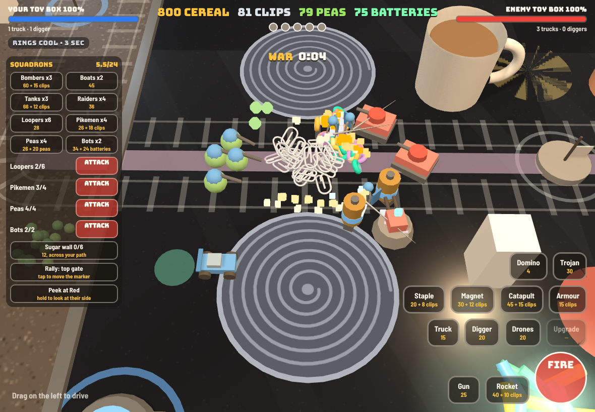 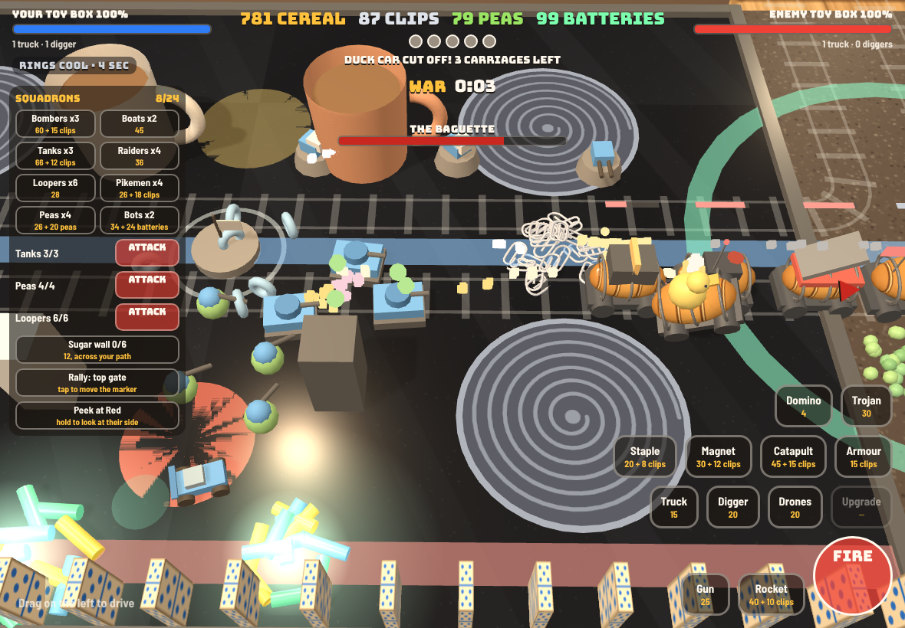 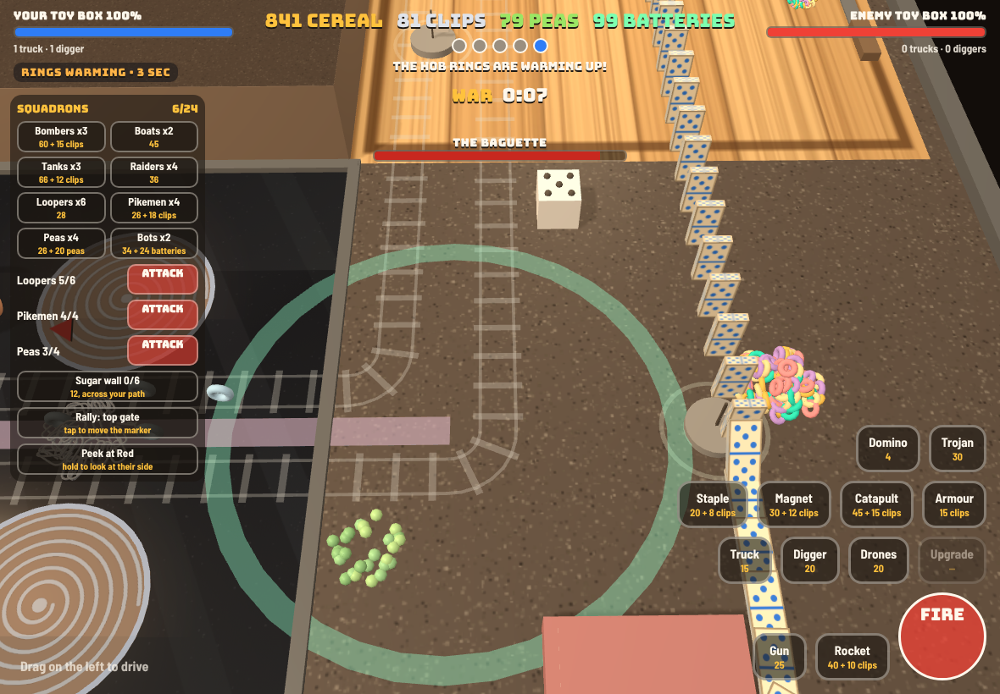 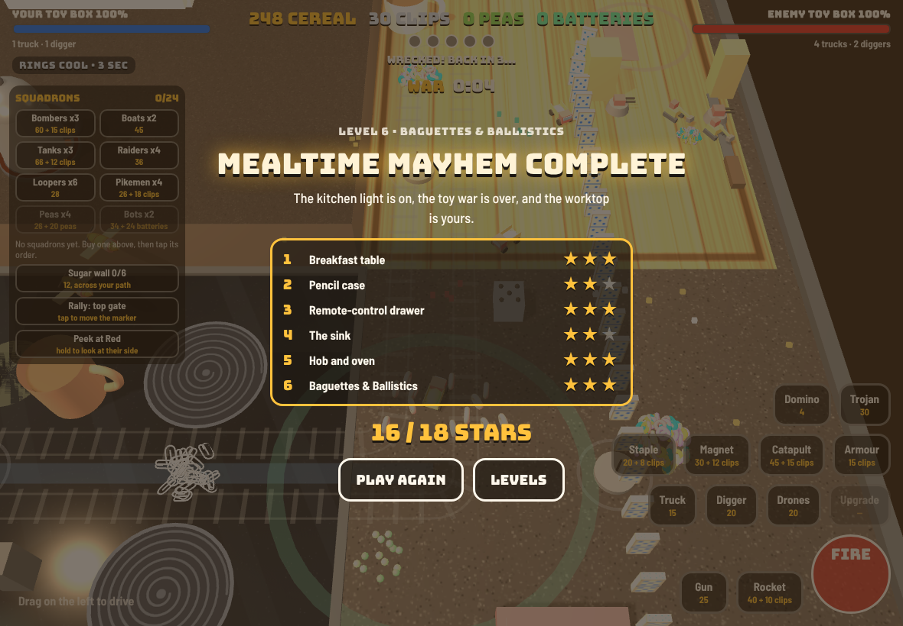

Stage 2 is built: infantry, THE BAGUETTE, the Great Domino Run, the fridge door and the ending. New code is in two marked places: the infantry (just after `SQUADS`, `squadThink` and its helpers), and one block headed "Level 6, the finale: stage 2" above `// ---------- Main loop ----------` (track, train, great runs, fridge, ending). `state.finale.stage2` = `{ train, baguetteDone, fridge }`.

### Infantry (Harry: "everything you collected all game becomes your army")

New `SQUADS` entries (`inf: true`; `squadWeight` = n x 0.5, and `armyOf` counts an `e.inf` unit as 0.5): **loopers** (Cereal Loopers, 6, 28 cereal), **pikemen** (Paperclip Pikemen, 4, 26 cereal + 18 clips), **peashooters** (Pea Shooters, 4, 26 cereal + 20 peas), **botsq** (Battery Bots, 2, 34 cereal + 24 batteries). `ENEMY_TYPES` `looper`, `pike`, `pea`, `bot` (flag `inf`; `armor`, `floats`), models in `squadModel` (shared parts, 1 to 8 meshes each), `SQ_MODELS` radii, `WEAPONS` `loopshot`, `pike`, `peashot`, `botzap`. They walk with the normal `steer` and `squadThink`. One job each:
- **Loopers:** fast (25), 24 hp, a weak popgun. On Attack and Raid `u.capGoal` sends each to the nearest bottle cap its side does not hold, so they take caps and soak fire. The hoop rolls (`infPose`).
- **Pikemen:** slow (6.5), 130 hp, `armor` 2, a short spear (range 7.5). `weapon.vsCar` 2: `hurt` multiplies by it against cars (you, workers, non-infantry non-flying units). On Defend they stand in a line across the rally gate (`u.slot`) and only fight what comes into it.
- **Pea shooters:** `weapon.lob` peas (range 34, splash 2.6, 22 damage); they stand off at 22. They **float** (`u.floats`): `waterPush` skips them and `steer` uses a third route grid `closedFlt` (the same as `closed` but with the water open, copied in `navBuild` just before the water step), so they walk straight across the sink. On the water they bob (`infPose`).
- **Battery bots:** no bullet. `botThink` and `botPulse`: every 4.2 to 5 s, if an enemy turret or car is within 12, a pulse (radius 14, drawn by one ring from the shared pool `pulseRings`, 8 at most) sets `e.stun = 1.5` on enemy turrets (the main loop skips their gun while `stun > 0` and sparks them) and `e.pinned = 1.5` on cars, workers and you (the existing staple pin). Infantry, bombers, toy boxes, sugar walls and Baguette parts are not affected. 6 damage each.
- **Pressing buttons:** `squadThink` now honours `u.presser` like `unitThink`; `UNIT_WEIGHT` has infantry at 0.5, bombers 0, `sqtank` 2.

**Peas and batteries** are extra stocks: `state.peas` and `state.batts` (arrays per team, level 6 only), `LEVELS[5].resources` = `['cereal','clips','peas','batteries']`, `start.peas` and `start.batts` 0. `stockOf(res)` maps a truck's `loadRes` to its stock (the old line wrote everything that was not cereal into `state.clips`; level 3's batteries still do). Piles: peas at (50, 46) and (-50, 46) on the lanes, batteries at (8, 60) and (-8, 60) beside the ceasefire line, small (100 and 90). The third worker of a side (`pref === 'clips'`) fetches whichever of clips, peas, batteries it has least of, and **you can scoop them yourself by sitting on the pile** (`extrasUpdate`, 9 a second): that is the risky part. Red also gets a trickle (0.25 peas and 0.12 batteries a second) so its infantry do not wait for ever. The HUD shows `peasHud` and `battHud` next to the clips on this level only (made in `finaleUI`, hidden by `finaleCleanup`). The enemy queue (`AI_QUEUE`) now includes loopers, pikemen, pea shooters and bot squadrons; its pikemen always Defend.

### THE BAGUETTE (the boss)

- **Track** (`BAG_VERTS`, `bagTrack`, `trackAt`): a closed loop that outlines the U, 540 long, rounded 90 degree corners (radius 4 to 4.5), resampled to 1 unit. Up the breadboard arm by the outer lane (x 60), a U-turn, down the inner lane (x 51), west along the bend (row z 32), up the sink arm by the inner lane (x -49), a U-turn, down the outer lane (x -57), east along the bend (row z 40), and round again. No crossings. Checked against the obstacle list, the water and the table edge with a 2.3 margin: 0 bad points. **No A\***: the train is placed by arclength (`T.s`). `bagRails` draws it as one mesh of two rails and sleepers (faint, in `levelRoot`, visible from the start).
- **Parts:** `bagPart` makes an entity of **`kind: 'bag'`** for the engine (`locked`, 900 hp, r 3.4) and each carriage (380 hp, r 2.8, armor 3), in the order engine, Stapler, Duck, Remote, Toaster. `bagModel` builds them from shared shapes (chassis, 2 axles, a crusty loaf with the `finTex.baguette` texture, 3 steel bands, and a top per weapon: 9 to 13 meshes). Each has a flat hp bar (`bagBar`, two shared colours; grey while the engine is locked).
- **hurt():** `hurt` hands any hit on a `bag` entity to `bagHurt` (one line at its top). The engine soaks hits (a spark, and a toast now and then) until `T.cars` is empty (`locked` false); `nearestEnemy` skips a locked engine so turrets do not waste shots. Armour takes 3 off each hit. A dead carriage (`bagDie`): burst, `bigBoom`, shake, a 40 cereal spill, its model flies off as a tumbling `T.debris` piece (shrinks, then is `disposeTree`d) and the others close up (their `off` eases). Last carriage: banner "ALL CARRIAGES GONE". Engine death: `bossShield(false)`, six spills of 55 (330 cereal), colour bursts, banner "THE BAGUETTE IS STALE!".
- **state.boss** is a stand-in `{ kind: 'bagtrain', x, z, hp (total), maxHp, shieldBroken }` so the existing boss bar, arrow and shield work. `hurt`'s base shield line also checks `!state.boss.shieldBroken`. The bar reads "THE BAGUETTE" and sits 160px down (the war clock is where the other bosses' bar goes). Banner: "THE BAGUETTE" and "Cut it apart carriage by carriage!".
- **Weapons** (`bagUpdate`; each carriage looks for a target every 0.6 s): **Stapler car** snaps shut (kills) a turret or sugar wall within 8.5, every 2.2 s, with a lid animation. **Duck car**: `WEAPONS.bubble` at range 44 (popped near the target like the Duck). **Remote car**: `WEAPONS.snipe` at 46, leading the target, turrets first. **Toaster car**: `WEAPONS.toast` lobbed at 42. The engine's cow-catcher crushes anything of yours on the track (90 a second, 270 on turrets, so a turret built on the rails does not last).
- **Timing:** `BAG.at` 184 s of war (the fridge opens at 180). Speed 7.5, +10% for each lost carriage; a lap takes 72 s.
- Not done: nothing blocks or is blocked by the train physically (cars drive through it).

### The Great Domino Run

`buildLevelRun` now returns `buildGreatRun(team)` on this level. `GREAT[team]` holds the corners, radii and damage; `greatPath` rounds the corners and drops a domino every `RUN_STEP` (4.2). **Yours** (53 dominoes, the longest in the game; the old runs were at most 26): button at (-41, 63) at the bottom-left of the hob, along the bottom edge of the bend (z 62.5) to x 79.5, north up the enemy arm (between the book and the loaf tower), and into their fortress; the tip lands 6 from its centre. **Red's** (26 dominoes, aimed at your fortress): button at (-61, 48), west to x -91 and north along the west bank. Both go through `standRun`, which makes `addDominoLite` dominoes when `run.lite`: **one mesh each** (a painted texture, shared geometry and material), so 79 dominoes are 79 meshes, not 550. Weight: `BUTTON_WEIGHT` 3, a Monster, or a car plus drones and infantry (0.5 each; the toast says so); your squads and drones near you join when you sit on the button. `runsUpdate` uses `run.reset` (90 s here, 45 elsewhere). In `dominoesUpdate` a fallen domino of a run with `d.dmg` hits for that (500, or 250 for Red's) and `d.breaks` (yours only) calls `bagBreakShield` first, so the whole 500 lands even with the Baguette alive ("SHIELD SMASHED!"). Red presses its button after 100 s of war with the commander's existing code.

### The fridge door

`fridgeBuild` (in `finaleDecor`) stands a fridge on the north end of the cut-out (white box, shelves, jars and a lettuce, a hinged door with a handle, magnets and a note, all fresh shapes in `levelRoot`). `fridgeUpdate` (called from `finaleUpdate`): at **180 s of war** (`FRIDGE.at`) the door swings out 1.8 rad in 2.2 s, with a banner and a creak (`fridgeOpen`); the camera glances at it for 3 s (`F.cine`, hooks in `render`); the inside glows and a faint light fan shows. For `FRIDGE.open` (20 s) the **existing lights** are scaled by 1.9 (hemisphere, sun, the three point lights) and tinted cool; then the door slams (it accelerates shut; `clunk`, shake, burst, banner "SLAM!") and the lights ease to 0.68 of their old value and stay there (hemisphere 0.48, sun 0.34): darker than before, still readable. No new lights. `applyLights(k, cool, flick)` and `LIGHT_BASE` hold the numbers (they must match `finaleLight`).

### The ending

`endGame` calls `finaleEnding(earned)` for a **win on level 6** (after the stars are saved). `update` stops once the game is over, so the timeline runs in `endingDraw` (called from `render`): the kitchen light flicks (dark, flash, dark, flash, dark, then on for good: lights x2.3 and warm, the background lifts, a little confetti), and at 2.8 s `showEnding` fills `#ending` (made in `finaleUI`): **MEALTIME MAYHEM COMPLETE**, six rows (level name and its stars from `starsOf`, the saved `bb-progress-v1`), the total out of 18, Play again and Levels. Losing shows the ordinary card.

### Shared-code edits for stage 2 (all small, marked "level 6")

`ENEMY_TYPES`, `WEAPONS`, `spawnUnit` (inf flags), `steer` (`closedFlt`), `navBuild`, `setTableSize`, `waterPush` (floaters), `hurt` (`vsCar`, the `bag` line, the shield check), the turret loop (`stun`), `nearestEnemy` (`locked`), `makePile` and `peasGroup`, `stockOf` with the truck's drop and want lines and its load colour, `reset` (stocks), `standRun`, `runsUpdate` (reset time and the toast), `dominoesUpdate` (damage, shield), `buildLevelRun` (calls `buildGreatRun`), `UNIT_WEIGHT`, the camera lines in `render` (peek or cine), the render loop (`infPose`, `endingDraw`), `endGame` (one line), `SOUNDS` (`zap`, `loopshot`, `pike`, `peashot`, `botzap`, `fridgeOpen`, `clunk`), `finaleCleanup`, `finaleInit` (`stage2`), `finaleUpdate` and `finaleDecor` (hooks). `addDomino` itself is untouched.

### Tested (Chromium, Playwright, `update(1/60)` by hand with the real-time loop frozen)

- **Budget** (a 24 against 24 cheat: both sides given 3000 cereal and stocks and every squad type bought again and again, 10 minutes of war, the camera in the bend where the fight is, the Baguette and both Great Runs on the table; `renderer.info.render.calls`, shadow pass included, 360 x 250 page so renders are cheap): a render every 2.5 s peaked at **1,103** over the 10 minutes; counting every spark (a render every 3 frames, 160 s) peaked at **1,287**. The same method on level 4 (3 boats, 10 turrets, 14 cars a side kept topped up) peaked at **1,196**, so level 6 is at about **1.08x level 4**. Sparks (`burst`) are capped at 150 alive on this level (400 elsewhere) because each is a draw call, infantry cast no shadows, the Baguette's tops cast none, and each pikeman is 4 meshes, each bot 5. Geometries (`renderer.info.memory.geometries`) stayed between 314 and 394 for the whole 10 minutes with no trend (the Baguette came and went at 3:00 to 5:00); textures flat at 18; 5 real lights. (Stage 1's documented 829 was measured another way; do not compare the two.)

- Infantry: every squad bought (army 8 of 24 for 16 infantry); 3 pikemen hit a stationary tank for 475 in 5 s against 86 for 3 loopers; a pea shooter crossed the sink's open water in 6.6 s where a wheeled unit needed the bridge (21 s); a battery bot stunned a gun turret and pinned a tank for 1.5 s per pulse, and was shot dead after two pulses.
- Baguette: the engine ignored a 500 hit with carriages on and lost 97 of a 100 hit after; killing the four carriages one by one took the stand-in hp from 2420 to 2040, 1660, 1280 and 900, leaving 4 debris pieces that cleaned up; the engine died, the shield popped, the spills were left and the bar hid; the Stapler car snapped a gun turret in one pass, the engine ran over another on the rails, and the Duck, Remote and Toaster cars all fired (3, 7 and 3 shots in 14 s at three tanks and two turrets).
- Great Domino Run: 53 dominoes; a Racer alone: "too light" (stays ready); with 10 infantry it fell in 8.3 s; their fortress went 2500 to 2000 (500) and the shield broke with the Baguette alive; it stood again 90 s later. 79 dominoes in the scene (yours and Red's).
- Fridge: closed until 180 s, open at 180 (hemisphere 0.7 to 1.33, sun 0.5 to 0.95, points x1.9), slammed at 200, then 0.48 and 0.34.
- Ending: base destroyed, the ordinary card stays hidden, `#ending` shows at 2.8 s with 14 of 18 for saved stars of 3, 2, 3, 1, 2 and the win's 3; Play again restarts the level.
- Levels 1 to 5 load and play 20 s with no page errors.

### Not done / open

- Balance is simulated only; no human has played it on an iPad. Tune `BAG.carHp`, `BAG.engineHp`, `BAG.speed`, the squad costs and `BOT`.
- The train does not block cars and is not blocked by them. The Great Run's dominoes cannot be shot down (`fixed`); the only counter is to kill the crew on the button.
- Red's run button sits on your side of the bend (-61, 48), so Red only presses it by sending cars into your defences; if they never come, the run never falls.
- The fridge only looks bright where the camera is: the real effect is the lights (the light fan on the cut-out is faint).
- A looper takes a cap even in the middle of a fight, on purpose.

## Level 6, stage 3: the giant worktop (2 Nov 2026)

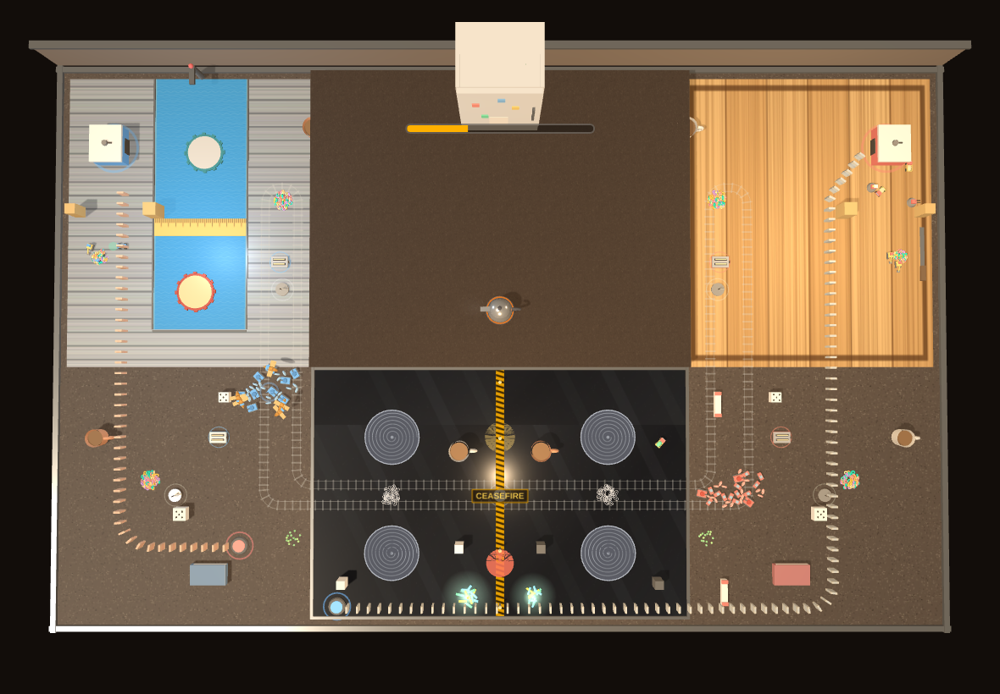 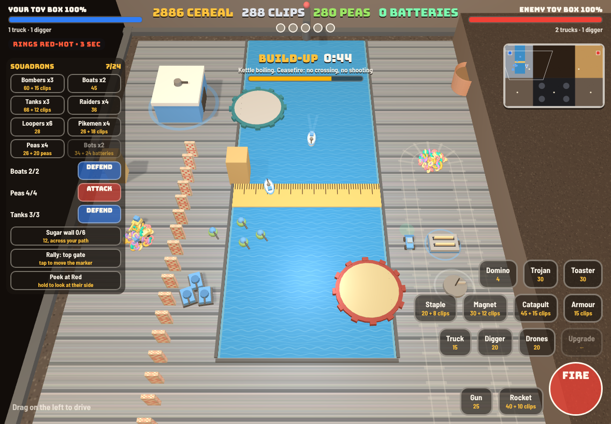 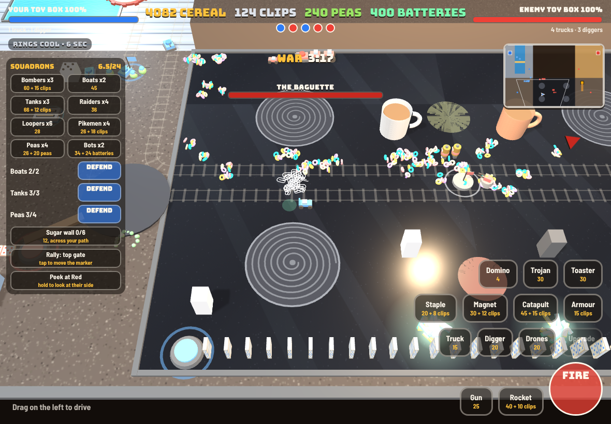

Harry: the finale should be 4 to 6 times the area of a normal level. **Done at 4.0x** (see "why not 5x" below). Everything in the stage 1 and stage 2 sections above is still true except the coordinates: **every level 6 position is the old one x 1.65** (some nudged by hand). Object sizes (cars, turrets, mugs, the kettle) did not change, so the camera sees the same size of toys, just a longer way between things.

### The new map

| | old (stage 1) | now |
|---|---|---|
| Table `size` | 210 x 130 | **346 x 216** (grid 173 x 108 at `CELL` 2) |
| Area | 21,000 (1.46x normal) | **57,568 = 4.00x** of 14,400 (74,736 minus the cut-out) |
| Cut-out block | x +-45, z -65 to 5 | x +-74, z -108 to 8 (148 x 116, `blocks[0]`) |
| Arms | 60 wide, 70 long | 99 wide (|x| 74 to 173), 116 long (z -108 to 8) |
| Bend (hob) | 60 deep | 100 deep (z 8 to 108); hob glass 148 x 100 |
| Toy boxes | (+-92, -48) | (+-155, -80) |
| Rings | (+-26, 22/50) r 8 | (+-43, 36/82) r 11 |
| Lanes / gates | z 11, 36, 60 / x +-56 | z **18, 58, 98** / x +-**92** (`FIN.lanes`, `FIN.gateX`); `coverR` 28 (and 32 in `finaleCovered`) |
| Ceasefire line | z 5 to 65 | z 8 to 108, five posts, sign at (0, 58) |
| Caps | (+-53,-14) (+-78,36) (0,36) | (+-87,-23) (+-129,59) (0,59) |
| Piles | see `LEVELS[5].piles` | beside the boxes (+-160,-36), inner bank (+-87,-59), bend (+-139,53), clips (+-43,59), peas (+-82,76), batteries (+-13,99); amounts 100 to 190 |
| Baguette track | 540 long | **857 long** (`BAG_VERTS`: rows z 63 and 55, arm lanes x 99/84 and -81/-94, U-turns at z -64); speed 7.5 to 10, a lap about 86 s. Checked: 0 points within 2.3 of a block, the water or the edge |
| Great Run (yours) | 53 dominoes | **89** ((-60,103) east along z 103, north up x 131, tip at (144,-77)) |
| Great Run (Red's) | 26 | **43** ((-108,79) west to x -150, north to z -62) |
| Camera | `camZoom` 1.75 | **2.1** (Peek and the fridge glance still x1.2); Peek looks at (120,-4), the fridge glance at (0,-62) |
| Fridge / kettle | z -64 / -8 | z -108 (north end of the cut-out) / -14 |
| Fog, lights | 150-340, 3 point lights | fog 260-640; the three point lights moved out and got a bit stronger (`LIGHT_BASE.pts` 0.95/0.7/0.7) |
| Shadow box | from `setTableSize` | the same code, now 2.3x (about 0.2 units a texel at 2048; shadows are softer than on the small levels) |

Two extra blocks on each side of the bend (dice, mugs, a pepper pot) so the bigger bend is not bare. The cook picks pan spots only for z >= 24 now.

### The sink: a pool in the middle of the arm

`LEVELS[5].water`: `x0 -138, x1 -102` (36 wide, in the middle of the arm), `z0 -114` (off the table edge) to `z1 -7`, so there is a land lane on **each side** (35 wide on your toy box's side, 28 on the cut-out side) and the bend is open at the south end. Ruler bridge at z -48 (7 wide). Two bottle-cap ferries (`R` 7.5, leg 8 s, stops at x -142 and -98, z -22 and -78). The Baguette's lanes (x -81, -94) and the cap are on the cut-out side bank. Boats patrol z -92 to -58 (Defend) or -52 to -16 (Attack); the flotilla launches at z -95. Pea shooters float straight over it (they use `closedFlt`), wheels use the bridge or a ferry. Nothing in the water code changed: it all reads `state.water`.

### The minimap (level 6 only)

`miniMapDraw` in `finaleDraw`; a 380 x 238 canvas (`#miniMap`, shown at 190 x 119 CSS pixels) top right under the enemy toy box bar. The worktop is painted once into `finVis.miniBg` (`miniBack`); the rest is redrawn **5 times a second** (`MINI.every`, measured at 0.22 ms a draw). It shows: the U (steel sink arm, bread arm, dark cut-out, black hob, the four rings), the water and bridge, both toy boxes (squares), the five bottle caps by owner, your car (white-ringed blue arrow that turns), your units, boats and turrets (blue), **enemies you can see** (red; within `MINI.sight` 55 of your car or `MINI.unitSight` 40 of anything of yours, so it is not a free radar), the Baguette (orange engine square, tan carriages, always shown) and a white outline of what the camera shows. `pointer-events: none`, so it never eats a touch. On the 1180 x 820 view it sits at x 972 to 1168, y 84 to 209: clear of the Squadrons panel (x 12 to 226) and of every button (the right-hand buttons start at y about 500). Hidden on the title screen, when the game is over, and on every other level (it is created by `finaleUI`, which only runs on level 6, and `finaleCleanup` hides it).

### Travel: toasters, speeds, build-up

- `LEVELS[5].toaster: true` turns the Toaster button on (30 cereal, 3 at most; the ready-made ones do not count). `finaleBegin` places **two ready-made toasters per side** (blue (-88,-34) and (-112,36), red mirrored; `makeToaster(...).pre = true`): the first throws a car from the sink bank over the lane to the bend, the second across the bend. `toasterHop()` is **48** on this level (30 elsewhere). Only the player uses them; the AI's squads still drive (they could be sent through them with `u.via`, not done).
- `sqtank` speed 9.5 to 11 (level 6 only type). The build-up stays 60 s: crossing is not slow enough to need 90 (below).
- **Measured crossings** (war, no enemy, base to the enemy base along the lane by the bridge, about 450 units): Racer **15 s**, Tank (player) **33 s**, a Tanks squad (11 speed) **39 s** (45 s at the old 9.5), Loopers 56 s (they detour for caps). Bombers fly straight (16 speed, about 20 s). The old map took about 27 s for the same squad.

### Performance (Chromium, swiftshader, `update(1/60)` by hand, real loop frozen; a render every 12 ticks so sparks age; 360 x 250 page)

Same harness on both levels: both sides get 4000 cereal and stocks every second, 24 against 24 on level 6 (squads of every kind bought again and again, 7 turrets each side, the Baguette and both Great Runs on the table), level 4 with 14 cars a side kept topped up, 3 boats and 5 turrets each side; the camera parked where the fight is; 10 minutes.

| | level 4 | level 6 (4.0x) |
|---|---|---|
| Draw calls (shadow pass included), min / mean / max | 490 / 1,021 / 1,307 | 133 / 739 / **1,103** (0.84x level 4 at the peak) |
| `update()` ms: mean / p99 | 1.0 / 5.4 | **3.1 / 8.6** (a long find: `findPath` 6 ms worst on the whole map) |
| Entities | 54 | 112 |
| Geometries over 10 min | 726 to 2,473 (grows: see "seen, not fixed") | **298 to 459, flat** after minute 1 (407, 405, 396, 438, 438, 441, 441, 420, 423 every minute) |
| Textures | 6 | 18 flat |

So there is headroom, but the bigger cost is the update, not the drawing. Single `update()` spikes of 30 to 200 ms show up now and then in this sandbox in unrelated functions (`dominoesUpdate`, `tone`, a render hook): they look like GC pauses, not code (wrapping every function and timing it found no function that is slow every time).

**Two real fixes the big grid forced (both level 6 only, marked in the code):**
1. **`findPath` could churn for ever.** A cell's `g` is a `Float32Array`; a 64-bit cost compared with its 32-bit rounded copy was "better" again and again, so a long or unreachable search kept re-pushing cells (a heap of 1.1 million entries; a Raiders squad froze the page). On level 6 only the search now treats improvements under 0.001 as none, expands each cell once (`done`), and reuses its three buffers (`astar`). Paths are otherwise the same A*. Levels 1 to 5 still run the old code.
2. **`pathBudget`:** `update()` refills it to 2; `steer` only starts a route search while it is above 0 (level 6 only). A unit that is refused keeps its old route (or drives straight) and asks again within 0.02 to 0.07 s. Without it, a whole squadron asking at once (war start) cost up to 120 ms in one tick.

### Why 4.0x and not 5x

The draw-call and geometry numbers had room for 5x, but the map is already 4.0x and a tank squad needs about 40 s to cross it; 5x would be about 45 s plus more empty ground, and the shadow map (2048 for a 416-wide box) is already soft. Going to 5x means re-scaling the numbers above by 1.12 (they are all in `LEVELS[5]`, `FIN`, `BAG_VERTS`, `GREAT`, the water data and a few `finaleDecor` literals; search for this section's numbers), which is a half-day of editing and re-checking the track and runs, not a tuning knob. Decision for Harry after a play on a real iPad.

### Shared-code edits for stage 3 (all marked "level 6")

`findPath` (above), `steer` (`pathBudget`), `update` (refills `pathBudget`), the commander's toaster line (skipped on level 6), `buildToaster` (the ready-made ones are not counted), `toasterHop()` (`launch`, the landing preview), `cookPick` (z >= 24), the camera lines in `render` (Peek and fridge glance targets), `ENEMY_TYPES.sqtank` speed. New: `miniBack`, `miniMapDraw`, the `#miniMap` element and CSS. The `canvas { position: fixed; inset: 0 }` rule in the page applies to every canvas, so `.miniMap` has to say `left: auto; bottom: auto`.

### Checked

- Baguette track: 0 bad points (block, water, edge at 2.3). Great Runs: both build (89 and 43), no dominoes inside a block or the water at 1.8 (two blocks and a mug that were on the lines were moved).
- Levels 1 to 6 each load and play 90 s of game time (`update` by hand, a render every 12 ticks) with 0 page errors; levels 1 to 5 still 150 x 96, no minimap element. After the route-search budget a 5-minute level 6 run measured `update()` 3.4 ms mean, 9.9 ms p99, calls 133 / 656 / 851, geometries 298 to 449 flat.

### Seen, not fixed

- On level 4, in my harness (cars killed and respawned all the time), `renderer.info.memory.geometries` climbs from 726 to 2,473 in 10 minutes. Not level 6 and not caused by this stage. **Fixed later: see "Level 4 geometry leak" at the end.**
- Red's squads and units never use the toasters (only you do).
- (Fixed later: Red's Great Run button is now in the middle of the bend; see the end.)
- The cut-out looks bare from above (a dark slab with a kettle and a fridge); fine from the game camera, which seldom sees it.

## Level 5, Hob and oven (2 Nov 2026)

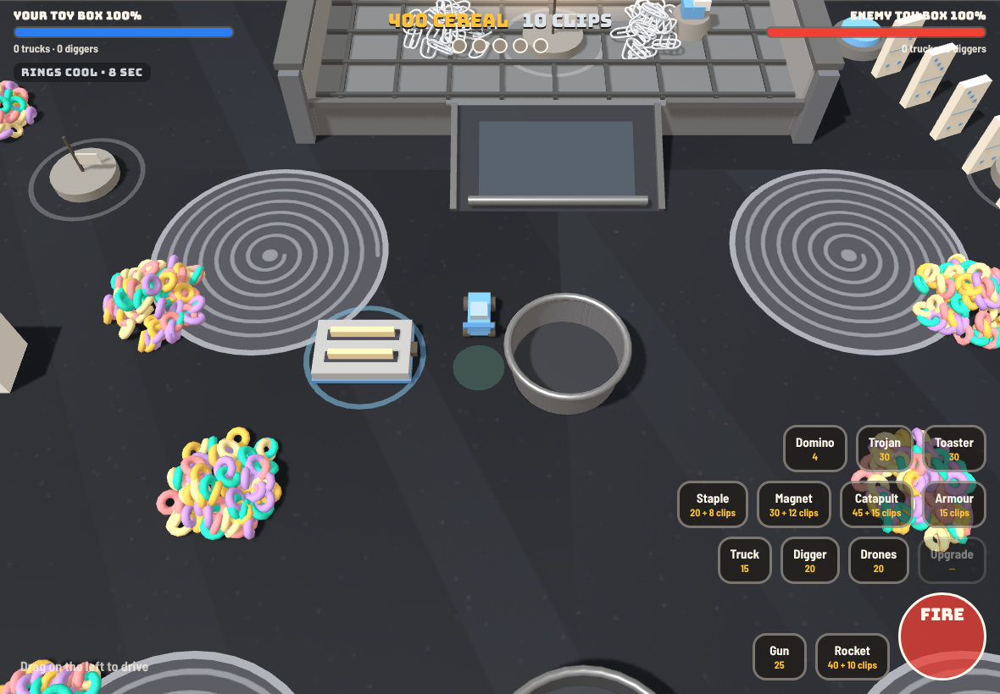 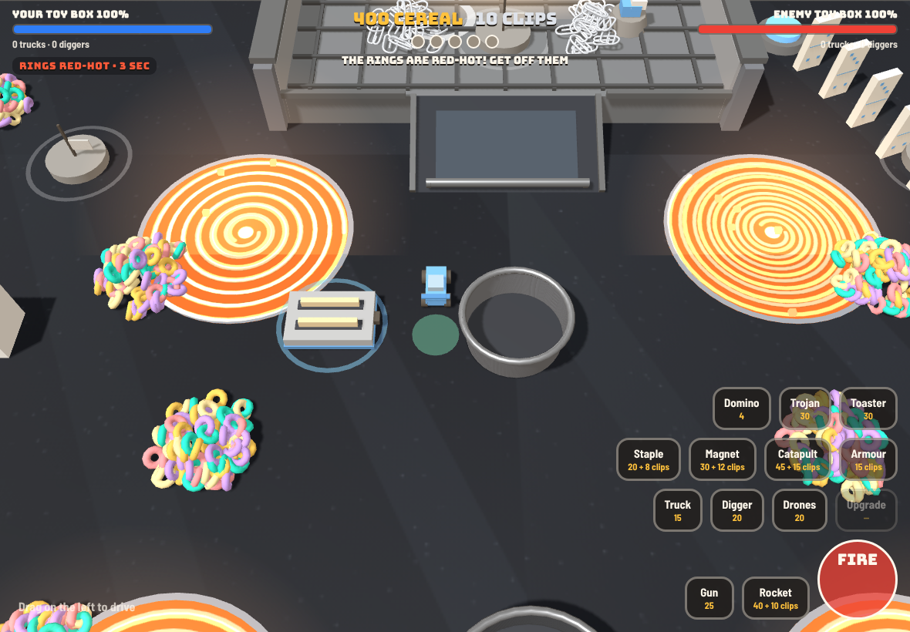 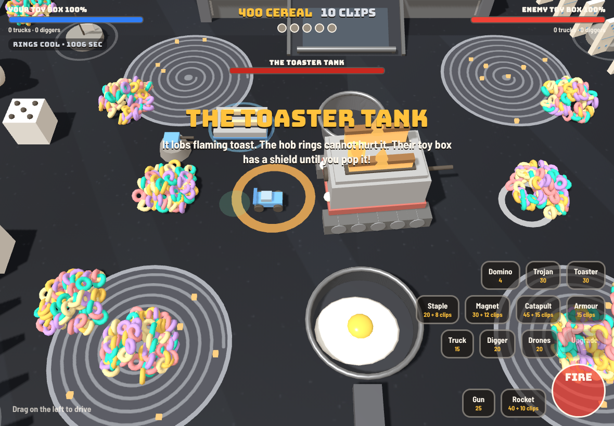

**The big idea: four hot rings on a cycle, and a raised oven.** Data is `LEVELS[4]` (`hob`, `oven`, `toaster`, `rules.rusher`, `rules.boss.kind: 'toaster'`); code is in one block headed "Level 5, Hob and oven", just above `// ---------- Levels ----------`, plus small hooks.

**Layout.** Black glass table (`tableTex: 'hob'`, `hobTexture`). Rings at (±22, ±19), radius 9. The oven is at the back, x ±20, z -48 to -32: solid side walls (height 7, in `blocks`), a stainless floor with wire-rack bars, a back panel with knobs, a glowing element. The door lies down as a ramp (x ±8, z -32 to -23.5) rising 3.2 (`LEDGE_H`). Low rails (height 1, so shots fly over but cars can't cross) run along the ramp sides and the ledge front (`rail` obstacles pushed in `hobDecor`). Caps at (±38, ±27) and the middle cap on the ledge at (0, -40, `LEDGE_H`); two paperclip piles in the oven at (±9, -41). Cereal piles: between the rings at (±22, 0) (safe), on the edge of each ring at (±29.5, ±14.5), dead centre of the front rings at (±22, 19) (200, refills 0.45 a second: rich, only safe while cool), and far ones at (±48, ±34). A frying pan with an egg (`block` kind `pan`, with a handle box) and a saucepan are the blocks, plus mugs, books, sugar cubes and salt and pepper. Start: 40 cereal, 10 clips, Racer and Tank; resources `cereal` + `clips`, so all the paperclip toys work. Base health 1800, raids from 2:20 every 100 s. No gumball on this level.

**Rings** (`state.hob`, `hobPhase`, `hobUpdate`, `hobBurn`, `hobDraw`). The clock `h.t` starts at -6 (a longer first cool spell); the cycle is cool 10, warn 3, hot 6 (`LEVELS[4].hob`). On every phase change a toast shows (and `sizzle` when hot). While hot, once a second (first tick 0.5 s in) everything with its centre on a ring takes 12 (turrets 6): cars, units, workers, boats. The Toaster Tank (kind `boss`), bases and cars in the air are immune. The look: `hobVis` holds four shared materials (fill, coil texture, additive shimmer, halo sprite). `hobDraw` eases one heat value `V.g` (up fast, down slowly for an afterglow) and tints them: dark and grey when cool, a dim orange pulse when warming, bright red-orange with a spinning additive shimmer, a halo and heat sparks (`burst`) when hot. A clock (`hobEl`, made in JS) at the top left reads "RINGS COOL / WARMING / RED-HOT · n sec".

**How the AI treats rings.** `h.avoid` is true when warm, hot, or with less than `safe` (5) seconds of cool left. While true, `navBuild` closes the ring cells (not in the fat grid, so the boss walks through), `steer` moves a goal that sits on a ring out to the ring's edge and walks anything standing on a ring off it, and diggers and trucks skip piles in the middle of a ring. Measured over 4.5 minutes: no AI unit, worker or turret was burned. `buildLevelRun` and `planDominoRun` use `hobBlocked` (rings and the oven zone), so the level runs never cross a ring.

**The oven is a lift, not a layer.** `ledgeLift(e)` gives 0 on the table, a ramp from 0 to `LEDGE_H` between z -23.5 and -32 when |x| < 8, and `LEDGE_H` on the ledge. `render` adds it to every car's y and tilts a car on the ramp (the same trick as the sink's `bridgeLift`); piles and spills in the oven are lifted when made; the build ghost follows. Logic stays 2D. Turrets whose spot is on the ledge get `high: true`, mesh y 3.2 and **range x 1.3** (`makeTurret`; a toast says so when you build one); `canPlace` refuses the ramp. Shots from the ledge start higher (`fire` adds the lift).

**The toaster launcher** (`TOASTER`, `toasters[]`, `makeToaster`, `buildToaster`, `launch`, `airStep`, `toastersUpdate`, `landMarksUpdate`). Button *Toaster* (`#bToaster`) or **K**, 30 cereal, 3 at most per side, placed 6 behind you (`toasterSpot`: not near blocks, not on the ramp, 9 from another). A chrome slab with two slices that pop. Drive onto it at more than 2.5 units/s (0.8 s between launches) and `launch` sets `e.air = { t, T: 0.95, sx, sz, tx, tz, l0, l1, H: 11 }`: a straight line in x and z to a spot 30 units ahead of your heading (clamped to the table). `drive` returns into `airStep` while `e.air` is set; collision, `collideMovers` and `hurt` skip a car in the air. `render` draws the arc (`4 H f (1-f)`, blending the start and end lift so a jump onto the ledge doesn't pop). On landing `collideObstacles` nudges you out of anything and cars under you take 25. A dark disc marks the landing for every car in the air, and a pulsing white ring previews it when you are within 14 of a ready toaster of yours (`landMarks`, made once).
- **The enemy** saves up for one toaster (`commander`, spots (34, 0), (36, ±6)). When its wave is released each car gets `u.via = toaster`, drives onto it, and jumps towards your toy box.

**The rusher** (`rules.rusher`, `rushUpdate`, `state.rush`). The commander's army cap is 6 (to 1:00), 9 (to 2:00), then 12+; each new car gets `u.hold` and a rally point (x 42 to 48, near their toy box) and waits there (still shooting what comes in range). `rushUpdate` releases the wave when it has `rush.size` cars (4, then +1 each wave to 9) or `gap` (70 s) has passed, but **only while `!hob.avoid`**: if the rings are not safe the toast says "Red is waiting for the rings to cool…". First wave from 0:50. Tested: wave of 6 at 1:03, right as the rings cooled.

**The Toaster Tank** (`spawnToaster`, `toasterThink`, `buildModel('toaster')`, `TT_STATS`, `WEAPONS.toast`; rule `boss: { at: 180, hp: 1500, spill: 120, kind: 'toaster', name: 'THE TOASTER TANK' }`). A chrome toaster on tracks with two bread slots of flaming toast, a lever and a dial; armour 2, `fat` (takes the wide routes), r 4.8. It walks towards your nearest turret (or your toy box) and stops 27 away, then every 1.3 s (0.85 under half health) pops flaming toast from the alternate slot (`fire` with a proxy at the slot, `weapon.lob = 1.5`, so the toast flies in a high arc and lands where the target was: 26 damage, splash 4.5) at turrets first, then you, units and workers, the toy box last. An orange ring marks where each piece will land (`landMarks.toast`). Toast is a bread slice with a flame (shared shapes in `fire`). The bubble shield, banner and arrow are the same as the other bosses. On death: 120 cereal spills, banner "TOASTER TANK POPPED!".

**Other small changes in shared code:** `WEAPONS.toast`; `fire` y and the flame mesh; `hurt` returns for cars in the air and has the Tank's death branch; `drive`, `collideMovers`, `navBuild`, `steer`, `makeTurret`, `canPlace`, `build`, `makePile`, `makeSpill`, `buildLevelRun`, `planDominoRun`, `commander`, `unitThink`, `workerThink`, `render`, `reset` (clears `toasters`, sets `state.hob`, `state.ledge`, `state.rush`); new sounds `boing`, `thud`, `sizzle`, `toast`.

**Tested in Chromium** (Playwright, swiftshader, by calling `update(1/60)`):
- the rings do no damage while cool or warming, 12 a second hot (3 hits in 2.5 s), nothing off a ring, turrets 6, units 12; the Tank is immune by rule;
- a Racer driving east onto a toaster at (-30, -39.5) flew over the oven wall (apex y 12.6) and landed at x -2 on the ledge (y 3.2) 0.95 s later; the shadow and "BOING!" showed;
- the ramp lifts: 0.57 at z -25, 3.2 on the ledge, with a pitch of 0.36 on the slope; a gun turret on the ledge has range 22.1 (17 × 1.3), mesh y 3.2; `canPlace` says "Not on the ramp";
- the enemy wave jumped from its toaster and landed at about (3, 0);
- the Tank spawned at 3:00, lobbed toast, died to a 5-hp hit: shield bubble gone, 120 cereal spilled, banner shown, bar hidden;
- both level domino runs exist (11 dominoes, off the rings), mine did 200 damage; trojan works;
- levels 1 to 4 loaded in turn with no page errors.

**Not done or open.**
- Balance was never played by a human on an iPad: only simulated. Aim is 9 to 13 minutes.
- No gumball on this level. No sound for the toast landing beyond the existing cannon thump.
- The enemy never uses the ledge on purpose (its turret spots come from `spotNear` and sometimes land there).
- The rings all share one clock; a half-cycle offset between the front and back pair would be a possible twist.

## Level 4, The Sink (1 Nov 2026)

  

**Layout.** White-tile table. A channel of water, x from -13 to 13 over the
whole depth, splits the sink; bases are still at x = ±62. Both banks have cereal
piles (a rich one at (±24, 0) that refills at 0.35 a second), mugs, a sponge, a
knife, a sugar cube and a dish cloth for cover, and caps at (±36, ±14). The
fifth cap sits on the bridge itself at (0, 0).

**Water rules.**
- `state.water` is the level's `water` block (null on other levels).
- Wheels (player, units, workers) can't enter it: `waterPush` (called at the end of
  `collideObstacles`) shoves them out of the two blocked rectangles north and south
  of the bridge, using a radius of 0.6 × the car's radius so they can overhang a little.
- `navBuild` closes the water cells (0.8 margin, 3 for the fat grid), except a
  lane 2 cells wide along the bridge, so A* routes everything over the bridge.
- The Hover (`VEHICLES.hover.floats`) skips `waterPush`: free to cross anywhere.
- Turrets, your dominoes, the enemy's dominoes (`planDominoRun`) and the level
  domino runs (`buildLevelRun`'s `blocked`) all use `inWaterX`, so nothing is
  built on water or on the bridge. On this level the automatic route puts your
  domino button on the enemy bank (x 15.9), so you cross the bridge to press it;
  theirs is on your bank. Both runs were tested (200 damage each).
- The bridge is a ruler 27 long and 6 wide, a flat box 0.5 thick. Cars on it are
  lifted by `bridgeLift` (with a short ramp) in `render`; it is not an obstacle.

**Ferries** (`ferriesUpdate`, `ferries[]`). Two bottle caps (radius 4.6, 26
ridges on the rim): north at z = -26 (red, west to east dock, 6 s a crossing,
3 s at each dock); south at z = 26 (teal) with a stop at the island in the
middle (3 s legs, 2 s stop). Motion is cosine-eased. Anything whose centre is on a
ferry (player, units, workers) is carried and remembers it (`e.ferryRef`). Off a
ferry into open water you hit an invisible rim; you can only step off onto a
bank, the bridge or the island. AI doesn't plan with ferries and trucks use
the bridge only.

**The island** is a pink soap dish at (0, 31), radius 7, with a 260 cereal pile
(refills 0.6 a second). Only you scoop it, by driving over it (`islandScoop`,
7 a second); trucks and diggers skip piles flagged `island`. Get there on the
Hover or on the south ferry during its 2 s stop. Driving off the island into
the water bounces you back.

**Boats** (button *Boat*, key B, 30 cereal, `BOAT_CAP` 3 per side). `launchBoat`,
`buyBoat`, `boatThink`, `BOATS`.
- Gunboat: soap dish with a small gun, 70 hp, speed 12, `boatgun` (7 damage, range 20).
- Sponge raft (the enemy only): 160 hp, speed 6.5, `raftgun`, 24 cereal.
- Boats are a new entity kind `'boat'`: they patrol a lane up and down the
  channel, slow down and shoot the nearest enemy in range (boats, cars on the bank,
  the bridge, the Duck). They are clamped to x0..x1, pushed off the island and
  the ferries, and keep apart. Each leaves a wake (`addWake`, two strips scaled by speed).
- `enemyBoats`: from 1:15, a new enemy boat every 26–36 s if it has the cereal
  (40% rafts). Ground units shoot boats in range but never chase them.

**Drips** (`dripsUpdate`, `dripSplash`). A tap (chrome pipe, red handle) at the
north end. Every 8 s (±0.75) a drip is aimed at a random spot within 22 of the
channel centre: a dark blue ring marks it for 1.2 s while a drop flies in from
the spout. The splash (an expanding ring from a pool of 3) pushes every car,
worker and boat within 11 by up to 34 (half that for boats) plus a small
instant shove; `plip` sound. No damage.

**The Rubber Duck** (`spawnDuck`, `duckThink`, rule `boss: { at: 240, hp: 800,
spill: 80, kind: 'duck' }`). Built from spheres in `buildModel('duck')`, armour 2.
It drifts along the channel at 4 a second, swaying a little, bobbing. Every
3.4 s it lobs a `bubble` (34 damage, splash radius 5.5, speed 12) at your
nearest turret, car, boat or truck, preferring ones near the water; the bubble
pops where the target was. The bar says THE RUBBER DUCK (`#bossName`). On death
it pays 80 cereal straight into your stock (it sinks, so a spill would be out of reach).

**Other rules on this level.** Raids from 2:30 every 100 s (2–3 raiders over the
bridge), base health 1500, start with 40 cereal and the Racer and Tank.

**Tested in Chromium** with Playwright: Racer stopped at the bank (x -13.96), Hover crossed;
Racer and Monster crossed the bridge; ferry carried the player 19 units across in
6 s; island pile scooped from the ferry; boats stayed inside x -10.9..11.3 over 30 s and
killed a dummy; drips pushed a Racer 4.2, a Tank 2.9, a Hover 6.4 and a boat; the Duck
spawned at 4:00, killed a gun turret, took 330 damage from 3 gunboats and paid out when killed;
both level domino runs worked; 5 minutes of AI play without page errors; levels 1 and 2 unchanged.

## Level 3, Remote-control drawer (2 Nov 2026)

  

**The big idea: it is dark.** Everything is built on `LEVELS[2].dark`. Code lives in
one block, "The Remote-control drawer", just before `// ---------- Levels`, plus small hooks elsewhere.

**Lighting** (`setLighting(dark)`, called by `buildLevel` for every level):
- Normal: hemisphere 0.75, sun 0.85, brown background. Drawer: hemisphere 0.26 (blue-ish), sun 0.1, near-black navy background and fog.
- `darkRig` (made once, added to the scene only on this level) holds the **5 real lights**: your headlight (a SpotLight that follows the car), a PointLight over each toy box, one at the torch lens, and one for the newest flare. Their count never changes, so shaders compile once. No other real lights.
- Everything else is fake: `lightPool` (a flat additive radial-gradient plane on the felt, one shared geometry, a material per colour), `lamp` (a small unlit bulb), and a few additive Sprites for halos (batteries, flare). `addHeadlights` puts two lamps and two pools on every car, truck and digger (hooked into `buildModel` through `FRONT`); `addGlow` puts a lamp and a pool on turrets and toy boxes. Cereal piles get a faint pool so you can find them.
- The build ghost uses an unlit material, so it is visible in the dark (brighter on this level).

**The stealth rule** (`darkUpdate`, called at the end of `render`). Each frame it fills reusable number arrays (`litX`, `litZ`, `litR`) with lit circles, then sets `mesh.visible` for every enemy unit and truck:
- Yours: the car (a circle 8 ahead, radius 19), your toy box 27, turrets 15, your units 11, your trucks 8, caps you hold 10.
- Neutral: glowing battery piles (6 to 11, scales with the pile), the torch 17, flares (30).
- An enemy stays visible 0.45 s after it was last lit, and 0.7 s after it fires (`from.flashT`, set in `fire`; sneaky raiders and hijackers only 0.25 s).
- Enemy turrets and their toy box are always drawn (they glow); shots and sparks are unlit, so always seen. Turrets and your auto-aim still shoot hidden enemies.
- The Remote Car is different: its `body` group hides, its `lights` group (blinking bulbs) never does.

**Layout.** Navy felt (`feltTexture`), a wooden drawer rim. Blocks: two TV remotes each side (`remote`: dark box with button bumps), four loose AA batteries (`battery`, lying flat), two cable tangles of low walls (`cable`: height 1.1, so cars can't cross but shots fly over), two charger bricks (`charger`, green light) and the torch (`torch`, lens facing the middle cap, its light is a neutral lit zone). Caps at (±34, ±30) and (0, 0). The two level domino runs and the trojan work as on other levels (tested: run 200, trojan 260).

**Batteries.** Second resource, shown as "N BATTERIES" in green. Piles use `batteriesGroup` (glowing coloured cells, a pool and a halo). Four piles: two mid-table at (-15, 14) and (15, -14), 130 each, refilling 0.18 a second; two far ones, 90 each. Trucks haul them exactly like paperclips (`pref`, `secondRes()`); the worker code was generalised from `'clips'` to "the level's second resource". Start: 30 cereal, 10 batteries, Racer and Tank.
- **Laser turret** (button *Laser*, key L): 35 cereal + 8 batteries, `TURRETS.laser`, range 23, 8 damage every 0.14 s, cyan lens model. The enemy builds them too (45% of its turrets, costs it the batteries).
- **Jet Bike**: 20 cereal + 14 batteries (`vehicleCosts`). The garage and toasts print the resource name.

**The Flare** (button *Flare*, key V, 8 cereal, 2.5 s reload; `flare`, `flaresUpdate`, `flares[]`). Lobbed 26 units ahead over 0.8 s, then it sits for 15 s: a bright ball, a halo, a big soft pool, and a lit circle of radius 30 (opens up for the first second, dims over the last 3 s). Three at once at most; the PointLight follows the newest.

**The sneaky enemy** (`rules.sneaky`): first hijacker at 1:10 then every 60 s (normally 2:30 / 120 s); after 4:00 a second hijacker follows if you have two trucks or more; the domino layer from 2:10 every 110 s. Raiders arrive with only a toast, no siren. Hijackers and raiders are `sneak`, so they hide again quickly after firing.

**The Remote Car** (`spawnRcar`, `rcThink`, `buildModel('rcar')`, rule `boss: { at: 180, hp: 1000, spill: 90, kind: 'rcar', name: 'THE REMOTE CAR' }`). Orange RC buggy with an aerial and blinking blue and red lights, armour 1. It follows an arc round your toy box on the table side (radius 27 to 36, changes direction every 4 to 9 s, turns round at the ends, runs away along the arc if your car comes within 17), speed 23, so it is as quick as a Racer. Every 1.3 s (0.8 s under half health) it snipes (`WEAPONS.snipe`: 20 damage, range 46, speed 75, leads the shot), turrets first, then you, then trucks. The toy box has the boss bubble shield (`bossShield`) and there is a banner and an arrow. When it crashes: 90 cereal spills and you get 10 batteries.

**Tested in Chromium** with Playwright (swiftshader, about 3 frames a second, so all by calling `update(1/60)`):
- enemies hide outside light and show in a headlight, a flare, near a battery pile; a lit unit hides again after about half a second;
- batteries were hauled (10 to 48 in a minute with 3 trucks); a laser turret built and killed a scout; it is refused with too few batteries; the Jet Bike unlocked for 20 + 14;
- the flare costs 8, reveals at 30 and is gone after 15 s;
- the Remote Car spawned at 3:00, orbited, sniped a player to a wreck and a turret down, died to three lasers and the base gun, popped the shield (bubble removed, banner shown, 10 batteries paid);
- level domino run 200 damage, trojan 260, domino placing works, the build ghost shows;
- levels 1, 2 and 4 get their normal light back after visiting the drawer (checked after each switch);
- 2.5 minutes of simulated play with raids, hijackers and a domino layer: no page errors, shapes in memory about 660 to 760.

**Not done or open.**
- Balance was never played by a human on an iPad: only simulated. Aim is 8 to 12 minutes.
- The gumball machine is not on this level.
- Enemy turrets are always drawn, not hidden.
- The Remote Car can duck inside the turret ring when its route bends round clutter, where it takes fire from the toy box's gun.
- Real-light count is 5, but the first frame of the level recompiles shaders (a small hitch on an iPad).

## Level domino runs (1 Nov 2026, Harry's idea: part of the level, switched on)

Every level now has two domino runs built in, one per side
(`buildLevelRun`, `standRun`, `runsUpdate`, `state.runs`):

- Each run is 13 or so cream dominoes with spots in its side's colour. It
  starts at a big push-button in the middle of the table, runs along that
  side's edge, and bends in to end 9.5 units from the *other* toy box.
- Drive onto your button (blue) to set yours off: 200 damage when it lands.
  **The button is stiff: it needs weight 3** (`BUTTON_WEIGHT`,
  `PLAYER_WEIGHT`, `UNIT_WEIGHT`). Monster truck 3 on its own; Tank or Mech 2;
  Racer 1; Jet Bike 0.5; the Hover floats (0). Your drones count 1 each and
  pile on when you park on the button. So: fetch the Monster from the garage,
  or bring drones. A toast says how much weight is missing. The enemy sends a
  Monster buggy if it has one, or a crew that weighs enough together.
  Their cars press the red one: from 1:40, the nearest red car is sent
  whenever it's set up (`u.presser`).
- Level dominoes are fixed: cars and shots don't knock them over, only the
  button (or a domino chain running into them).
- A fallen run is set up again after 45 seconds. The button glows when ready.
- The route is found automatically per level (tries mid-table spots and
  angles until the whole line is clear of blocks), so new levels get runs for
  free. Tested on levels 1 and 2: blue run 200 damage; the enemy pressed
  theirs at 1:47 and hit for 200.

## Hitting a toy box without going at it (1 Nov 2026, every level)

- **Domino run** (button *Domino*, key X): 4 cereal each, 40 at most. A domino
  stands across your path, so a line you drive along falls the way you were
  driving. Drive into the first (or anything fast does: enemy cars blunder
  into them too). Each falling domino knocks the next if it's within 5.8 units
  and ahead. Where the top of a domino lands on their toy box: 200 damage,
  once per run (2 s apart). Enemies under a falling top take 60. Dominoes
  can stand inside the no-build zone. `placeDomino`, `topple`,
  `dominoesUpdate`, `dominoes`.
- **Trojan truck** (button *Trojan*, key Y): 30 cereal, right next to one of
  their dump trucks. It stays red, so neither side shoots it, gets a firework
  in the back, and drives home; at their toy box it goes off for 260 damage
  (50 to their cars nearby). `trojan`, `trojanThink`, `w.trojan` (skipped by
  `nearestEnemy` and by shots).
- **The enemy uses both** (`enemyTricks`, from `update`):
  - From 3:00, about every 2.5 minutes (40 cereal), a red builder (`layer`, a
    Mech) lays a run of 5–6 red dominoes ending 9.5 units from your toy box,
    from a side with room (`planDominoRun`), backs off and rams the first.
    Then it joins the fight. Warning toast and siren when it sets out.
  - From 2:30, about every 2 minutes (25 cereal), a `hijacker` (fast racer)
    goes for your nearest truck; on contact the truck becomes a trojan and
    drives to *your* toy box (260). **Ram your own hijacked truck to defuse
    it.**
  - Counterplay: shoot their builder; a shot knocks over a standing domino of
    the other side the way it was going, so shoot their run from the toy-box
    side and it falls away from you. Dominoes landing on any toy box hurt it,
    yours included.
  - Tested in Chromium: their run hit the box for 200 at 18 s after setting
    out; a hijack at 12 s; ramming defused a trojan.

## Paperclip upgrades (1 Nov 2026, paperclip levels only)

- **Staple gun turret** (button *Staple*, key Q): 20 cereal + 8 clips. Fires
  bursts of 4 staples, then reloads; each staple pins a car in place for 0.7 s
  (a boss for a quarter of that). `WEAPONS.staple`, `TURRETS.staple`, `pin`
  handled in `hurt`, `drive` and `steer`.
- **Paperclip armour** (button *Armour*, key R): bolt plates onto your car at
  home, 15, 25 and 35 clips. Each plate takes 15% off every hit (3 at most,
  so 55% of the damage gets through). Plates stay on when you swap cars.
  `armour()`, `armourModel()`, `state.plates`.
- **Magnet tower** (button *Magnet*, key F): 30 cereal + 12 clips. No gun:
  it pulls loose cereal within about 16 units straight into your stock, and
  drags and pulls enemy cars within 12. `magnetThink`.
- **Rubber-band catapult** (button *Catapult*, key E): 45 cereal + 15 clips.
  Lobs an eraser in a high arc over walls every 3.2 s, range 44, so it can hit
  their toy box from just outside the no-build zone (36). Aims for the toy box
  whenever it's in reach. 30 damage with full effect on boxes (about 10 a
  second: two minutes to flatten a box alone, so the enemy must hunt it).
  Lobbed shots: `weapon.lob`, `s.lobbed` in the shot loop.
- The paperclip buttons sit in their own row, hidden on levels without clips.

## Level 1 race opening (2 Nov 2026; Harry's "race, then battle" twist, level 1 only)

 

Level 1 now starts as a short race. It teaches driving before building, and the boxes you
drop become your base. `LEVELS[0].race = { laps: 2 }` turns it on; levels 2 and 4 are untouched.
Everything lives in one block of `index.html` headed "Level 1 race opening" (just above `step`).

**Phases.** `state.phase` is `'race'` (the 3-2-1 start hold, then racing), `'countdown'`
(BATTLE! banner and 3 kettle clicks) or `'battle'` (everything as before; every other level
is `'battle'` from the start). `update()` hands `'race'` and `'countdown'` to `raceUpdate(dt)`
and returns, so **no economy, enemy commander, shooting, raids, boss or tricks run during the
race**. `reset()` calls `cleanupRace()`, then `startRace(L.race)`, and skips the usual starting
trucks and diggers for a race level (`startBattle` spawns them). While racing, `body.racing`
hides every build and fight button and the cereal counter; the race HUD (`#raceHud`:
"Lap 1/2 · 2nd of 4 · Carrying: Gun turret", plus a **Skip race** button), the **Drop** button
(`#bDrop`) and a gold arrow to the next gate (`#gateArrow`, `raceArrow`) show instead.
Keys: WASD or arrows to drive, **Z drops** (in battle Z still uses an item). All the build keys and
buttons are ignored until the battle starts (see the guards in the `keydown` handler and `tap`).

**Track** (`RACE_HALF`, `raceTrack`). 23 corner points for half a lap, repeated turned half a circle
(`-x, -z`), rounded with 3 passes of Chaikin smoothing and resampled every 2.5 units: 166 points, length
about 414. Start/finish is at (-48, 0), heading north. It goes round the NW book (west lane at x -70),
along the top, dips through the pencil gap (the "inner box" between the two pencils), then
east lane x 48, round the SE book, and back through the south dip. Level 1's blocks are point-symmetric,
so the track is too. **Checked against the real level:** at least 4.1 from every obstacle, at least 10.1 from every
level-run domino, 15.6 from both run buttons (the domino runs sit in the NE and SW, so the track goes
south of the blue run and north of the red one). The patches are soft: it grazes the juice and cereal edges
only at the dips.

**Gates** (`RACE_GATES`, `buildGate`): 8 gates, `[x, z, half width]`, snapped to the nearest track point.
Two posts with gold balls, a bunting line (one vertex-coloured mesh), a chequered strip on the start line.
The next gate's strip pulses gold and its balls glow. A gate counts when a car crosses its line (the
signed distance along the track turns from negative to positive) within half-width + 1.2 sideways
(`gateCheck`), and only in order. `c.passed` counts gates; 16 passes finish 2 laps.

**Cars.** You (a Racer, `state.player`) and 3 red rivals (`R.rivals`; plain objects with `kind: 'racer'`, **not in
`entities`**, so nothing targets them). Rivals follow the track with `steer()` and Racer stats
(speed 24 × `k`, `k` = 0.99 / 0.96 / 0.93), easing off in tight corners (`speedF`), a lane offset of -1, 0 or 1,
and a rubber band (up to +8% when behind you, -4% when ahead). If one sits still for 1.5 s it is lifted back onto the
track. Red 3 is a "bully": when you carry a box and it is within 18, it rams you. Measured with a
perfect-line autopilot: you lap in about 18 s, the rivals in about 25 s. A real player is slower than the autopilot.
Cars bump each other in `raceCollide`.

**Boxes** (`RACE_SPOTS`, `makeCrate`, `crateIcon`). 8 boxes on or beside the track: 2 gun, 2 wall,
2 truck, 1 rocket, 1 digger. A cardboard box with a tape band and a small toy on top (gun, rocket, sugar cubes,
truck, digger). Drive over an idle box to carry it (`pickUp`): one at a time, it rides on the roof, and your top speed
drops 15% (`RACE_CARRY_SLOW`; measured 24 → 20.4). The spot grows a new box 10 s later (`RACE_RESPAWN`).
**Drop** (`dropCrate`) leaves it behind you, tinted in your team colour; dropped boxes can't be picked
up again. **Ram** (`raceCollide`, `knockOff`): hitting a car of the other team that carries a box at 7 or more
units/s (`RACE_RAM`) knocks the box off, grey again and loose, and the rammer gets 1.8 s head start to grab it.
Red rivals pick up any box close to the line, then drop it when within 8 of a spot near their toy box (80%)
or a spot further out (20%); `RACE_RED_DROPS`, `RACE_RED_ELSE`.

**The switch** (`finishRace`, `startBattle`, `unfoldCrate`). The first car to make 16 passes ends the race: BATTLE!
banner with the result, three kettle clicks (`sfx('tick')`), a growing screen shake, then every dropped box and every
box still being carried (where its car is) unfolds for its team:
gun → `makeTurret('gun')`, rocket → `makeTurret('rocket')`, wall → a 3 × 7 sugar-cube block (`block(..., 'sugar')` into `levelRoot`, `navDirty = true`),
truck or digger → `spawnWorker`. A turret or wall that fails `canPlace` is first nudged up to 7 units
(`findDropSpot`, which solves boxes dropped close together); if nothing fits it pays 15 cereal (`RACE_COIN`) and
the banner says so. Prizes: the winner's team +30 cereal (`RACE_PRIZE`); the last-place car's team gets a free
gun turret near its home. Then the 3 rival cars are removed, the usual starting truck and digger for each side are
spawned, **`state.time = 0`** (so raids, boss, `nextLayer`, `nextHijack`, domino runs and stars time the battle only) and the phase is `'battle'`.
Loose and un-dropped boxes just vanish.

**Skip race** (`skipRace`): `startBattle(true)`. Unfolds whatever is already dropped or carried, sends you home to
(-52, 0) and gives no prizes. With no boxes it is exactly the old level 1 start.

**Tested in Chromium** (Playwright, level 1): rivals alone finish 2 laps in about 50 s; an autopilot player
picks up, carries and drops boxes (Z and the button), carried speed is 20.4 against 24; ramming at 22 units/s knocks a box
off and the rammer picks it up (both ways), a slow bump does not; a crafted finish unfolded 2 turrets, 1 wall, 3 workers and
15 cereal for blue, and gun, rocket (carried), wall, truck, digger for red, plus the last-place gift; an idle player came last
and got the free gun; Skip with no boxes gave the old start (2 trucks and diggers, 25 cereal, 2 domino runs); 4 minutes of
battle afterwards ran the normal economy, the enemy army and turrets, and the tricks (`nextLayer` 180, `nextHijack` 150
at the start); levels 2 and 4 start in `'battle'` with no race UI; no page errors.

**Known limits.** The ideal lap is about 18 s, short of the 25 to 35 s target (the table is small); only a casual player
reaches 25. Rivals ignore dropped boxes of yours. Dropped boxes are not solid. There is no sound on pickup for rivals.

## Loadout Race (2 Nov 2026; Harry's "Kitchen Grand Prix", built small)

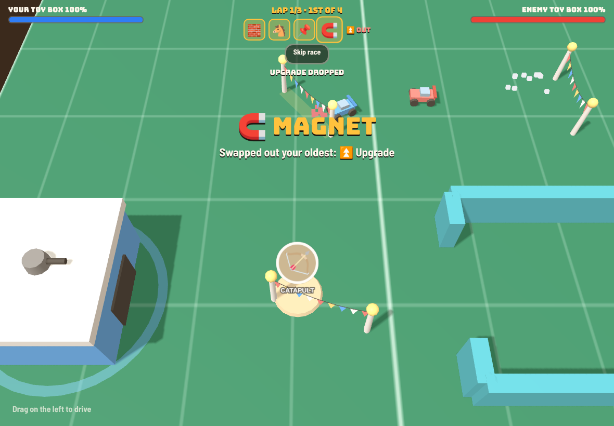 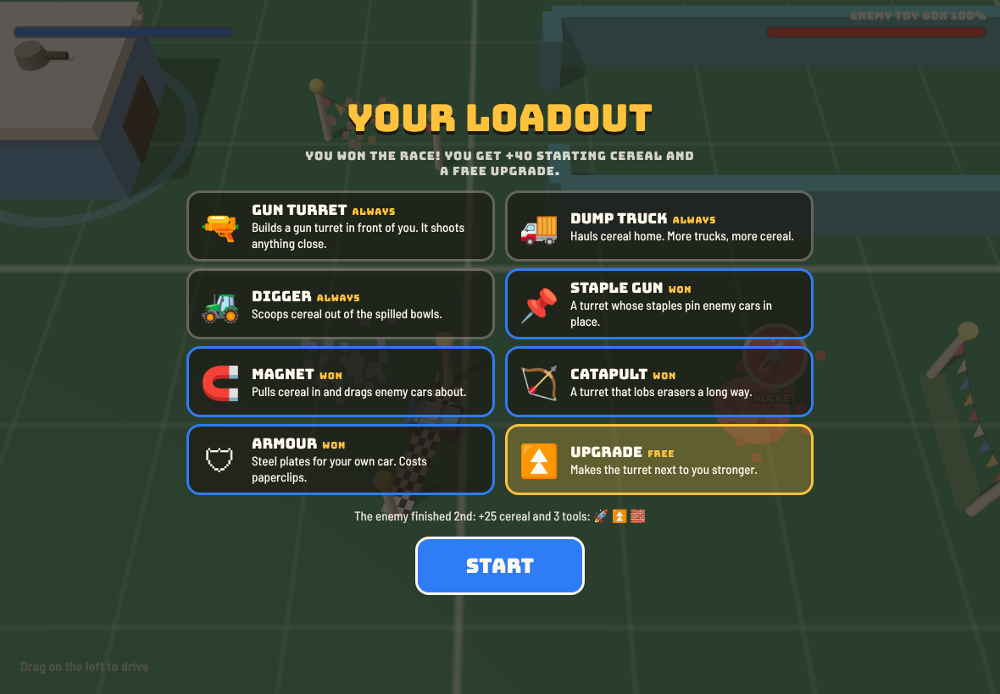 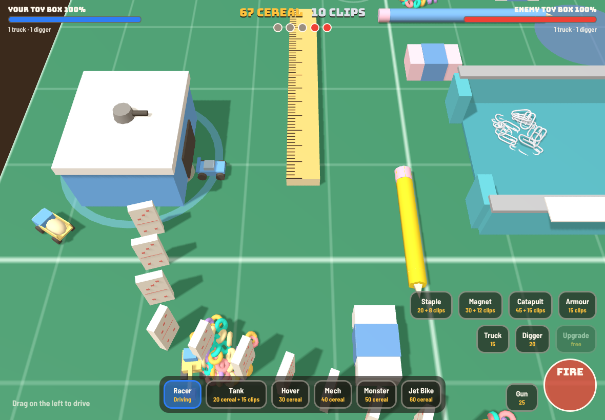

**Why.** An independent review scored the game 66/100 with clarity worst: 13+ build buttons and a Squadrons panel on every level. Now a short race before each level decides which tool buttons you get, and the YOUR LOADOUT card explains each one once, in plain words. All code is one block headed "Loadout Race" just above `step`, plus the hooks listed below.

**Flow.** `start()` (PLAY, Play again, Next level) calls `reset()` then `lrIntro()`. `reset()` now builds a **stand-in level for every level, level 1 included** (`stageL = stageLevel(L)`): no blocks, patches, outposts, piles, runs, water, hob or finale, and `size: [520, 400]` (only so `collideObstacles` does not clamp the car to a 150 x 96 table). It sets `race: { laps: 1, kr: true }`, and `startRace` hands that to `krStart` (THE KITCHEN RUN, below). The intro card (`#lrIntro`: GO!, Skip race) holds the race still (`R.intro`). The first car home calls `finishRace`, which works out the places (`raceProg` returns `c.prog` on the Kitchen Run) and calls `lrOpenCard(place, foePlace, skipped)`. The card's START calls `lrStartGo`, which sets `pendingLoad` and calls `reset()` again: the race is thrown away (`cleanupRace` → `krCleanup`, `disposeTree(R.group)`) and the real level is built with the loadout. **Level 1's box race is retired** (its boxes unfolded onto the race table, which no longer is the battle table); its code (`RACE_*`, crates, `startBattle`, the countdown) and the old circuits (`LR_TRACKS`, `lrTrack`, `lrGates`) are still in the file, unused.

### THE KITCHEN RUN (2 Nov 2026; Harry: "the racetrack looks a bit rubbish... we've made it so basic")

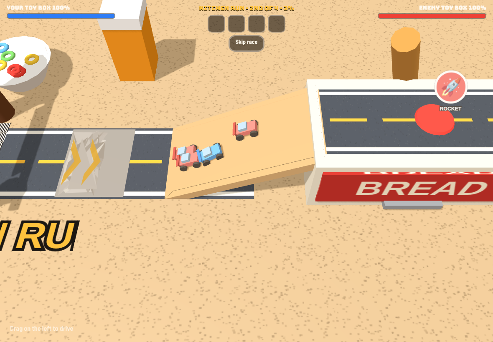 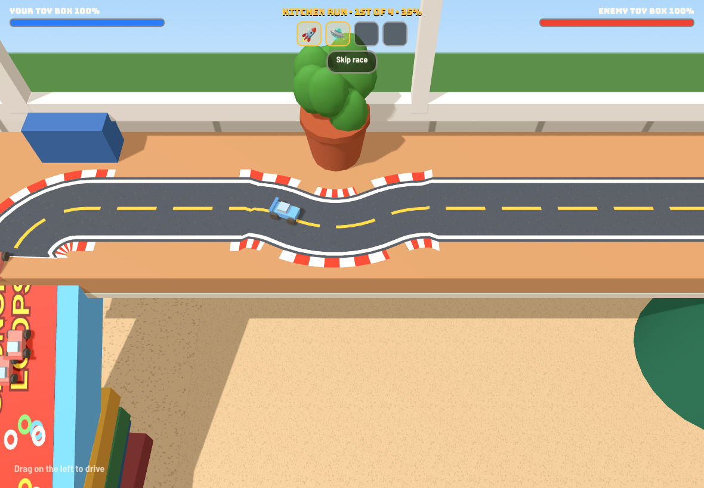 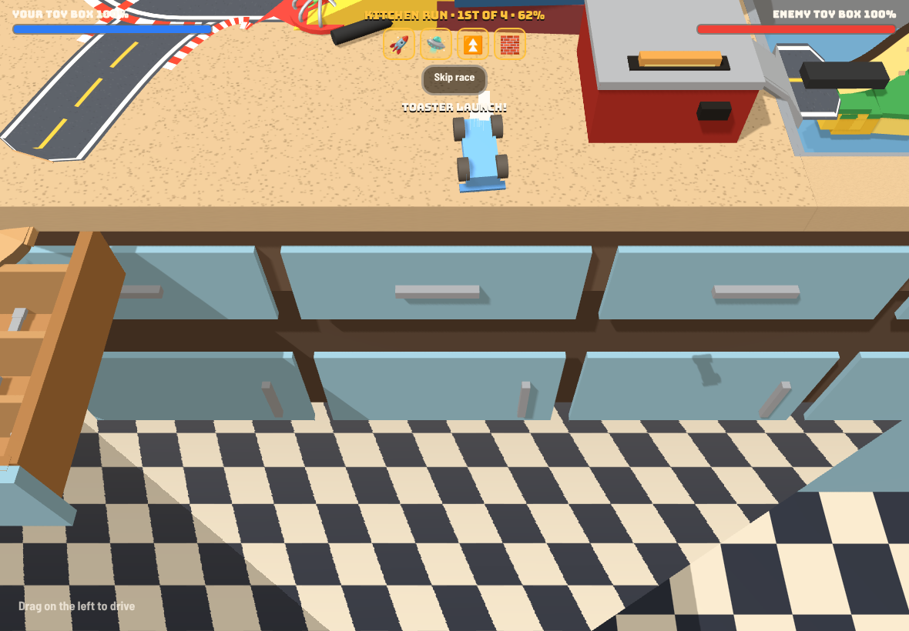 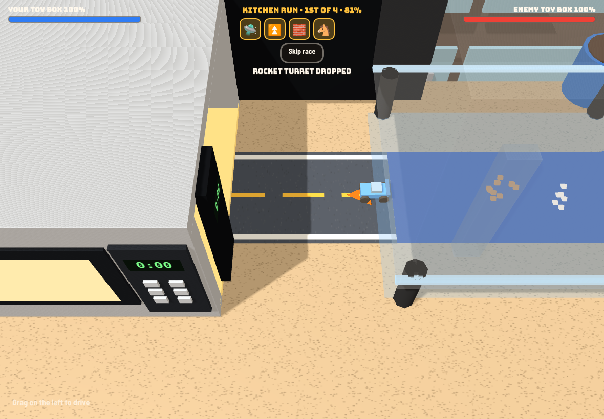 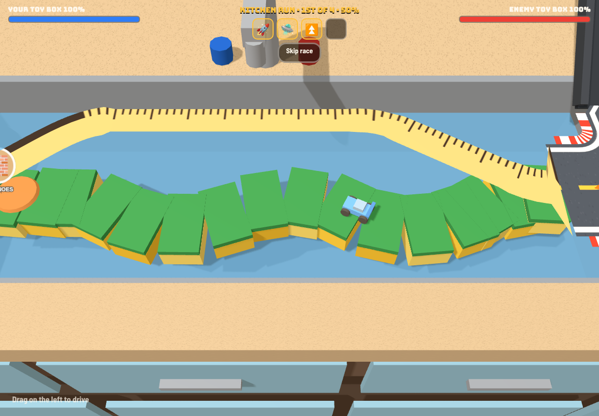 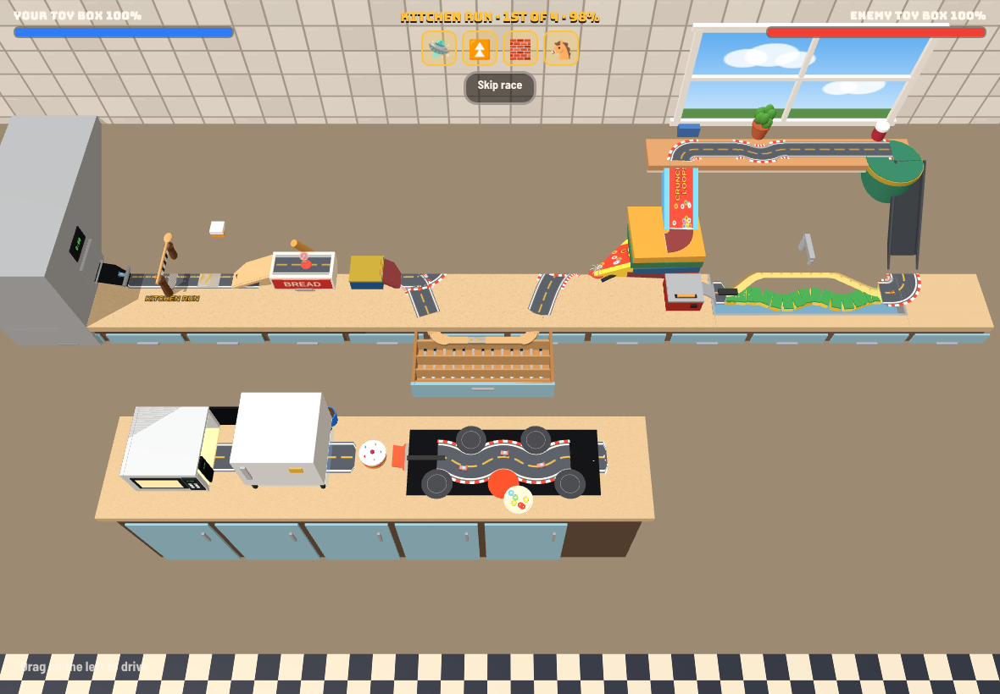

One lap of an obstacle course through a whole toy kitchen, built in its own space (x -232..222, z -86..~100; floor at y -90) when the race starts and disposed before the level is built. All code is one block headed "The Kitchen Run", just after the Loadout Race block.

**The route, in order** (main line ~1,090 units, of which ~250 is scripted flight/teleport):
1. Start/finish in front of the **oven**, between two pepper mills with a wooden-spoon gantry; tinfoil boost.
2. **Chopping board** ramp up onto the **bread bin** (y 10, edges), kick and **jump the gap** to the **biscuit tin** (y 7), down a cookbook.
3. Fork A: the main line loops round breakfast (a plate with egg and toast) and through the **kitchen-roll tube** (it goes see-through when you are inside); **shortcut 1, the cutlery drawer**: down a wooden spoon into the open drawer, along a divider 3.6 wide (tinfoil on it), up a spoon. ~20 units shorter plus a boost; falling into the trays is a respawn.
4. Fork B: two **cereal-box ramps** (CRUNCHY LOOPS art) with a stack of cookbooks between, up to the **window sill** (y 32), a swerve round the pot plant; **shortcut 2, the whisk spring**: a red pad off to the right fires you straight up onto the sill (saves ~2 s).
5. Along the sill above the kitchen, round the **tea caddy**, down the **baking-tray slide** (rims: no falling off).
6. Fork C, the **sink**: the main line weaves over **floating sponges** (squashy: 15% slower; edges over water); **shortcut 3, the ruler** straight across, narrow. Falling in = splash, respawn a bit back, soggy (28% slower) for 2.2 s.
7. Up the **butter knife** onto the **toaster**: TOASTER LAUNCH, a scripted 100-unit arc (one barrel roll, a puff trail) over the gap between the worktop and the island.
8. Island: the **hob slalom** round the rings (the hot one flickers: 1.6 s on, 1 s off; touching it while on spins you and halves your speed), tinfoil, **spatula** kick over the **cake**, under the **mini fridge** on legs (cold blue light, the fridge goes see-through), into the **microwave** (it goes see-through and glows): flash, ding, and you roll out of the **oven door** 140 units away, at the finish straight.

**Per level:** the worktop colour, the cupboard doors and a few props (L1 bowls of loops, juice, mug; L2 pencils and rubbers; L3 remotes and batteries; L4 rubber duck, washing-up liquid, bubbles; L5 frying pan and saucepan; L6 baguettes and cheese). Route changes: **level 4** has a longer, tighter sponge crossing (9 arcs instead of 5); **level 5** a longer hob with two hot rings. Tokens: the level's pool spread over 12 token spots in course order (bread-bin top, drawer divider, inside the tube, cereal ramp, sill x2, slide, the ruler, the sponges, by the hot ring, after the cake, under the fridge), so risky lines and shortcuts carry tools.

**How it is built.** The course is data: a turtle (`kTurtle`, `kS` straight, `kT` arc, `kJ` Hermite join) lays points 1.25 apart; each point has `y`, `hw` (half width), `edge` (can fall off; otherwise soft rails), `solid` (false over gaps), `scr` ('fly' toaster/whisk, 'tele' microwave, with speed `v`), `kick` (jump), `boost`, `water`, `hob`, `surf` (look). `kDone` adds tangents, normals, `cum` (distance in x/z) and `speedF`. Shortcuts are branches (`kBranch`, `.from`/`.to` main indices; progress on a branch maps linearly onto the main line, `krMainS`). `krScene` builds the room, the road (`kRibbon`: a play-mat road texture with yellow dashes on worktop, sill and bread bin; red/white kerbs on bends; the object's own surface elsewhere) and every prop **from the segments**, so props always sit under the road. Shapes use one vertex-colour material (`kVC`) and are baked by `kMerge` into one mesh per material per 90-unit cell; the roll, fridge and microwave bake into their own fading materials (`K.fades`). Course colours are picked in sRGB (`kMt`, and `convertSRGBToLinear` in `kMerge`), so the kitchen is richer than the pastel battle tables. Textures (worktop, tiles, floor, cereal art, foil, road, kerb, sky, START, clock...) are canvases made once and kept in `shared()`.

**Physics** (`krCar`, `krNear`, `krRespawn`): `drive()` steers in x/z as everywhere; `krNear` finds the nearest point on the car's own path (window -4..+10, plus the start of a branch near its fork or the main line near a branch's end; switching lines needs a clear lead). On the deck the car rides the interpolated height; off the side of a non-edge road it is pushed back (rails); off an edge, over a gap, or over a lip (ground drops > 1.3) it flies with gravity 50 and lands when it meets the deck. Kicks set vy and a minimum forward speed (bread bin 13 / 22, spatula 24 / 27) so a straight run always clears. Falling 5.5 below the last good height respawns 7 points back on a safe point, slow, with a 0.9 s wobble. Scripted rides (`c.scr`) carry the car along the path at the points' speed and release it at the end with its old speed.

**Rivals** (`krRival`): scripted along the main line only (no shortcuts, never fall), `s += 24 * k * band * speedF * (boost 1.3, sponge 0.85)`, `k` 0.84 / 0.815 / 0.79, rubber band +13% when behind you, -8% when ahead (0.0016 per unit of gap). They take every jump, flight (the arc is in the path heights) and teleport (hidden inside). `krCollide` bumps you off them (same height only).

**Camera** (`krCam`, called from `render` instead of the battle camera): follows the road height (`K.camY`), holds it while you are in the air or flying, so the car rises towards you and the drop shows; pulls back up to 1.3x when high or flying; keeps an airborne car centred (`- 0.8 * height` in z); cuts after the microwave (`K.snap`) with a white flash (`#krFlash`-style div, `krFlashEl`). It also moves the sun and its shadow box with the camera (restored by the next `setTableSize`). A shadow blob sits under the car in the air, on the worktop, the sink water or the floor far below.

**Shared-code edits** (small, marked "Kitchen Run"): `stageLevel` rewritten; `reset` builds the stand-in for every level and starts the race only on it, starting workers only off it; `startRace` → `krStart` when `cfg.kr`; `cleanupRace` → `krCleanup`; `raceProg`, `raceUpdate` (→ `krUpdate`), `raceArrow` (hidden); `tokensUpdate` checks height; `render` calls `krCam` for the race; intro card text; `SOUNDS.ding` added from the block.

**Test numbers (finish, 2 Nov 2026).** A scripted bot that steers at the path 7 points ahead (main line, no shortcuts, picks up all tokens) finishes in 40.2 s on levels 1 to 4 and 6 and 41.1 s on level 5 (hob), 0 falls; a person should take 45 to 60 s. Idle-player rivals: Red 1 finishes at 54 to 56 s, Red 2 about 2 s later, Red 3 later still, all through the toaster flight and the microwave teleport (rubber band +13% when you are behind). Falling off an edge respawns after about 0.45 s, 7 to 9 units back (20 edge points sampled). Memory over 4 race to level cycles: geometries 44 in the race, 161 in the level, textures 12, flat each time (the course is disposed). All six levels play 90 s after Skip race with 0 page errors. The floor sign 'KITCHEN RUN' was clipped by its canvas (92 px font); now 62 px.

**Tokens.** One per tool in `LOADOUTS[level].pool`, alternating sides of the racing line (+-2.6), `tokensUpdate` (player only; the red cars ignore them). Drive through one and it joins `R.carried`; a 5th pops the oldest (`R.swap`, banner, a red "out" chip in the slot strip `#slots`; that tool's token reappears on the track). A token is hidden while you hold its tool. The picture is a coin plus the emoji, drawn once per tool in a canvas (`tokenMat`, kept in `shared()`), on a flat plane tilted to face the fixed camera.

**Tools and levels.** `TOOLS` (name, emoji, colour, button id, key, one-line text) and `LOADOUTS` (per level: `pool`, `must`, `def` for Skip race, `ai`). Always on (`BASICS`): Gun turret, Dump truck, Digger (the economy needs both workers). Must-haves: level 3 Flare (you cannot see without it), level 4 Gunboat (water splits the map), level 6 Tank squad. Pools: L1 Rocket, Drones, Upgrade, Dominoes, Trojan; L2 those plus Staple, Magnet, Catapult, Armour; L3 Rocket, Drones, Upgrade, Dominoes, Trojan, Laser; L4 as L1; L5 Rocket, Drones, Upgrade, Trojan, Staple, Catapult, Armour, Toaster; L6 Bombers, Boat squad, Raiders, Foot soldiers, Rocket, Drones, Upgrade, Toaster.
**Default (Skip race) loadouts:** L1 Rocket, Upgrade, Drones, Dominoes; L2 Rocket, Upgrade, Staple, Catapult; L3 Laser, Rocket, Upgrade, Drones (+Flare); L4 Rocket, Upgrade, Drones, Trojan (+Boat); L5 Rocket, Upgrade, Toaster, Drones; L6 Bombers, Raiders, Upgrade, Rocket (+Tank squad). Skip counts as 2nd place for both sides (+25 cereal each, 3 enemy picks, no free Upgrade).

**Level 6.** The Squadrons panel stays, but its buy buttons show only the squads whose tokens you hold (`SQ_TOOL`, `squadOn`): Tank squad always; Bombers, Boat squad, Raiders, and Foot soldiers (all four infantry types) from tokens. Sugar wall, Rally and Peek stay always. Squads are the whole level 6 war, but Tanks alone are a fair start and the enemy is limited the same way; that is why only the three extra squad types are won.

**Rewards.** `LR_BONUS = [40, 25, 12, 5]` starting cereal by your place. 1st also gets `state.freeUp = 1`: the next Upgrade costs nothing (the Upgrade button shows FREE) and the Upgrade button is shown even if you did not pick it. The old +30 level 1 winner prize is gone (the bonus replaces it); level 1's last-place gun turret stays. **The enemy:** its best car's place picks how many of `LOADOUTS[i].ai` it gets (`LR_AI_TOOLS = [4, 3, 2, 1]`) and its cereal bonus. `aiHas(id)` gates what the commander builds: Rocket turrets (else guns), Laser, level-ups, Toaster launcher, the domino layer (Dominoes), the hijacker (Trojan) and on level 6 which squads it buys (`aiSquadOk`). `state.aiLoad` is null (no limit) outside a loadout game.

**The bar.** Every tool button has a `TOOLS[id].btn`; `applyBar()` toggles `.off` (display none) on those you do not have and hides a row with nothing left. `state.load` is a Set of tool ids (null = everything, the old behaviour, for tests that call `reset()` after a loadout). Keys for tools you do not have do nothing (`KEY_TOOL` guard at the top of the battle keydown; B still builds walls on level 6). The Use (gumball item) button moved to the Fire row. Buttons visible (before, after with 4 picks and 1st place): L1 8, 8; L2 12, 8 to 9; L3 10, 8 to 9; L4 9, 8 to 9; L5 13, 8 to 9; L6 13 plus an 8-squad panel, 7 to 8 plus a panel of 1 to 5.

**Shared-code edits.** `raceTrack` split into `trackFrom`; `startRace` takes `cfg.track` and builds tokens; `finishRace` and `skipRace` rewritten; `cleanupRace` also hides the two cards; `raceUpdate` waits while the intro is up and draws the slots; `update` returns in phase 'loadout'; `reset` builds the stand-in level, sets `state.load`/`aiLoad`/`freeUp` and calls `applyBar`; `darkNow`, `makeBase` read `curL()` instead of `LEVELS[curLevel]`; `upgrade` and `updateCosts` know the free Upgrade; `start` shows the intro; the finale squad panel filters its buy list; AI gates in `commanderBuild`, `commander`, `enemyTricks`, `finaleEnemy`. `shoot.js` now clicks `#lrSkip` and `#lrStart`.

**Tests (Playwright, swiftshader, 1180 x 820).** A scripted bot that steers through tokens won on all six levels (36 to 44 s), got the loadout card and the bar showed only the won tools; Skip race then 90 s of play on every level had 0 page errors; over three cycles of all six levels (intro, Skip race, card, START, 6 s of battle, switch) geometries stayed at 171 and scene children at 100; textures rose by 2 per cycle, which the code before this change also does (17, 19, 21 on the old file), so it is an old leak (some level decor texture), not the race.

**Not fixed / ideas.** Red cars ignore tokens and each other's tools (the enemy loadout is only a list). The rivals' speed bands keep it close, so the bot nearly always finishes 1st or 2nd; a human will vary. Tokens are emoji, so look slightly different per platform. Level 6 infantry is one token for four types. The card lists tools in order, not by how useful they are. No sound for tokens beyond the pickup fanfare. The race is not shown to anyone on level selection (the title card still describes the battle).

## Characters and dialogue (2 Nov 2026; Harry: "a bit of beef before each race", 16-bit style)

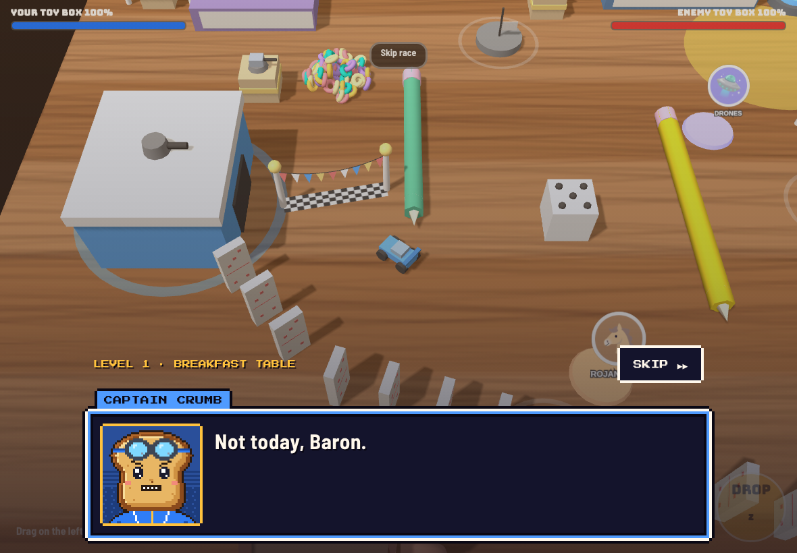 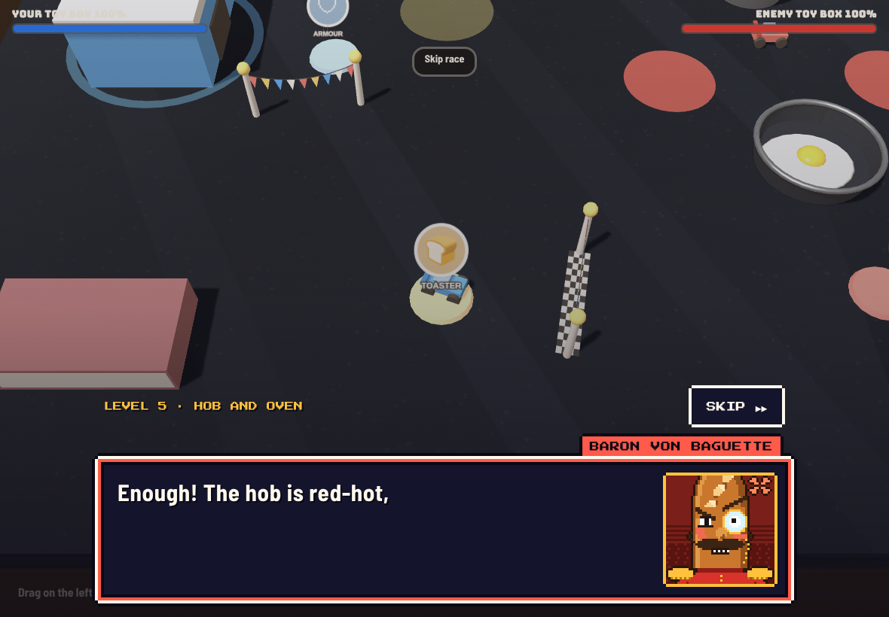 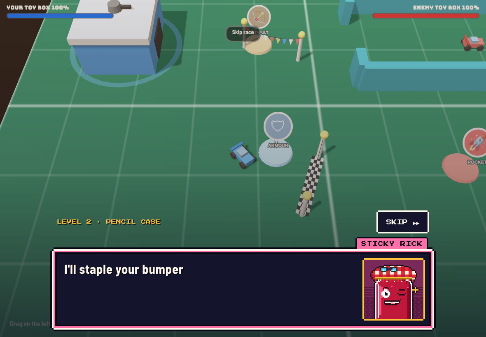 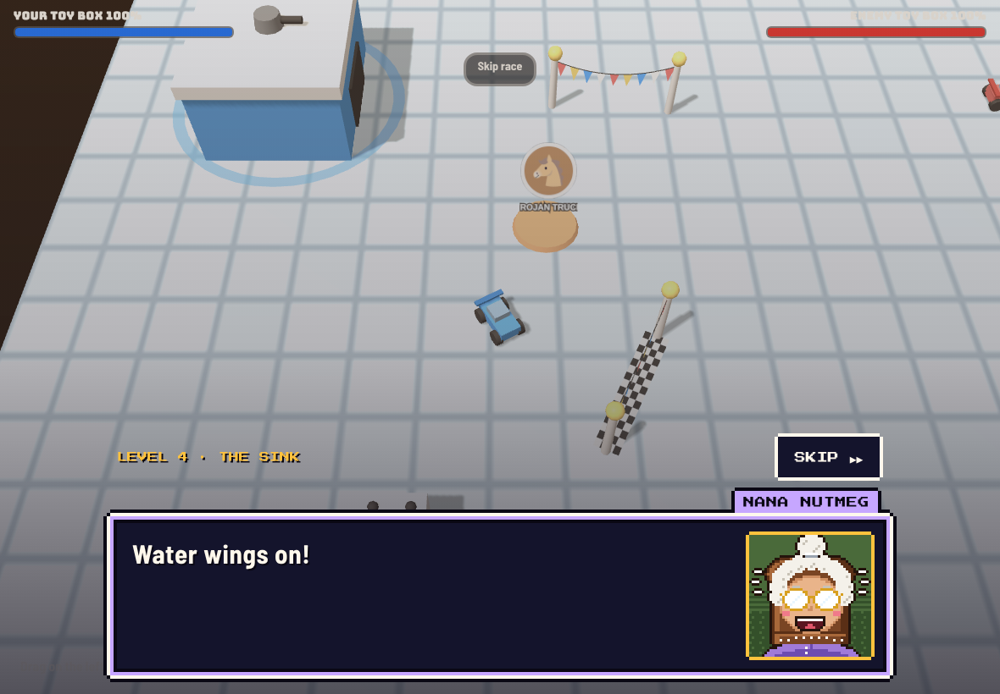
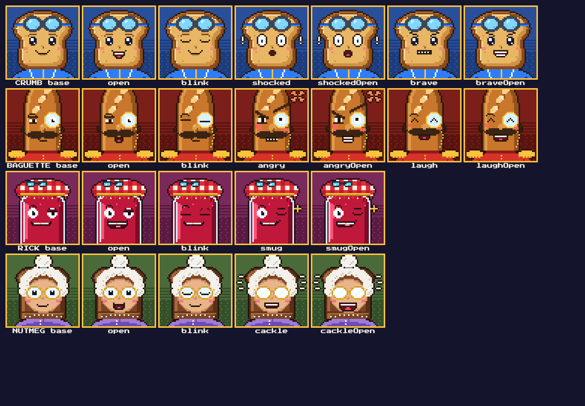

Before each race the cast trade 4 or 5 lines in a 16-bit RPG talk box; after a level the Baron sulks (win) or gloats (lose). **A self-contained module:** one HTML/CSS block headed `Characters and dialogue` just before the three.js `<script>` tag (the `#talk` overlay, its CSS, a Press Start 2P font link), and one `<script>` with the same heading after the main script. Nothing is drawn in the 3D scene (0 draw calls): it is an HTML overlay with one 48 x 48 canvas.

**The hook is one function:** `talkThen(levelIndex, when, cb)` with `when` = `'pre'`, `'win'` or `'lose'`. It plays the lines, then calls `cb` (Skip calls it too). With no lines it calls `cb` straight away. Three call sites, nothing else in shared code changed:
- `start()`: `talkThen(curLevel, 'pre', lrIntro)` instead of `lrIntro()`. The race already holds still from `startRace` (`R.intro` is true until GO!), so nothing moves while they talk. If the intro card changes on another branch, keep this one call and pass whatever shows the card.
- `endGame()`: inside the 1.2 s timeout, `talkThen(curLevel, won ? 'win' : 'lose', () => { $('end').hidden = false; })`.
- `endGame()`, level 6 win: `talkThen(curLevel, 'win', () => finaleEnding(earned))` (the Baron's last word, then the light flicks on).

**Controls.** Tap anywhere (or Space / Enter): finish the line, then next line. **SKIP** (top right of the box, or Escape) closes it and goes on. While the box is up it eats every key except M (mute), so WASD does not leak into the race. Text types at 38 letters a second (`TALK_CPS`) with short stops after `. ! ? ,` (`TALK_PAUSE`) and a blip on every other letter (`talkBlip`, using the game's own `tone()`; Baron a low sawtooth, Crumb a square, Rick a mid square, Nana a high triangle; silent when muted).

**Look.** Dark navy box with a notched white pixel border and a coloured inner line in the speaker's colour, a name plate tab, a gold-framed portrait (144 px on iPad, 96 px under 600 px wide). Crumb sits on the left; the others on the right (the box flips). Dialogue text is the game's body font (Barlow Semi Condensed, bold, 31 px; 21 px on a phone): Press Start 2P was too hard to read for a dyslexic player at line length, so it is only used for the name plates, the level tag, SKIP and the arrow. Each line is 60 characters or fewer (2 lines on iPad, 3 on a phone). The portrait box pops when the speaker changes, and a line can ask for `shake` or `bob`. The face flaps its mouth while letters type (shut on spaces and pauses) and blinks every 1.8 to 4.8 s.

**Cost.** Its own `requestAnimationFrame` loop runs only while the box is open. Each face is painted once into a 48 x 48 canvas and cached (`talkFaces`: 24 canvases at most, all four characters and every frame); the visible canvas is redrawn only when the frame changes. Typing all six pre-race scripts through took 27 ms of script time in total. All six levels: dialogue, Skip race, 90 s of play, 0 page errors (`all6b.js`, Playwright, 1180 x 820); also checked at 390 x 844.

### The data (all in the dialogue `<script>`)

- `TALK_CAST[id]`: the pixel art: `pal` (one letter per colour, `.` is see-through), `bg` (two backdrop colours), `base` (48 strings of 48 letters: mouth shut, eyes open), `frames` (patches).
- `TALK_INFO[id]`: `name`, `color` (name plate and border line), `side` (`'left'` or `'right'`), `wave` and `pitch` (the voice), `moods`.
- `TALK_SCRIPT[level]`: `{ pre: [...], win: [...], lose: [...] }`; a line is `[who, text, mood?, fx?]`.

**Add a line:** add `['rick', 'Your text, 60 letters at most.', 'smug', 'bob']` to the right list in `TALK_SCRIPT`. `mood` must be one of that character's `moods` (otherwise it shows the normal face); `fx` is `'shake'`, `'bob'` or nothing.

**Add a frame (a new mood):** a patch is `[x, y, rows]` drawn over the base; `_` keeps the base pixel, any palette letter paints. Add `grumpy: [x, y, [...]]` and `grumpyOpen: [...]` (the same face with the mouth open, used while typing) to `frames`, and `'grumpy'` to that character's `moods` in `TALK_INFO`. The easiest way to make one: copy the 48 base strings, change the face, and keep only the rows and columns that differ (replace unchanged pixels with `_`). `open` and `blink` are the plain talking and blinking frames.

**Add a character:** a new `TALK_CAST` entry (palette, `bg`, 48 base rows, at least `open` and `blink` patches) and a `TALK_INFO` entry, then use its id in `TALK_SCRIPT`. Draw on a 48 x 48 grid with a dark outline letter round the shape (`k` in all four), light from the top left, and keep the face in rows 16 to 36 so it reads at 96 px.

### The cast

| id | Name | Look | Moods |
|---|---|---|---|
| `crumb` | CAPTAIN CRUMB (you, blue) | a slice of toast in a blue racing suit, blue goggles pushed up on the crust | `shocked`, `brave` |
| `baron` | BARON VON BAGUETTE (red leader) | a tall baguette with slashes, monocle on a gold chain, handlebar moustache, red coat with gold epaulettes | `angry` (brows down, anger mark, gritted teeth), `laugh` |
| `rick` | STICKY RICK | a jam jar with a gingham lid, shades on top, jam drips, gold tooth | `smug` (a wink and a sparkle) |
| `nana` | NANA NUTMEG | a wooden pepper mill with a white bun (the knob), curls, big gold glasses, pearls, lilac cardigan | `cackle` (glasses flash, speed lines) |

### Not done / open

- The level 6 win line plays before the ending's light flick, over a frozen scene; the lose line plays over the frozen scene too (the game has stopped).
- The script does not know how often you have beaten the Baron: his lines escalate by level, not by your record. `progress.stars` could pick a line if Harry wants that.
- No dialogue on the title screen's level select (only when a level starts) and none between race and battle.
- Portraits were drawn with a small Python helper in the scratchpad (shapes on a 48 x 48 grid, then turned into the strings); only the strings are in the game, so edit those.

## 5. Known problems (fix first)

1. ~~**Edge of the table**~~ **Fixed 31 Oct:** the car was always kept on the table; the camera showed the dark beyond. It now stays over the table.
2. ~~**Building is unclear**~~ **Fixed 31 Oct:** a build ghost (green or red circle) shows where a turret will go.
3. ~~**Sound**~~ **Done 1 Nov:** toy sounds made in code: a click per weapon, thumps, a cereal crunch, a pour, a build ratchet, a capture fanfare, win and lose tunes, and an engine hum that follows your speed. M mutes.
4. **Hard start:** new players struggle in the first minute (Harry: "starts off really hard, but you get the knack"). It needs a gentler first two minutes, or a short tutorial.
5. ~~**No level select or progress saving.**~~ **Done 1 Nov:** 6 level buttons, stars, saved on the device.
6. **Cereal is solid piles.** Harry wants loose bits you push with a bulldozer into hoppers.

## 6. What to build next, in order

| # | Job | Why | Done when |
|---|---|---|---|
| 0 | **Race-then-battle opening** (DESIGN.md, "The twist"): **built for level 1 (2 Nov)**, see "Level 1 race opening"; levels 2 to 6 open with the **Loadout Race** instead (see "Loadout Race"), a tools race, not a box race | Harry's big idea; teaches driving first | level 1 starts as a 2-lap race with boxes; dropped boxes become your base. Other levels: not a box race (see Loadout Race) |
| 1 | ~~Table edge + build ghost~~ done 31 Oct | stops the two worst frustrations | you can't fall into the void unless the design says so; you can see where a turret will go before buying |
| 2 | Sound pass | toys must *sound* like toys | each weapon, impact, pickup and build has its own clicky toy sound (Web Audio, generated in code); the kettle click counts down |
| 3 | Game feel ("juice") | makes every hit satisfying | screen shake on big hits, hit-flash, cereal bursting out of wrecks, wheels kicking crumbs |
| 4 | First-two-minutes tutorial | keeps new players | a new player builds a truck, a digger and a turret in the first 2 minutes without reading the text |
| 5 | Loose cereal + hoppers + bulldozer | Harry's idea; physical and fun | cereal bits can be pushed; a hopper turns pushed cereal into money |
| 6 | ~~Level select + saving~~ done 1 Nov | reason to come back | the title card shows 6 levels; stars saved on the device |
| 7 | ~~Level 2: Pencil case~~ done 1 Nov (no bulldozer yet) | second resource (paperclips) | paperclips, pushable erasers, raids every 90 s, the Stapler boss at 4:00. Balance is untested by a human: playtest it (target 8 to 12 minutes) |
| 8 | Two players on one iPad | Micro Machines spirit | one player at each end of the screen |

## 7. Questions still open (Harry's call: taste)

- Name on the title screen: *Baguettes & Ballistics* (chosen); is *Mealtime Mayhem* the campaign name? (Assumed yes.)
- Should falling off the table be a feature (respawn) or a wall?
- Cartoon or realistic sound?

## 8. Screenshot recipe

```js
// node shoot.js  (needs Playwright; Chromium with --use-gl=swiftshader)
const { chromium } = require('playwright');
const b = await chromium.launch({ args: ['--use-gl=swiftshader', '--enable-unsafe-swiftshader'] });
const p = await b.newPage({ viewport: { width: 1180, height: 820 } });
await p.goto('file://' + process.cwd() + '/index.html');
await p.click('#play'); await p.waitForTimeout(30000);
await p.screenshot({ path: 'shots/3-economy.png' });
```

## 9. Specialists to train (for an award winner)

| Specialist | Owns | First task |
|---|---|---|
| **Game-feel / "juice"** | shake, impact, particles, timing | items 3 and 1 |
| **Sound designer** | toy sounds made in code, music, the kettle countdown | item 2 |
| **Level designer** | the six kitchen levels, hazards, pacing | level 2 paper plan |
| **Economy and balance** | costs, enemy commander, difficulty curve | item 4; keep a balance sheet |
| **Enemy AI** | commander strategy, personalities per level (greedy, turtle, raider) | three commander styles |
| **Touch-controls and UX** | iPad thumbs, build ghost, menus, readable for dyslexia | item 1 build ghost |
| **Playtester** | plays every build on iPad, writes "what was annoying in the first 60 seconds" | every release |
| **Technical artist** | toys from shapes, lighting (morning sun, fridge light), keeping it 60 fps on iPad | performance budget |

Each specialist works from this file and DESIGN.md, changes one thing at a
time, and shows a screenshot or short clip before and after.

## Fixes, 1 Nov 2026 evening (Harry: "it kept crashing when the Stapler came out, and the Stapler got stuck")

- **Crash, most likely memory:** every shot, every spark and every cereal loop
  made a fresh three.js shape and colour that was never freed, so a long fight
  (busiest at 4:00, when the boss comes) kept growing until an iPad tab gave up.
  Now shots, sparks and cereal loops use shared shapes (`shared`, `sparkGeo`,
  `basicMat`), dead models and spills are freed (`disposeTree`), and sparks are
  capped when 400 are already flying. Measured over 2 minutes of heavy fighting
  on level 2: shapes in memory stayed about 900 (before: climbed from 2,500 to
  4,500 and kept going).
- **Stapler stuck:** routes were allowed right along the table edge, where the
  big boss can't fit, so it wedged against the edge at the top of the table.
  The route grid now keeps a margin from the table edge. And if the Stapler
  hasn't moved 3 units in 3 seconds it **stomps**: hops up to 12 units towards
  its target, hurting your cars nearby (25), with a shake. Tested: it now
  marches over, snaps turrets, reaches your toy box and dies to defence.

## The Gumball Machine and battle items (level 2; Harry's ideas)

- A gumball machine mid-table (`LEVELS[1].gumball`, `placeGumball` finds a
  clear spot). Ram your side of it (from the left, at speed) to pay 10 cereal
  and spin (`spinGumball`, `PRIZES`). 2.5 s between spins per side.
- **Prizes:** turret level-up, 30 s toy-box shield (hits do a fifth), turbo
  (+45% top speed), double damage, gumball armour (hits on your car halved),
  40 cereal, a free truck, a dud (whoopee cushion), and **items**.
- **Items, Mario Kart style** (`ITEMS`, `giveItem`, `useItem`, `itemsUpdate`):
  carry one, use it with the Use button or Z. Butter pat and jam blob drop
  behind you (butter spins a car out, jam nearly stops it; the dropper gets 1 s
  to drive clear, then they catch anyone). Marble fires ahead, bounces off
  walls and the table edge, hits the first car for 40 and spins it. Wasp homes
  on their nearest car for 45. Sherbet fizz blasts cars within 10 away (15).
- **The enemy plays too:** from 0:45 a car sometimes goes to ram their side
  (`gumball.spot`), and they use items when one of their cars is within 22 of
  you (`state.redItems`).
- Tested: 12 spins gave a spread of prizes and items; marble did 40, butter
  spun a car, the enemy spun the machine.

## Bosses explain themselves (2 Nov 2026; Harry: "not sure what the duck was doing")

- While a boss is alive, their toy box sits in a **bubble shield** and takes
  half damage (`bossShield`, the check in `hurt`). Killing the boss pops it.
- A big **banner** when a boss arrives and when it dies says exactly that
  (`banner`), and a red **arrow** at the screen edge points to the boss when
  it's off-camera (`#bossArrow`, in `render`). Works for the Stapler and the
  Rubber Duck.

## The Sink, round two (2 Nov 2026; Harry: "the sink wasn't big enough" and "you can't get on the ferries")

- The channel is now 42 wide (x -21 to 21, was 26); the bridge is 7 wide.
  Piles, the sponge and the knife moved out to the new banks.
- **Ferry bug:** a ferry stopped so far out that a car pressed against the
  bank was just outside the distance that counted as aboard, so it never
  carried you. Ferries are now bigger (radius 5.5), dock at x ±17 so the cap
  overlaps the bank by 1.5, wait 4 s at each bank, and carry anything on the
  cap. Tested: drove on from the bank, rode across, drove off the far side.
- `buildLevelRun` also tries spots further out along the banks (x ±30, ±38),
  so the wider water still has room for both domino runs (9 dominoes each).
- **Tuning after Harry won the Sink in 3:16** (before the Duck even came):
  the Duck now arrives at 2:30 (was 4:00) and toy boxes have 2,000 (was
  1,500). An idle-player sim still loses its box at about 2:40, so the enemy
  isn't weak; Harry starved it by killing its trucks.
- The title screen now scrolls when the card is taller than the screen (long
  level text pushed PLAY off the bottom of an 800×600 screen).

## Level switching memory (2 Nov 2026)

`reset` now frees the old level's models (entities, caps, piles, spills,
dominoes, run buttons, the gumball, toasters) with `disposeTree`. Switching
levels 10 times used to climb from about 500 to 4,000+ shapes in memory; it
now stays at about 240–370.

## Hob round two (2 Nov 2026; Harry: "why is there cereal all over the thing? Shouldn't there be sticky spots? Somebody cooking, putting the pan down on random bases?")

- **Frozen peas, not cereal:** `LEVELS[4].pileLook = 'peas'` draws piles and
  spills as green peas, and `cerealName: 'peas'` renames the HUD counter,
  toasts and garage prices on this level (the stock is still `state.cereal`).
  Fewer piles: 6 pea piles (was 12), refilling a little faster.
- **Sticky and slippery spots:** new patch kinds `sauce` (red, top speed ×0.35)
  and `oil` (yellow, slides like juice). Tested: 8 speed in sauce against 24
  on clean glass.
- **The Cook** (`LEVELS[4].cook`, `COOK`, `cookPick`, `cookUpdate`): every 22–30 s
  a shadow grows on a random spot for 2.5 s (a third of the time by a toy box,
  either side), then a frying pan slams down: 70 to cars under it (and shoves
  them), 140 to turrets, 120 to a toy box. It stays as a wall for 15 s, then is
  lifted away. Never inside the oven.

## Hob round three (2 Nov 2026; Harry: bigger pan, more aggressive enemy, die on a hot ring, use the cooker's screen)

- **Bigger pan that smashes:** radius 11 (was 6), drops from high and
  accelerates, squashes on impact, sends out a dust ring, shakes the whole hob.
  160 to cars (most die), 300 to turrets, 220 to a toy box. Every 18–26 s.
- **Red-hot rings are deadly:** cars, trucks and boats on a ring when it's
  red-hot are wrecked ("Burnt to a crisp!"). Turrets melt at 25 a second.
- **The cooker screen** (`hobScreen`, `hobVis.screen`): a canvas display lying
  on the hob glass in front of the oven door: SAFE / HOT IN / HOT! with a
  big countdown, redrawn only when it changes.
- **Angrier enemy:** first wave at 0:30 (was 0:50), waves start at 5 and grow to
  10, 40 s apart (was 70); raids every 70 s from 1:30. Tested: a wave of 6 at
  0:44, as soon as the rings were safe.

## Steering freeze fix (2 Nov 2026; Harry: "it freezes with the steering halfway through the game")

The touch stick ignored any new touch while it thought an older one was
still down. iPad Safari sometimes never reports a touch lifting (for example
when a message appears under the finger), so the stick stayed stuck on the
old direction for the rest of the game. Now a new touch on the left half
always takes the stick (with pointer capture), and the stick, keys and fire
are released on blur, tab switch and lost capture. Tested by simulating a lost
touch: the old build stayed stuck (x 0.91), the new one follows the new finger.

## The big sink (2 Nov 2026; Harry: "for level 4 it should be really big")

- The basin now fills most of the table: water from x -44 to 44 (88 of 150
  wide). Each toy box sits on its own **draining board** (x ±44 to ±75), with
  its cereal piles, two caps, a mug and a sugar cube. Plates and knives stick
  out of the water; the sponge island (radius 10, 320 cereal) is in the middle.
- One long ruler bridge at z 0 (the middle cap sits on it). Ferries dock at
  x ±40: the north one crosses the whole basin (10 s), the south one calls at
  the island.
- **Domino runs may cross water on this level** (`water.runsOverWater`): the
  dominoes stand in the shallow water, buttons stay on land. Blue's run is 27
  dominoes from its own draining board across the sink to their toy box.
- **Red's run is now a mirror of blue's on every level** (`buildLevelRun(RED,
  blueRun)`, `makeRun`), so both sides always get the same run. Levels 1, 2, 3
  and 5 come out exactly as before (checked: same buttons and lengths).
- Tested: ferry carried a car the full width; an idle player still loses to
  the enemy by about 3:00, so the enemy copes with the bigger water.

## Level 4 geometry leak, Red's Great Run, and the finale gumball machine (2 Nov 2026)

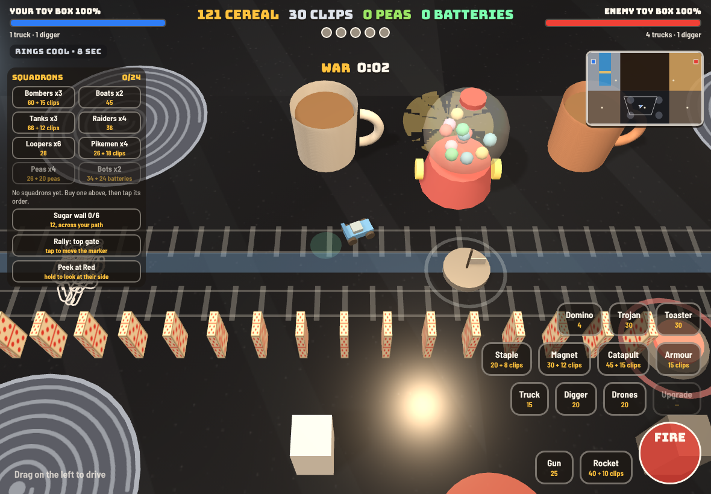 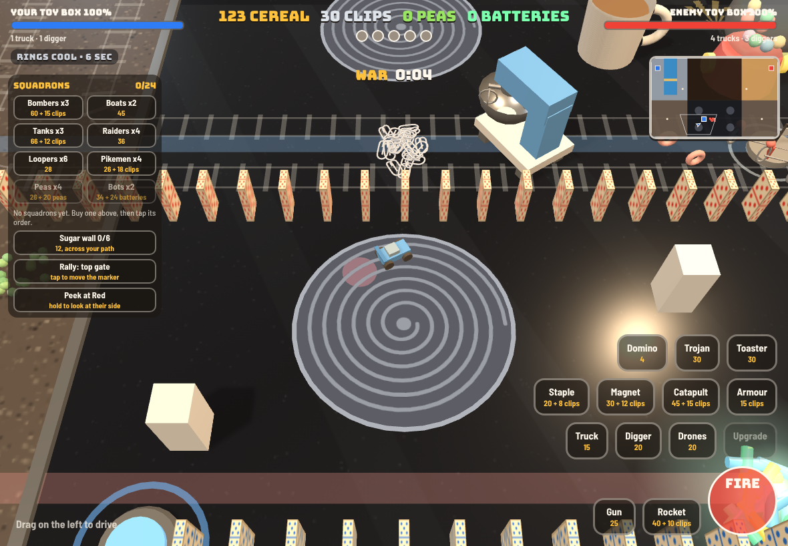 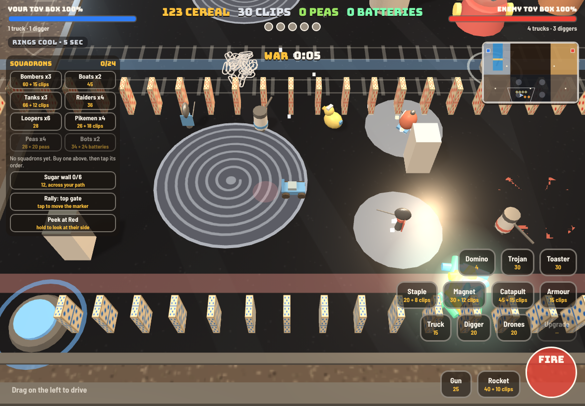

### Task 1: the level 4 leak (fixed)
Cause: the level domino runs (`standRun`) rebuilt every domino with **fresh** `BoxGeometry` and `mat()` (5 meshes each) every time a run reset, and never disposed the old ones. Level 4's run is the only ordinary level run that falls often in a long fight. Found by wrapping every `THREE.*Geometry` constructor, recording the stack, and counting geometries still on the GPU by creator (`addDomino` was 270 of the growth). Fix: `addDomino` uses `shared()` shapes and colours; `standRun` also calls `disposeTree` on the old pivots. Level 4, 10 minutes, same harness as before: **geometries 351 to 454, flat** (was 726 to 2,473); draw calls 490 / 1,012 / 1,245 (min / mean / max).

### Task 2: Red's Great Run
- Button moved from (-103, 79) (your side) to **(21, 68)**, the middle of the bend; the line runs west along z 68, jogs to z 79 at x -100, then west and north up x -150 to the toy box (75 dominoes, was 43; checked clear of blocks, rings, piles, caps, water). Weight 3 still needed.
- **Old bug found:** the old end (z -62) put the last domino's top 14 away from your toy box, which only counts within 10, so **Red's run never did damage**. The end is now (-152, -71): the run does 250 to your toy box (checked: 2500 to 2250).
- `redPressGreat` (in `enemyTricks`, level 6 only): from 50 s of war, then every 70 to 110 s while the run is standing, Red sends a whole tank squad (else raiders, else infantry, nearest to the button first) with `u.presser`. Passive player, 4 minutes: the run fell at war 52 s and 160 s (and 21 / 133, 59 / 166 in other runs). With six level-3 turrets by the button it did not fall in 240 s (base 2500), so it can be defended.

### Task 3: the finale gumball machine
Code is one block headed "Level 6, finale gumball" just above `// ---------- Main loop ----------`.
- `LEVELS[5].gumball = { spots, s: 1.4 }`: the machine at (0, 46), 1.4x size, ram it from your side (west). 24 cereal a spin (`FIN_GUM_COST`); the enemy sends a unit to spin every 35 to 70 s (`gumball.redNext`).
- `finalePrizes(t)`: level 2's `PRIZES` (incl. items) + each hero you do not have (weight 2.5) + the mixer while `F.mixerDone` is false, weight = (sum of the others) / 24, i.e. **1 in 25**. Measured 0.0400. Three forced mixer rolls gave one mixer; 300 spins left at most one of each hero per side.
- **THE STAND MIXER**: `ENEMY_TYPES.mixer` hp 2800, armour 4, speed 5.2, r 5.4, `fat` (uses `closedFat`, so it takes the land lanes, not the bridge), 16 shared meshes, two whisk arms that spin. It marches the attack route (your battle-plan lane), `mixerSmash` every 0.2 s: 80 damage a second to anything within about 12, sugar walls die at once, 40 a second to the toy box. Banner on spawn; for Red's mixer a banner and an orange edge arrow (`#mixArrow`, `mixArrowDraw`). Minimap: big square with a white ring, always shown. Measured: your mixer walked base to base in about 105 s and took the enemy toy box from 2500 to 1916 in 10 s before dying to the defence; Red's mixer destroyed an undefended toy box in 156 s.
- **Heroes** (`heroThink`, `kind: 'unit'`, `hero` set, `sq = HERO_SQ`, not counted in `ARMY_CAP`): Captain Teaspoon (speed 21, hp 300, hunts infantry, 90 damage and a flip, `flipPose`; squads within 26 get `buffT` and fire 1.25x weapons via `buffW`), Salt Shaker (hp 110, range 62, keeps 30 to 54 away; each shot drops a `saltPatch`, 6 per side, 14 s, enemy cars at 0.45x top speed via `saltSlow` in `drive`), Nurse Duck (hp 80, heals 6 a second to units within 14, runs from enemies, follows the nearest friend), Egg Timer (hp 140, stays at the rally, rings at 14 s then every 30 s: friendly squads `boostT` = 1.4x speed for 10 s). They follow the attack route (no per-hero orders). All shapes shared.
- Measured: captain killed 4 loopers in 4 s; salt patch slowed a tank and took it 200 to 80; nurse healed a tank 50 to 86 in 6 s; egg timer boosted a tank.
- **Budget** (same harness as stage 3, 24 v 24 on level 6, 10 minutes; stress: every minute both sides are topped up with all four heroes and each side gets a new Stand Mixer every 20 s, so two mixers walk at once, more than a real game ever has). Run beside the stage 3 build on this machine: stage 3 calls 129 / 664 / **949**, update 3.97 ms mean, 9.8 p99, geometries 295 to 467; with the gumball block **129 / 732 / 1,234**, update 5.5 mean, 18.3 p99, geometries **352 to 516, flat** after minute 1 (textures 18). So about +285 draw calls at the peak (the machine, 10 heroes, 2 mixers, the longer Red run), still under level 4's 1,245 to 1,307.
- Levels 1 to 6 each play 90 s with 0 page errors (`all6.js`; level 6 shows 89 and 75 dominoes for the two Great Runs).

### Shared-code edits (all marked "level 6" or "finale gumball")
`placeGumball(L)` / `makeGumball(x, z, s)` (spots and scale from the level), `spinGumball` (cost and pool), the ram test and Red's spot (scale), `enemyTricks` (gumball throttle, `!fly`, `!hero`; `redPressGreat`), `drive` (salt), `weaponName` (`.base`), `unitThink` (hero line), `squadThink` (boost, buffed weapon), `armyOf` (heroes free), `squadModel` (hero models), `render` (hero pose, flip, mixer arrow), `finaleUpdate` (`heroesUpdate`), `finaleCleanup`, `miniMapDraw` (`heroMini`), `addDomino` and `standRun` (task 1), `GREAT[RED]`. New `#mixArrow` element.

### Seen, not fixed
- Heroes follow the attack route only; no Defend or Raid for them, and no on-screen hero list (the minimap shows them). The mixer has no health bar.
- A flipped unit that is not infantry is hit, not flipped.
- Red's squads still do not use the toasters.

## AR mode (branch game/ar-mode)

Put the game on a real table with WebXR `immersive-ar`. Full write-up in [AR.md](AR.md) (how it works, what WebXRKit's polyfill supports, the real-device checklist, wrapping steps). For developers:
- All the logic is the last `<script>` ("AR mode"). Hooks in shared code, all marked `AR hook`: the `AR` object and `alpha: !!navigator.xr` beside the renderer; `stickDown` (the pointerdown handler, now a named function); `arStick()` at the three `input.x, input.z` reads; `step` (rAF only when `AR.on`; `arFrame`; waits until placed); the last line of `render` (`arRender`); `burst`'s spark cap. With AR off the cost is one boolean per hook: level 1 after 40 s with a seeded `Math.random` gives 848 to 860 draw calls and 37,134 triangles both before and after (same numbers).
- The whole scene is scaled onto the table (scene transform), so new meshes need nothing special. Anything real-world sized (the reticle) must cancel the scene transform (see `arFrame`). Code that projects to the screen (`.project(camera)`) works because `arFrame` bakes the scene matrix into `camera.matrixWorldInverse`. The minimap's view-trapezoid (`unproject(camera)`) is wrong in AR (cosmetic, not fixed).
- The Kitchen Run's floor, tiled wall and window are hidden in AR by size (700-wide); if the kitchen scenery changes, check `arFit`. Do not add elements to `<body>` that must show in AR without checking: a `MutationObserver` moves them into `#arRoot`, but the iOS polyfill hides anything outside the root.
- Bugs not fixed: minimap trapezoid (above); levels 3 (dark) and 6 (finale) ran 15 s in the AR mock with no errors but were not looked at closely; Chrome Android and real ARKit untested; no anchors (the world can drift on a long session).

## My Track (branch game/draw-track, build 36)

The player's own race track on their real surface, drawn with a finger or built by **Auto**, then a battle on the same table. Player guide, design and the real-device checklist: [AR.md, "My Track"](AR.md#my-track-your-own-race-track-on-your-real-table-build-36). Also playable without AR: **My Track** under PLAY (a practice table seen from above; mouse or finger drawing).

**Flow.** `mtBegin(ar)` (title button, or AR → chooser → My Track: `arStart` then `mtBegin(true)` with `AR.placed` set, no placing step) → `reset()` builds a stand-in level from `mtLevel()`; `stageLevel` gives it `race: { mt: true }`; `startRace` → `mtStart`, which with no track yet sets `state.phase = 'mt'` (scan/draw/auto screen, `mtUpdate`, top-down `mtCam`) → Race! (`mtGo`) fixes `MT.loop`, fits the battle board (`MT.fit`, `MT.level`), `reset()` again → `mtStart` builds the race (`R.kr` = a Kitchen-Run-style course, `R.mt` = true) → the usual `lrIntro` card (text swapped by `mtIntro`) → `finishRace` → YOUR LOADOUT → `lrStartGo` → `reset()` builds `MT.level` (the battle; `mtBoardDecor` sets `MT.phase = 'battle'` and turns the surface group under the board). End card PLAY AGAIN → `mtAgain` (same track); LEVELS or Exit → `mtExit` (title card, normal level, `curLevel` restored; ends the AR session if one is running). My Track uses level 1's tools and rules (`curLevel = 0` while on) and saves no stars.

**Shared-code edits (all marked "My Track hook").** Main script: `const MT` beside `AR`; `curL()` returns `MT.level` while My Track is on; `reset` picks `mtLevel()`; `stageLevel` (race cfg and a 1000 x 1000 size); `startRace` → `mtStart`; `cleanupRace` → `mtCleanup`; `raceUpdate` → `mtRaceUpdate`; `update` → `mtUpdate` in phase 'mt'; `render` → `mtCam` first; `buildLevel` hides the wooden `table` for `L.mt`; `spawnPt` uses `mtSpawn`; `endGame` (no stars, no Next level); `start` → `mtAgain`; the LEVELS button → `mtExit`. AR block: build tag 36; the AR button opens the Kitchen Run / My Track chooser; `arStart` adds the extra hit-test rays and starts My Track; `arEnded` cancels them and calls `mtExit`; `arFit` steps aside; `arFrame` calls `mtArFrame`; `arUiSync` hides Re-place, turn and Size in My Track.

**Memory.** Road, gates, tokens and blob live in `R.group` (disposed by `cleanupRace`); the surface group (`MT.group`: practice table, scan paint canvas texture, marker, preview road, live line) is disposed on every `mtBegin`/`mtExit`; the preview road and live line are disposed on every rebuild.

**Tested (no real device; Chromium + swiftshader, Playwright; scripts in the session scratchpad).**
- `hxr/mtar.js`: HelloXR's real `webxr-polyfill.js`, fake native iOS bridge, `NO_OVERLAY=1` (as on the owner's iPad). Fake ARKit: a 1.2 m x 0.6 m table at y = -0.9 m, hit tests empty outside it, answered from the screen point the polyfill sends (so the 4 extra `offsetRay` sources are exercised). Camera sweeps rows over the table for 36 s (the harness renders only ~5 XR frames a second, so 1,400 hits; a real iPad gets ~150 a second), then holds still. Run 1: Auto → 2.3 m loop, centre line at least 5.4 cm inside the table's edge (road half width with kerb 3.45 cm), height 0.900 m, scene scale 0.005; race 30 s: rivals at 1.00 to 1.08 laps; Skip → battle board 226 x 100 units (1.13 m x 0.5 m) fitted on the table, toy boxes at its ends at real x = ±0.5 m. Exit AR, enter again. Run 2: a loop drawn with synthetic touch events on `#arTouch` → 2.1 m, 11 cm inside the edge; race 30 s: rivals at 1.09 to 1.17 laps (4-lap race); battle 220 x 100. 0 page errors, 0 console errors.
- Note: the old `hxr/real.js` fake bridge never answered `stopAR`, so the polyfill thought it was still running and a second AR session got no frames. That was the harness, not the game (fixed in `mtar.js`; with it, Kitchen Run and My Track both re-enter fine).
- `mt/practice.js`: practice mode twice: scan (6 s pretend sweep), Auto, Another one, Race!, GO, 30 s (rivals 0.9 to 1.1 laps), let Red win, card, START, 40 s battle (226 x 124 board), Exit; then Draw in two mouse strokes (2.2 m, OK), a stroke off the end of the table (red, "That bit's off the table!", Race! off), Undo, redraw, race, battle. 0 page errors.
- `mt/mem.js`: five practice runs (auto, draw alternately) through race, battle and exit: geometries at the title 44, 46, 46, 46, 46; textures 11; scene children 27 each time.
- Regression: `all6b.js` (all six levels, Skip race, 90 s) and `krtalk.js`: 0 errors, same numbers as before.

**Cut / not done.** The battle is level 1's full battle on a rectangle fitted inside the scan, not a free-form map (scan outside the rectangle is unused; an L-shaped worktop gets a board on its biggest straight part). Props are level 1's layout stretched, not chosen from the real table. Red cars never leave the road (scripted, as in the Kitchen Run). No bridges: a drawn track may not cross itself. Tokens lean back for the practice camera, not towards the iPad. Auto uses rays from one middle point, so on a U-shaped worktop it only uses part of it.

**Seen, not fixed.** In AR battle the garage bar sits over the AR Quality / Exit bar (as in the existing AR battle). The race HUD shows the toy-box bars during the race (as in the Kitchen Run). The scan marker stays on after scanning (it shows where the iPad points).
