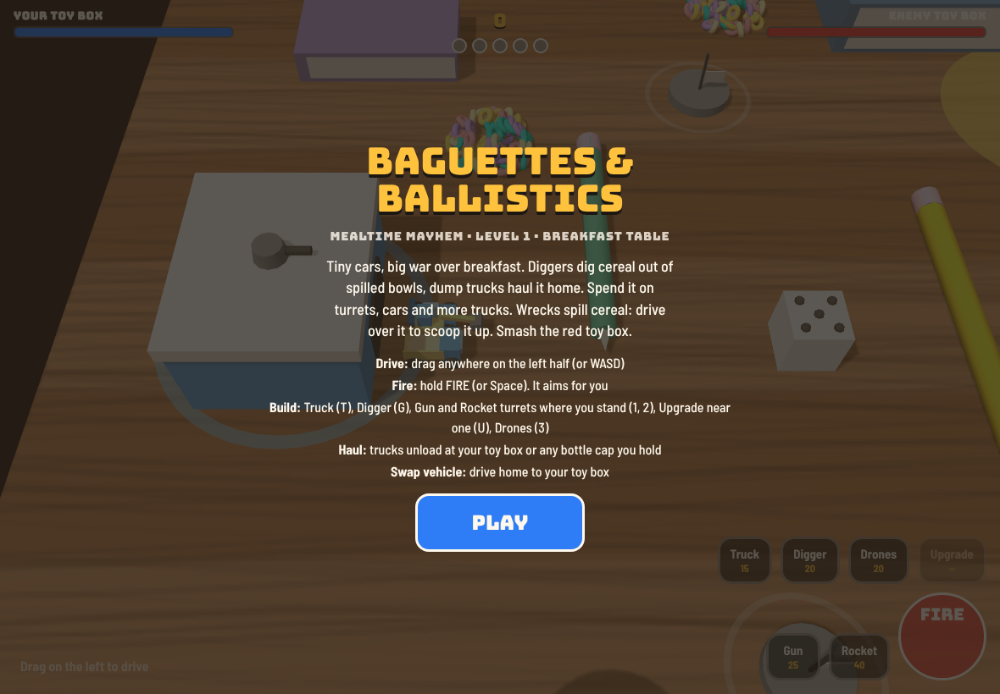
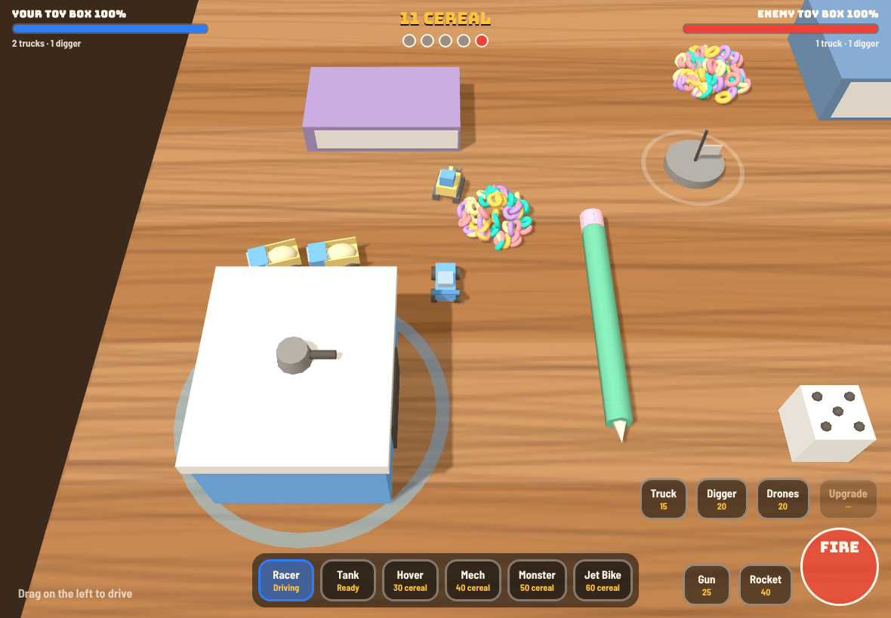
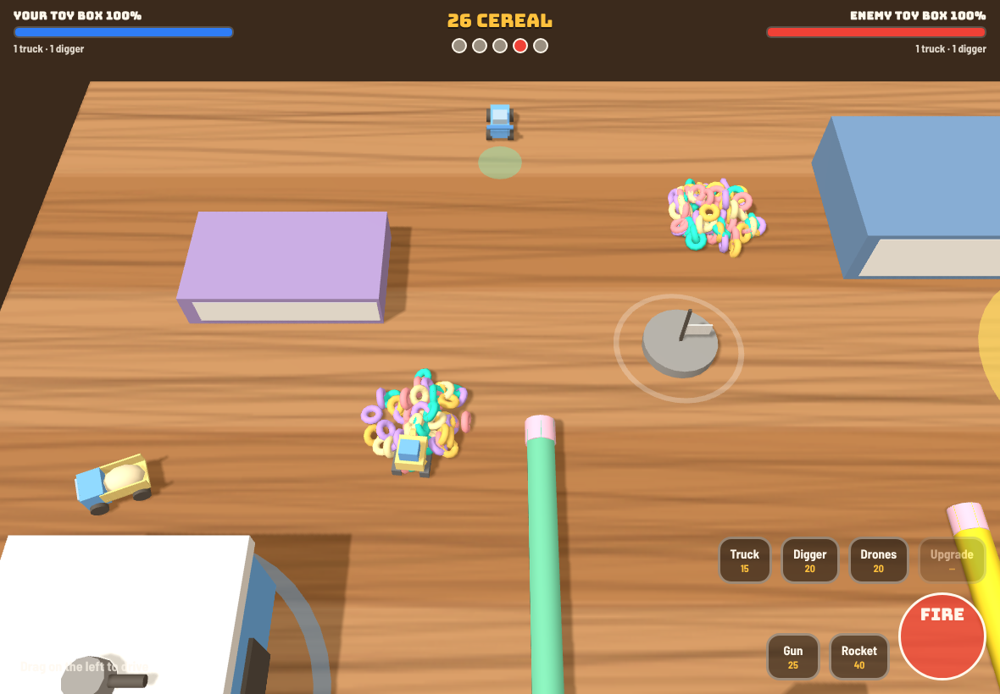

# Baguettes & Ballistics: developer handover

**In this pack:** `index.html` (the whole game), `README.md`, `DESIGN.md` (the plan), `HANDOVER.md` (this file), `shoot.js` (screenshot script), `shots/`. It's also on GitHub: `hrranford-afk/gods-eye-view-patch-town`, branch `game/micro-precinct`, folder `games/baguettes-and-ballistics/`.

*Mealtime Mayhem*, a Micro Machines-style toy war across a kitchen, for iPad.
This file is for the developers (human or AI) picking it up. Read this, then
[DESIGN.md](DESIGN.md) (where it's going), then `index.html`.

## 1. What it looks like now

| Title | Level 1 running |
|---|---|
|  |  |


*Known bug, shown above: the player can drive off the table into the dark,
and the camera follows.*

## 2. How to run it

- Open `index.html` in Safari on iPad or any desktop browser. It's one file,
  with no build step and no assets. three.js r128 comes from cdnjs.
- **Touch:** drag on the left half to drive, hold FIRE, use the build buttons
  on the right. The garage bar appears when you drive home.
- **Keys:** WASD or arrows to drive, Space to fire.

  | Key | Does |
  |---|---|
  | T | truck |
  | G | digger |
  | 1 | gun turret |
  | 2 | rocket turret |
  | U | upgrade |
  | 3 | drones |
  | 4–9 | vehicles, at home |

- **Screenshots:** `node shoot.js "$PWD/index.html"` (needs Playwright) writes `shots/`. Section 8 has the short version.

## 3. The game loop today (level 1, Breakfast table)

1. **Gather.**
   - Diggers dig cereal out of 7 spilled bowls.
   - Dump trucks haul it to your toy box, or to any bottle cap you hold. The 5 caps are depots, shown as the dots at the top.
   - The middle bowl refills at 0.6 a second, so it's the hot spot.
2. **Build.**
   - Gun turrets cost 25 and rocket turrets 40, and both upgrade to level 3.
   - Drones cost 20, trucks 15 and diggers 20.
   - There are six vehicles: Racer and Tank are free; Hover 30, Mech 40, Monster 50, Jet Bike 60.
3. **Fight.**
   - FIRE aims for you.
   - Wrecks spill cereal; drive over a spill to scoop it up.
   - Raid the enemy's trucks to starve it.
4. **Win.** Break the enemy toy box (1,200 health).
   - Cannons and missiles do 1.5× damage to boxes; machine guns only 0.3×.
   - Turrets can't sit within 36 units of the enemy box.

**The enemy commander** runs the same economy: it digs, hauls, builds turrets and upgrades.
- Its army cap goes 3, then 5, then 8–14 as the game goes on.
- Both sides get a free truck every 45 seconds.

## 4. Code map (`index.html`, about 1,220 lines)

| Lines | What |
|---|---|
| 1–130 | HTML, CSS, HUD, title and end cards |
| 133–135 | table size (150 × 96 toy units, 1 unit ≈ 1 cm), teams, colours |
| 157–395 | building the world: `mesh`, `woodTexture`, `block`, `buildModel` (every vehicle is made from shapes), `makeBase`, `makeOutpost` (bottle caps), `makePile` |
| 240–260 | **tuning tables:** `WEAPONS` (damage, rate, range, vsBase), `VEHICLES`, `ENEMY_TYPES` |
| 377–378 | cereal pile spots and the refilling bowl |
| 398–480 | economy: spills, `WORKERS`, `workerThink` (dig, haul, unload) |
| 482–575 | route finding: A* on a 2-unit grid (`navBuild`, `findPath`), `steer` |
| 577–660 | spawning, vehicles, `reset`, touch buttons |
| 663–680 | `sfx` (simple beeps: needs real sound), `toast` |
| 681–800 | movement, collisions, `fire`, `burst` (particles), `hurt` |
| 799–870 | `TURRETS`, `build`, `canPlace`, `upgrade`, `drones` |
| 875–910 | garage and costs |
| 908–985 | **enemy commander** (`commanderBuild`, `commander`) and unit AI (`unitThink`) |
| 986–1150 | main loop: `step`, `update` |
| 1151–1200 | camera and `render` |
| 1204–1220 | win or lose, `start` |

**Rules for the code**
- Keep it one HTML file with no image or sound files until level 2 ships. That keeps it light on an iPad.
- Tune numbers in the tables, not inside functions.
- Test on a real iPad, not only a desktop.

## 5. Known problems (fix first)

1. **Edge of the table:** the player can drive off the table into the void (screenshot above). Clamp them to the table, or let them fall off and respawn at home: funnier.
2. **Building is unclear:** pressing 1 next to the pencil gives "Something is in the way", with no hint where you *can* build. Show a ghost turret, green or red, before you place it.
3. **Sound:** beeps only. This is the single biggest gap in how it feels.
4. **Hard start:** new players struggle in the first minute (Harry: "starts off really hard, but you get the knack"). It needs a gentler first two minutes, or a short tutorial.
5. **No level select or progress saving.**
6. **Cereal is solid piles.** Harry wants loose bits you push with a bulldozer into hoppers.

## 6. What to build next, in order

| # | Job | Why | Done when |
|---|---|---|---|
| 1 | Table edge + build ghost | stops the two worst frustrations | you can't fall into the void unless the design says so; you can see where a turret will go before buying |
| 2 | Sound pass | toys must *sound* like toys | each weapon, impact, pickup and build has its own clicky toy sound (Web Audio, generated in code); the kettle click counts down |
| 3 | Game feel ("juice") | makes every hit satisfying | screen shake on big hits, hit-flash, cereal bursting out of wrecks, wheels kicking crumbs |
| 4 | First-two-minutes tutorial | keeps new players | a new player builds a truck, a digger and a turret in the first 2 minutes without reading the text |
| 5 | Loose cereal + hoppers + bulldozer | Harry's idea; physical and fun | cereal bits can be pushed; a hopper turns pushed cereal into money |
| 6 | Level select + saving | reason to come back | the campaign map shows 6 levels; stars saved on the device |
| 7 | Level 2: Pencil case | second resource (paperclips) | see DESIGN.md |
| 8 | Two players on one iPad | Micro Machines spirit | one player at each end of the screen |

## 7. Questions still open (Harry's call: taste)

- Name on the title screen: *Baguettes & Ballistics* (chosen); is *Mealtime Mayhem* the campaign name? (Assumed yes.)
- Should falling off the table be a feature (respawn) or a wall?
- Cartoon or realistic sound?

## 8. Screenshot recipe

```js
// node shoot.js  (needs Playwright; Chromium with --use-gl=swiftshader)
const { chromium } = require('playwright');
const b = await chromium.launch({ args: ['--use-gl=swiftshader', '--enable-unsafe-swiftshader'] });
const p = await b.newPage({ viewport: { width: 1180, height: 820 } });
await p.goto('file://' + process.cwd() + '/index.html');
await p.click('#play'); await p.waitForTimeout(30000);
await p.screenshot({ path: 'shots/3-economy.png' });
```

## 9. Specialists to train (for an award winner)

| Specialist | Owns | First task |
|---|---|---|
| **Game-feel / "juice"** | shake, impact, particles, timing | items 3 and 1 |
| **Sound designer** | toy sounds made in code, music, the kettle countdown | item 2 |
| **Level designer** | the six kitchen levels, hazards, pacing | level 2 paper plan |
| **Economy and balance** | costs, enemy commander, difficulty curve | item 4; keep a balance sheet |
| **Enemy AI** | commander strategy, personalities per level (greedy, turtle, raider) | three commander styles |
| **Touch-controls and UX** | iPad thumbs, build ghost, menus, readable for dyslexia | item 1 build ghost |
| **Playtester** | plays every build on iPad, writes "what was annoying in the first 60 seconds" | every release |
| **Technical artist** | toys from shapes, lighting (morning sun, fridge light), keeping it 60 fps on iPad | performance budget |

Each specialist works from this file and DESIGN.md, changes one thing at a
time, and shows a screenshot or short clip before and after.
