# Baguettes & Ballistics: developer handover

**In this pack:** `index.html` (the whole game), `README.md`, `DESIGN.md` (the plan), `HANDOVER.md` (this file), `shoot.js` (screenshot script), `shots/`. It's also on GitHub: `hrranford-afk/gods-eye-view-patch-town`, branch `game/micro-precinct`, folder `games/baguettes-and-ballistics/`.

*Mealtime Mayhem*, a Micro Machines-style toy war across a kitchen, for iPad.
This file is for the developers (human or AI) picking it up. Read this, then
[DESIGN.md](DESIGN.md) (where it's going), then `index.html`.

## 1. What it looks like now

| Title | Level 1 running |
|---|---|
| 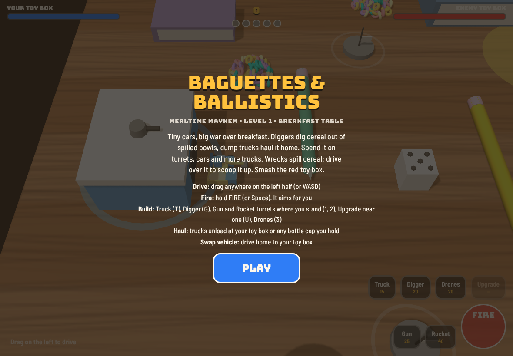 | 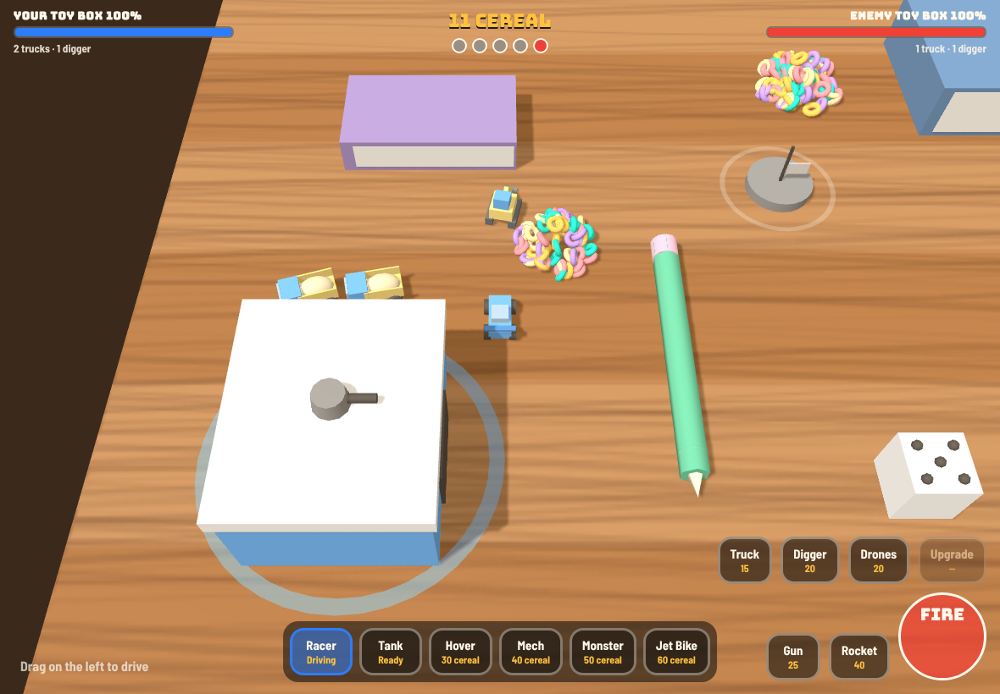 |

Level 2 (Pencil case): 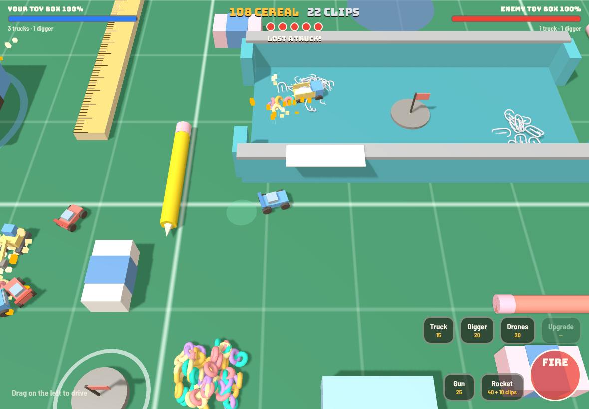 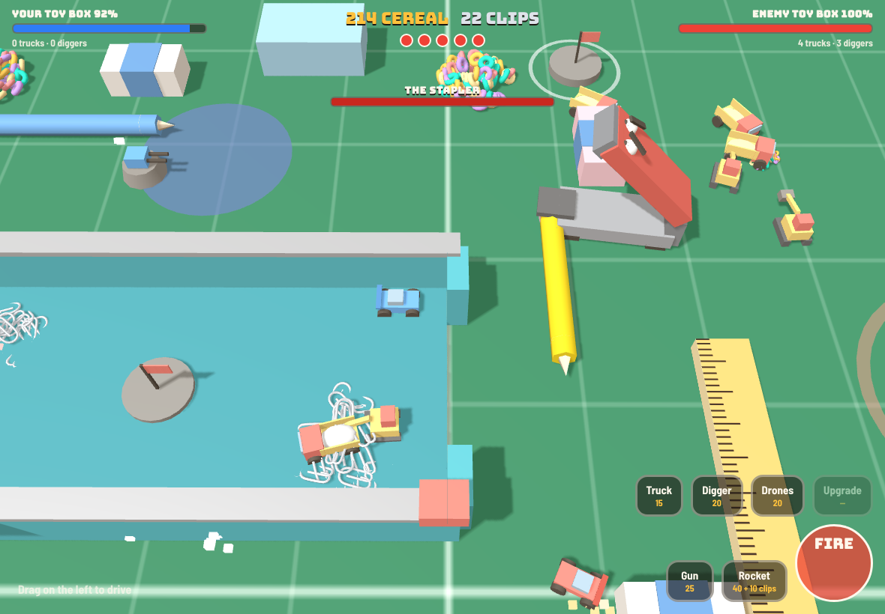 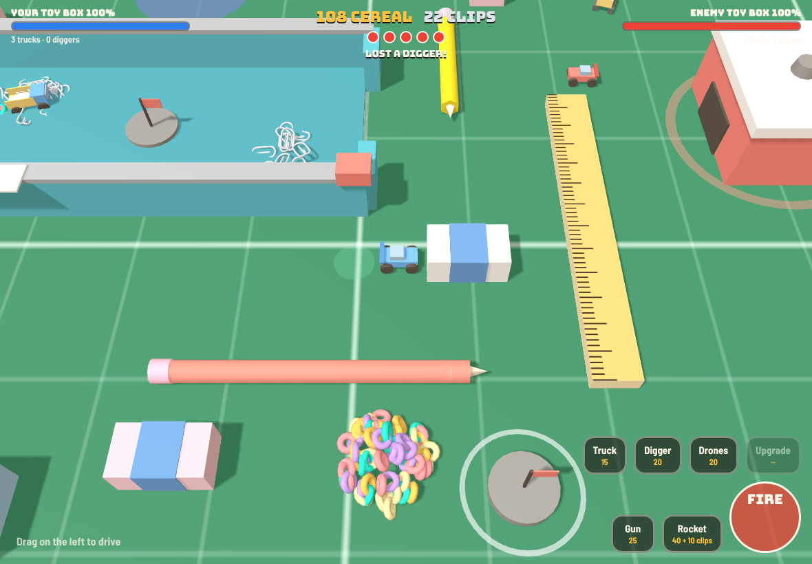 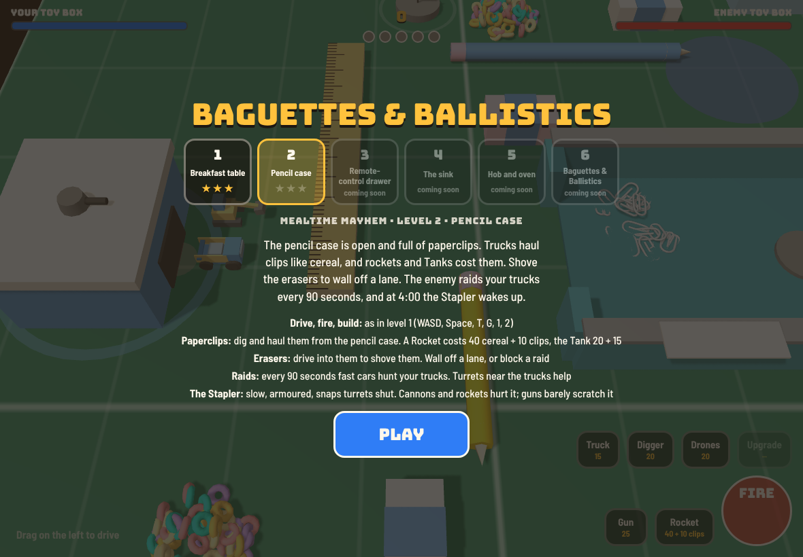

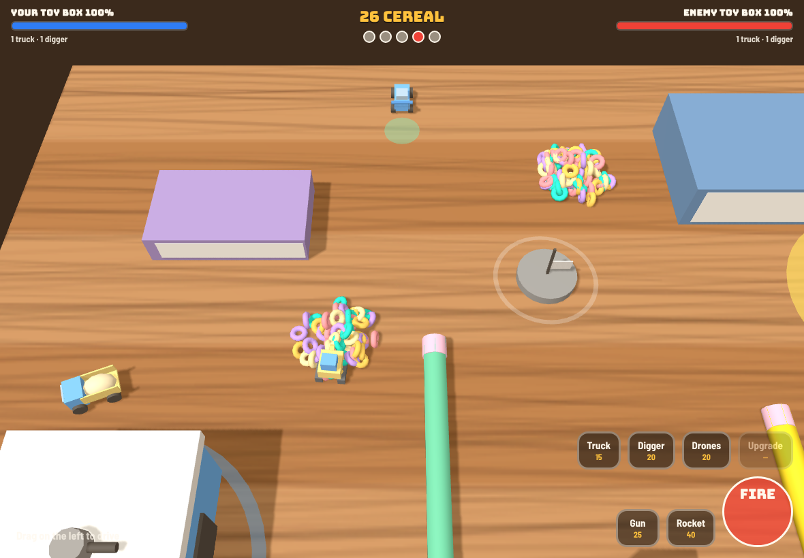
*Near the table edge the camera now stays over the table. The green circle behind the car is the build ghost: green means a turret fits there and you can afford it, red means you can't.*

## 2. How to run it

- Open `index.html` in Safari on iPad or any desktop browser. It's one file,
  with no build step and no assets. three.js r128 comes from cdnjs.
- **Touch:** drag on the left half to drive, hold FIRE, use the build buttons
  on the right. The garage bar appears when you drive home.
- **Keys:** WASD or arrows to drive, Space to fire, M for sound on or off.

  | Key | Does |
  |---|---|
  | T | truck |
  | G | digger |
  | 1 | gun turret |
  | 2 | rocket turret |
  | U | upgrade |
  | 3 | drones |
  | B | gunboat (level 4 only) |
  | L | laser turret (level 3 only) |
  | V | flare (level 3 only) |
  | 4–9 | vehicles, at home |

- **Screenshots:** `node shoot.js "$PWD/index.html"` (needs Playwright) writes `shots/`. Section 8 has the short version.

## 3. The game loop today (level 1, Breakfast table)

1. **Gather.**
   - Diggers dig cereal out of 7 spilled bowls.
   - Dump trucks haul it to your toy box, or to any bottle cap you hold. The 5 caps are depots, shown as the dots at the top.
   - The middle bowl refills at 0.6 a second, so it's the hot spot.
2. **Build.**
   - Gun turrets cost 25 and rocket turrets 40, and both upgrade to level 3.
   - Drones cost 20, trucks 15 and diggers 20.
   - There are six vehicles: Racer and Tank are free; Hover 30, Mech 40, Monster 50, Jet Bike 60.
3. **Fight.**
   - FIRE aims for you.
   - Wrecks spill cereal; drive over a spill to scoop it up.
   - Raid the enemy's trucks to starve it.
4. **Win.** Break the enemy toy box (1,200 health).
   - Cannons and missiles do 1.5× damage to boxes; machine guns only 0.3×.
   - Turrets can't sit within 36 units of the enemy box.

**The enemy commander** runs the same economy: it digs, hauls, builds turrets and upgrades.
- Its army cap goes 3, then 5, then 8–14 as the game goes on.
- Both sides get a free truck every 45 seconds.

## 4. Code map (`index.html`, about 2,540 lines; the line numbers below are the original ones from before levels 2 to 4, so use grep)

| Lines | What |
|---|---|
| 1–140 | HTML, CSS, HUD (cereal and clips, boss bar), title card with level buttons, end card |
| 145–150 | table size (150 × 96 toy units, 1 unit ≈ 1 cm), teams, colours |
| 165–280 | building the world: `mesh`, `woodTexture`, `matTexture`, `rulerTexture`, `block`, `makeEraser`, `pencilCaseDecor` |
| 232–260 | `tileTexture`, `waterTexture` (level 4); `sinkDecor` (~326) builds the sink: basin, water plane, ruler bridge, island, tap, drip pieces, ferries |
| 281–383 | **`LEVELS`** (see "Level format" below) and `buildLevel` |
| ~530 | **water helpers** (`inWaterX`, `onFerry`, `onIsland`, `bridgeLift`, `waterPush`); `ferries[]`, `sink` |
| 384–500 | **tuning tables:** `WEAPONS` (damage, rate, range, vsBase), `VEHICLES`, `ENEMY_TYPES`; `buildModel` (every vehicle, plus the Stapler, is made from shapes) |
| 504–600 | state, `makeBase`, `makeOutpost` (bottle caps), cereal piles (`loopsGroup`) and paperclip piles (`clipsGroup`), spills |
| 600–680 | economy: `WORKERS`, `workerThink` (dig, haul, unload; trucks stick to one resource per trip) |
| 680–785 | route finding: A* on a 2-unit grid (`navBuild`, `findPath`, `closedFat` for the big boss), `steer` |
| 784–830 | spawning, vehicles, `reset` (builds the current level), touch buttons |
| 830–950 | input, `sfx` (toy sounds in code, incl. raid siren, snap, roar, scrape) |
| 950–1090 | helpers, collisions (`collideObstacles` shoves erasers), `drive`, `fire`, `burst`, `hurt` (boss armour, boss death) |
| 1090–1205 | `TURRETS`, `build`, `canPlace`, `upgrade`, `drones`, garage and costs (`vehCost`, `clipsOf`) |
| 1205–1295 | **enemy commander** (`commanderBuild`, `commander`) and unit AI (`unitThink`, raiders) |
| ~1950–2085 | level 4 rules: boats (`BOATS`, `launchBoat`, `buyBoat`, `boatThink`, `enemyBoats`), `ferriesUpdate`, `dripsUpdate`, `dripSplash`, `islandScoop` |
| 1295–1370 | level 2 rules: `erasersUpdate`, `spawnRaid`, `spawnBoss`, `bossThink` |
| 1370–1610 | main loop: `step`, `update`, camera and `render` |
| 1610–1678 | progress and level select (`localStorage`), `endGame` (stars), `start` |

### Level format

`LEVELS` is an array of 6 entries. Levels 5 and 6 are `{ name, time, soon: true }`
stubs that show "coming soon". A playable entry holds:

| Field | Meaning |
|---|---|
| `name`, `time`, `blurb`, `tips` | title-card text |
| `tableColor`, `tableTex` | tint, and `'mat'` for the green cutting mat (default wood) |
| `blocks` | `[x, z, w, d, h, colour, kind]`; kinds: `pencil`, `book`, `mug`, `die`, `ruler`, or a plain box |
| `erasers` | `[x, z, w, d, colour]`: pushable blocks |
| `patches` | `{ x, z, r, kind: 'juice' \| 'cereal', color? }` |
| `outposts` | bottle-cap spots `[x, z]` |
| `piles`, `refill` | `[x, z, amount, res?]` (`res` is `'clips'` or default cereal); `refill` is `{ x, z, rate }` for piles that fill again |
| `start` | `{ cereal, clips, unlocked: [vehicles] }` |
| `resources` | `['cereal']` or `['cereal', 'clips']` (clips turn on the HUD counter and truck preferences) |
| `turretClips`, `vehicleCosts`, `heavyClips` | extra paperclip costs: turrets `{ rocket: 10 }`, vehicles `{ tank: { c, p } }`, the enemy's heavy tank |
| `rules` | `baseHp`, `raidEvery` (s), `raidSize` `[min, max]`, `boss: { at, hp, spill }` |
| `decor` | optional function that adds look-only shapes |
| `water` | level 4 only: `{ x0, x1, bridge: { z, w }, island: { x, z, r }, ferries: [{ color, inner, leg, start, stops: [{ x, z, wait }] }] }`; becomes `state.water` (null elsewhere) |
| `boats` | `true` shows the Boat button and lets the enemy launch boats |
| `outposts` | `[x, z]`, or `[x, z, y]` to lift a cap (the level 4 cap sits on the bridge) |
| `piles` | a fifth item `'island'` marks a pile only you can scoop (trucks and diggers skip it) |
| `tableTex` | also `'tile'` (white kitchen tiles) |
| `rules.boss` | `{ at, hp, spill, kind, name }`: `kind: 'duck'` spawns the Rubber Duck, `'rcar'` the Remote Car, otherwise the Stapler; `name` is the boss bar text |
| `dark` | level 3 only: `true` switches the lights down (`setLighting`), adds `darkRig`, and turns on the stealth rule. Every other level gets normal light back from `buildLevel` |
| `second`, `resources` | the second resource's name (`'batteries'`) and list. Its counter is stored in `state.clips` on every level, whatever it is called (`secondRes()`, `secondName()`) |
| `rules.sneaky` | `{ hijackFirst, hijackEvery, layerFirst, layerEvery }` in seconds: the sneaky enemy (earlier and more hijackers, sooner domino layer, raiders with no siren) |
| block kinds | `remote`, `battery`, `cable`, `charger`, `torch` (in `DRAWER_KINDS`); `tableTex: 'felt'` |

`reset()` calls `buildLevel(LEVELS[curLevel])`, which throws away the old
level's group and rebuilds blocks, erasers, patches and decor. Level 1's
numbers are the original ones.

**Progress:** `localStorage` key `bb-progress-v1`, `{"stars":{"1":3,"2":1}}`
(best stars per level number). Every playable level is open from the start
(Harry's call, 1 Nov): `isUnlocked` returns true. To bring locks back, make it
`(i) => i === 0 || starsOf(i - 1) > 0`. Every read and write is in try/catch, so the game
works without storage. Stars: 1 for a win, 1 for under 8 minutes
(`FAST_WIN`), 1 for no truck lost (`state.trucksLost`).

**Rules for the code**
- Keep it one HTML file with no image or sound files until level 2 ships. That keeps it light on an iPad.
- Tune numbers in the tables, not inside functions.
- Test on a real iPad, not only a desktop.

## Level 4, The Sink (1 Nov 2026)

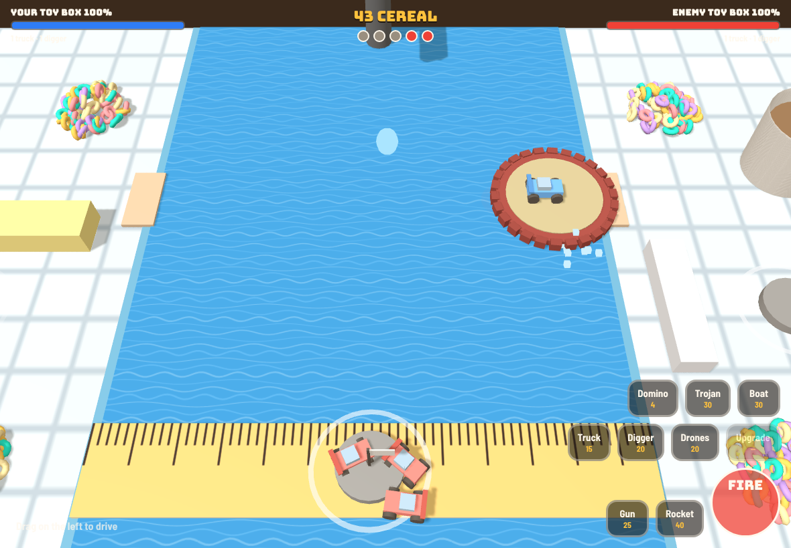 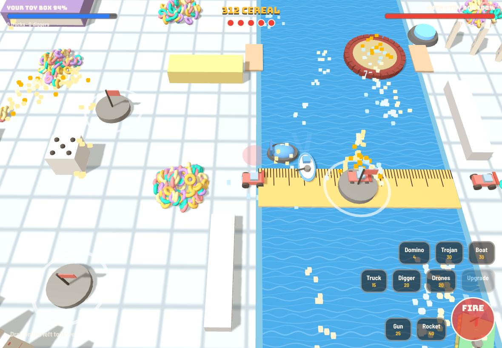 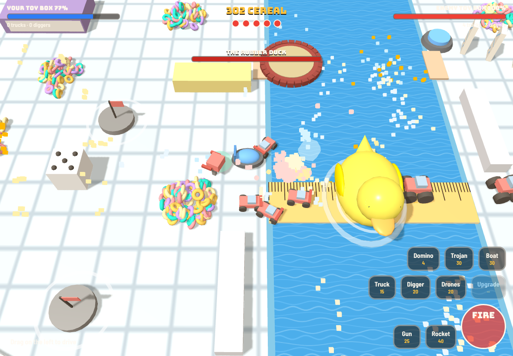

**Layout.** White-tile table. A channel of water, x from -13 to 13 over the
whole depth, splits the sink; bases are still at x = ±62. Both banks have cereal
piles (a rich one at (±24, 0) that refills at 0.35 a second), mugs, a sponge, a
knife, a sugar cube and a dish cloth for cover, and caps at (±36, ±14). The
fifth cap sits on the bridge itself at (0, 0).

**Water rules.**
- `state.water` is the level's `water` block (null on other levels).
- Wheels (player, units, workers) can't enter it: `waterPush` (called at the end of
  `collideObstacles`) shoves them out of the two blocked rectangles north and south
  of the bridge, using a radius of 0.6 × the car's radius so they can overhang a little.
- `navBuild` closes the water cells (0.8 margin, 3 for the fat grid), except a
  lane 2 cells wide along the bridge, so A* routes everything over the bridge.
- The Hover (`VEHICLES.hover.floats`) skips `waterPush`: free to cross anywhere.
- Turrets, your dominoes, the enemy's dominoes (`planDominoRun`) and the level
  domino runs (`buildLevelRun`'s `blocked`) all use `inWaterX`, so nothing is
  built on water or on the bridge. On this level the automatic route puts your
  domino button on the enemy bank (x 15.9), so you cross the bridge to press it;
  theirs is on your bank. Both runs were tested (200 damage each).
- The bridge is a ruler 27 long and 6 wide, a flat box 0.5 thick. Cars on it are
  lifted by `bridgeLift` (with a short ramp) in `render`; it is not an obstacle.

**Ferries** (`ferriesUpdate`, `ferries[]`). Two bottle caps (radius 4.6, 26
ridges on the rim): north at z = -26 (red, west to east dock, 6 s a crossing,
3 s at each dock); south at z = 26 (teal) with a stop at the island in the
middle (3 s legs, 2 s stop). Motion is cosine-eased. Anything whose centre is on a
ferry (player, units, workers) is carried and remembers it (`e.ferryRef`). Off a
ferry into open water you hit an invisible rim; you can only step off onto a
bank, the bridge or the island. AI doesn't plan with ferries and trucks use
the bridge only.

**The island** is a pink soap dish at (0, 31), radius 7, with a 260 cereal pile
(refills 0.6 a second). Only you scoop it, by driving over it (`islandScoop`,
7 a second); trucks and diggers skip piles flagged `island`. Get there on the
Hover or on the south ferry during its 2 s stop. Driving off the island into
the water bounces you back.

**Boats** (button *Boat*, key B, 30 cereal, `BOAT_CAP` 3 per side). `launchBoat`,
`buyBoat`, `boatThink`, `BOATS`.
- Gunboat: soap dish with a small gun, 70 hp, speed 12, `boatgun` (7 damage, range 20).
- Sponge raft (the enemy only): 160 hp, speed 6.5, `raftgun`, 24 cereal.
- Boats are a new entity kind `'boat'`: they patrol a lane up and down the
  channel, slow down and shoot the nearest enemy in range (boats, cars on the bank,
  the bridge, the Duck). They are clamped to x0..x1, pushed off the island and
  the ferries, and keep apart. Each leaves a wake (`addWake`, two strips scaled by speed).
- `enemyBoats`: from 1:15, a new enemy boat every 26–36 s if it has the cereal
  (40% rafts). Ground units shoot boats in range but never chase them.

**Drips** (`dripsUpdate`, `dripSplash`). A tap (chrome pipe, red handle) at the
north end. Every 8 s (±0.75) a drip is aimed at a random spot within 22 of the
channel centre: a dark blue ring marks it for 1.2 s while a drop flies in from
the spout. The splash (an expanding ring from a pool of 3) pushes every car,
worker and boat within 11 by up to 34 (half that for boats) plus a small
instant shove; `plip` sound. No damage.

**The Rubber Duck** (`spawnDuck`, `duckThink`, rule `boss: { at: 240, hp: 800,
spill: 80, kind: 'duck' }`). Built from spheres in `buildModel('duck')`, armour 2.
It drifts along the channel at 4 a second, swaying a little, bobbing. Every
3.4 s it lobs a `bubble` (34 damage, splash radius 5.5, speed 12) at your
nearest turret, car, boat or truck, preferring ones near the water; the bubble
pops where the target was. The bar says THE RUBBER DUCK (`#bossName`). On death
it pays 80 cereal straight into your stock (it sinks, so a spill would be out of reach).

**Other rules on this level.** Raids from 2:30 every 100 s (2–3 raiders over the
bridge), base health 1500, start with 40 cereal and the Racer and Tank.

**Tested in Chromium** with Playwright: Racer stopped at the bank (x -13.96), Hover crossed;
Racer and Monster crossed the bridge; ferry carried the player 19 units across in
6 s; island pile scooped from the ferry; boats stayed inside x -10.9..11.3 over 30 s and
killed a dummy; drips pushed a Racer 4.2, a Tank 2.9, a Hover 6.4 and a boat; the Duck
spawned at 4:00, killed a gun turret, took 330 damage from 3 gunboats and paid out when killed;
both level domino runs worked; 5 minutes of AI play without page errors; levels 1 and 2 unchanged.

## Level 3, Remote-control drawer (2 Nov 2026)

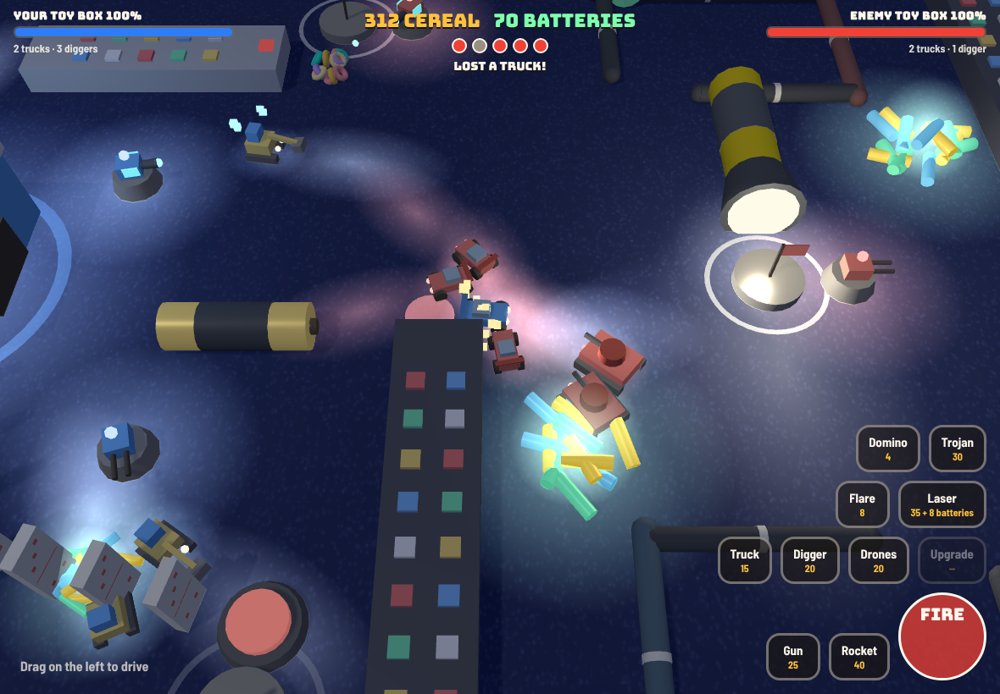 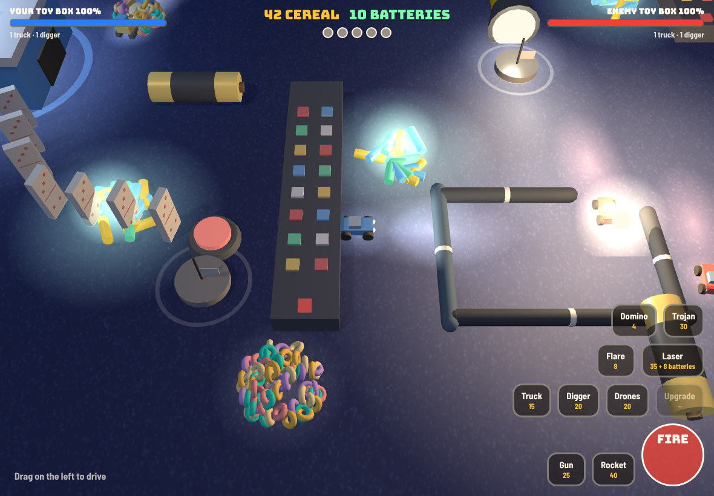 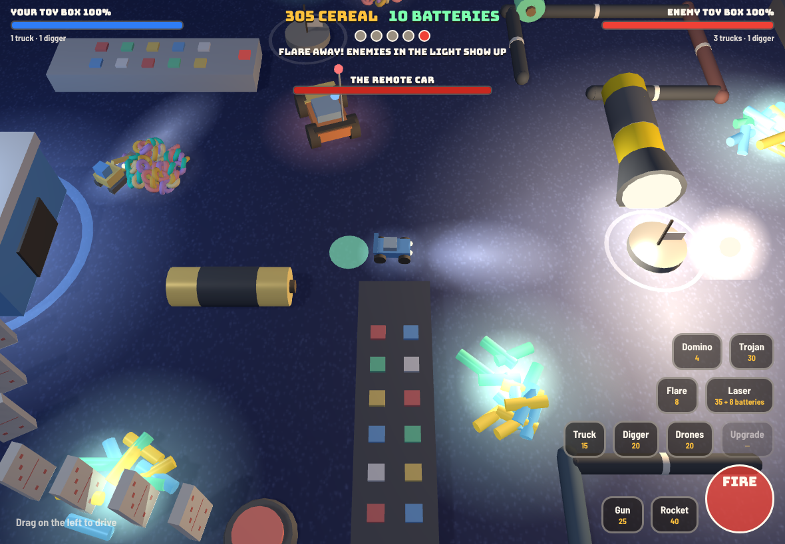

**The big idea: it is dark.** Everything is built on `LEVELS[2].dark`. Code lives in
one block, "The Remote-control drawer", just before `// ---------- Levels`, plus small hooks elsewhere.

**Lighting** (`setLighting(dark)`, called by `buildLevel` for every level):
- Normal: hemisphere 0.75, sun 0.85, brown background. Drawer: hemisphere 0.26 (blue-ish), sun 0.1, near-black navy background and fog.
- `darkRig` (made once, added to the scene only on this level) holds the **5 real lights**: your headlight (a SpotLight that follows the car), a PointLight over each toy box, one at the torch lens, and one for the newest flare. Their count never changes, so shaders compile once. No other real lights.
- Everything else is fake: `lightPool` (a flat additive radial-gradient plane on the felt, one shared geometry, a material per colour), `lamp` (a small unlit bulb), and a few additive Sprites for halos (batteries, flare). `addHeadlights` puts two lamps and two pools on every car, truck and digger (hooked into `buildModel` through `FRONT`); `addGlow` puts a lamp and a pool on turrets and toy boxes. Cereal piles get a faint pool so you can find them.
- The build ghost uses an unlit material, so it is visible in the dark (brighter on this level).

**The stealth rule** (`darkUpdate`, called at the end of `render`). Each frame it fills reusable number arrays (`litX`, `litZ`, `litR`) with lit circles, then sets `mesh.visible` for every enemy unit and truck:
- Yours: the car (a circle 8 ahead, radius 19), your toy box 27, turrets 15, your units 11, your trucks 8, caps you hold 10.
- Neutral: glowing battery piles (6 to 11, scales with the pile), the torch 17, flares (30).
- An enemy stays visible 0.45 s after it was last lit, and 0.7 s after it fires (`from.flashT`, set in `fire`; sneaky raiders and hijackers only 0.25 s).
- Enemy turrets and their toy box are always drawn (they glow); shots and sparks are unlit, so always seen. Turrets and your auto-aim still shoot hidden enemies.
- The Remote Car is different: its `body` group hides, its `lights` group (blinking bulbs) never does.

**Layout.** Navy felt (`feltTexture`), a wooden drawer rim. Blocks: two TV remotes each side (`remote`: dark box with button bumps), four loose AA batteries (`battery`, lying flat), two cable tangles of low walls (`cable`: height 1.1, so cars can't cross but shots fly over), two charger bricks (`charger`, green light) and the torch (`torch`, lens facing the middle cap, its light is a neutral lit zone). Caps at (±34, ±30) and (0, 0). The two level domino runs and the trojan work as on other levels (tested: run 200, trojan 260).

**Batteries.** Second resource, shown as "N BATTERIES" in green. Piles use `batteriesGroup` (glowing coloured cells, a pool and a halo). Four piles: two mid-table at (-15, 14) and (15, -14), 130 each, refilling 0.18 a second; two far ones, 90 each. Trucks haul them exactly like paperclips (`pref`, `secondRes()`); the worker code was generalised from `'clips'` to "the level's second resource". Start: 30 cereal, 10 batteries, Racer and Tank.
- **Laser turret** (button *Laser*, key L): 35 cereal + 8 batteries, `TURRETS.laser`, range 23, 8 damage every 0.14 s, cyan lens model. The enemy builds them too (45% of its turrets, costs it the batteries).
- **Jet Bike**: 20 cereal + 14 batteries (`vehicleCosts`). The garage and toasts print the resource name.

**The Flare** (button *Flare*, key V, 8 cereal, 2.5 s reload; `flare`, `flaresUpdate`, `flares[]`). Lobbed 26 units ahead over 0.8 s, then it sits for 15 s: a bright ball, a halo, a big soft pool, and a lit circle of radius 30 (opens up for the first second, dims over the last 3 s). Three at once at most; the PointLight follows the newest.

**The sneaky enemy** (`rules.sneaky`): first hijacker at 1:10 then every 60 s (normally 2:30 / 120 s); after 4:00 a second hijacker follows if you have two trucks or more; the domino layer from 2:10 every 110 s. Raiders arrive with only a toast, no siren. Hijackers and raiders are `sneak`, so they hide again quickly after firing.

**The Remote Car** (`spawnRcar`, `rcThink`, `buildModel('rcar')`, rule `boss: { at: 180, hp: 1000, spill: 90, kind: 'rcar', name: 'THE REMOTE CAR' }`). Orange RC buggy with an aerial and blinking blue and red lights, armour 1. It follows an arc round your toy box on the table side (radius 27 to 36, changes direction every 4 to 9 s, turns round at the ends, runs away along the arc if your car comes within 17), speed 23, so it is as quick as a Racer. Every 1.3 s (0.8 s under half health) it snipes (`WEAPONS.snipe`: 20 damage, range 46, speed 75, leads the shot), turrets first, then you, then trucks. The toy box has the boss bubble shield (`bossShield`) and there is a banner and an arrow. When it crashes: 90 cereal spills and you get 10 batteries.

**Tested in Chromium** with Playwright (swiftshader, about 3 frames a second, so all by calling `update(1/60)`):
- enemies hide outside light and show in a headlight, a flare, near a battery pile; a lit unit hides again after about half a second;
- batteries were hauled (10 to 48 in a minute with 3 trucks); a laser turret built and killed a scout; it is refused with too few batteries; the Jet Bike unlocked for 20 + 14;
- the flare costs 8, reveals at 30 and is gone after 15 s;
- the Remote Car spawned at 3:00, orbited, sniped a player to a wreck and a turret down, died to three lasers and the base gun, popped the shield (bubble removed, banner shown, 10 batteries paid);
- level domino run 200 damage, trojan 260, domino placing works, the build ghost shows;
- levels 1, 2 and 4 get their normal light back after visiting the drawer (checked after each switch);
- 2.5 minutes of simulated play with raids, hijackers and a domino layer: no page errors, shapes in memory about 660 to 760.

**Not done or open.**
- Balance was never played by a human on an iPad: only simulated. Aim is 8 to 12 minutes.
- The gumball machine is not on this level.
- Enemy turrets are always drawn, not hidden.
- The Remote Car can duck inside the turret ring when its route bends round clutter, where it takes fire from the toy box's gun.
- Real-light count is 5, but the first frame of the level recompiles shaders (a small hitch on an iPad).

## Level domino runs (1 Nov 2026, Harry's idea: part of the level, switched on)

Every level now has two domino runs built in, one per side
(`buildLevelRun`, `standRun`, `runsUpdate`, `state.runs`):

- Each run is 13 or so cream dominoes with spots in its side's colour. It
  starts at a big push-button in the middle of the table, runs along that
  side's edge, and bends in to end 9.5 units from the *other* toy box.
- Drive onto your button (blue) to set yours off: 200 damage when it lands.
  **The button is stiff: it needs weight 3** (`BUTTON_WEIGHT`,
  `PLAYER_WEIGHT`, `UNIT_WEIGHT`). Monster truck 3 on its own; Tank or Mech 2;
  Racer 1; Jet Bike 0.5; the Hover floats (0). Your drones count 1 each and
  pile on when you park on the button. So: fetch the Monster from the garage,
  or bring drones. A toast says how much weight is missing. The enemy sends a
  Monster buggy if it has one, or a crew that weighs enough together.
  Their cars press the red one: from 1:40, the nearest red car is sent
  whenever it's set up (`u.presser`).
- Level dominoes are fixed: cars and shots don't knock them over, only the
  button (or a domino chain running into them).
- A fallen run is set up again after 45 seconds. The button glows when ready.
- The route is found automatically per level (tries mid-table spots and
  angles until the whole line is clear of blocks), so new levels get runs for
  free. Tested on levels 1 and 2: blue run 200 damage; the enemy pressed
  theirs at 1:47 and hit for 200.

## Hitting a toy box without going at it (1 Nov 2026, every level)

- **Domino run** (button *Domino*, key X): 4 cereal each, 40 at most. A domino
  stands across your path, so a line you drive along falls the way you were
  driving. Drive into the first (or anything fast does: enemy cars blunder
  into them too). Each falling domino knocks the next if it's within 5.8 units
  and ahead. Where the top of a domino lands on their toy box: 200 damage,
  once per run (2 s apart). Enemies under a falling top take 60. Dominoes
  can stand inside the no-build zone. `placeDomino`, `topple`,
  `dominoesUpdate`, `dominoes`.
- **Trojan truck** (button *Trojan*, key Y): 30 cereal, right next to one of
  their dump trucks. It stays red, so neither side shoots it, gets a firework
  in the back, and drives home; at their toy box it goes off for 260 damage
  (50 to their cars nearby). `trojan`, `trojanThink`, `w.trojan` (skipped by
  `nearestEnemy` and by shots).
- **The enemy uses both** (`enemyTricks`, from `update`):
  - From 3:00, about every 2.5 minutes (40 cereal), a red builder (`layer`, a
    Mech) lays a run of 5–6 red dominoes ending 9.5 units from your toy box,
    from a side with room (`planDominoRun`), backs off and rams the first.
    Then it joins the fight. Warning toast and siren when it sets out.
  - From 2:30, about every 2 minutes (25 cereal), a `hijacker` (fast racer)
    goes for your nearest truck; on contact the truck becomes a trojan and
    drives to *your* toy box (260). **Ram your own hijacked truck to defuse
    it.**
  - Counterplay: shoot their builder; a shot knocks over a standing domino of
    the other side the way it was going, so shoot their run from the toy-box
    side and it falls away from you. Dominoes landing on any toy box hurt it,
    yours included.
  - Tested in Chromium: their run hit the box for 200 at 18 s after setting
    out; a hijack at 12 s; ramming defused a trojan.

## Paperclip upgrades (1 Nov 2026, paperclip levels only)

- **Staple gun turret** (button *Staple*, key Q): 20 cereal + 8 clips. Fires
  bursts of 4 staples, then reloads; each staple pins a car in place for 0.7 s
  (a boss for a quarter of that). `WEAPONS.staple`, `TURRETS.staple`, `pin`
  handled in `hurt`, `drive` and `steer`.
- **Paperclip armour** (button *Armour*, key R): bolt plates onto your car at
  home, 15, 25 and 35 clips. Each plate takes 15% off every hit (3 at most,
  so 55% of the damage gets through). Plates stay on when you swap cars.
  `armour()`, `armourModel()`, `state.plates`.
- **Magnet tower** (button *Magnet*, key F): 30 cereal + 12 clips. No gun:
  it pulls loose cereal within about 16 units straight into your stock, and
  drags and pulls enemy cars within 12. `magnetThink`.
- **Rubber-band catapult** (button *Catapult*, key E): 45 cereal + 15 clips.
  Lobs an eraser in a high arc over walls every 3.2 s, range 44, so it can hit
  their toy box from just outside the no-build zone (36). Aims for the toy box
  whenever it's in reach. 30 damage with full effect on boxes (about 10 a
  second: two minutes to flatten a box alone, so the enemy must hunt it).
  Lobbed shots: `weapon.lob`, `s.lobbed` in the shot loop.
- The paperclip buttons sit in their own row, hidden on levels without clips.

## Level 1 race opening (2 Nov 2026; Harry's "race, then battle" twist, level 1 only)

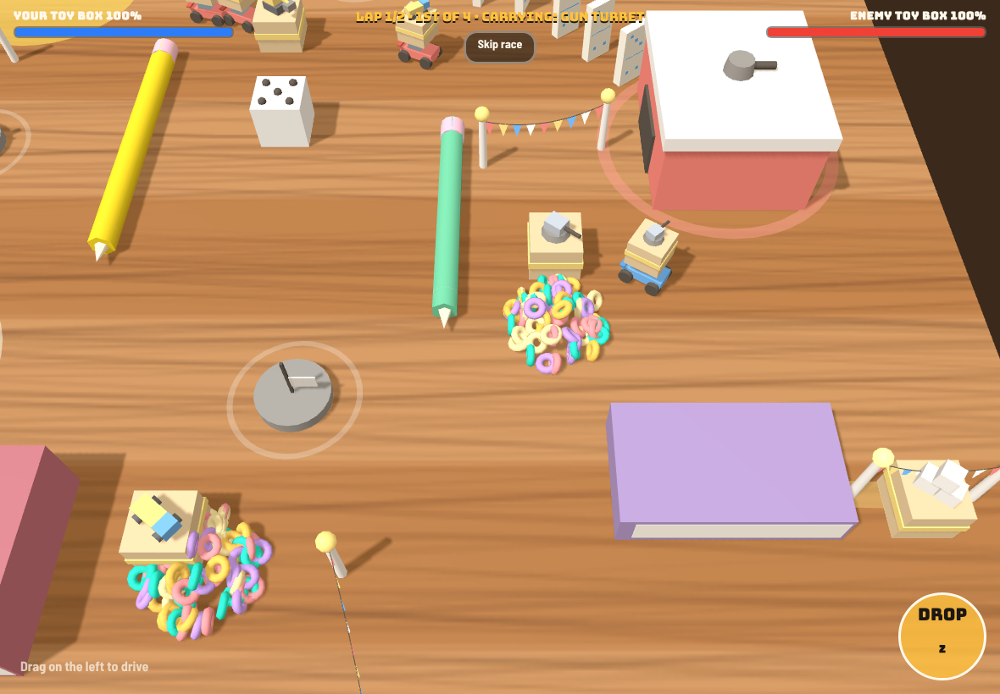 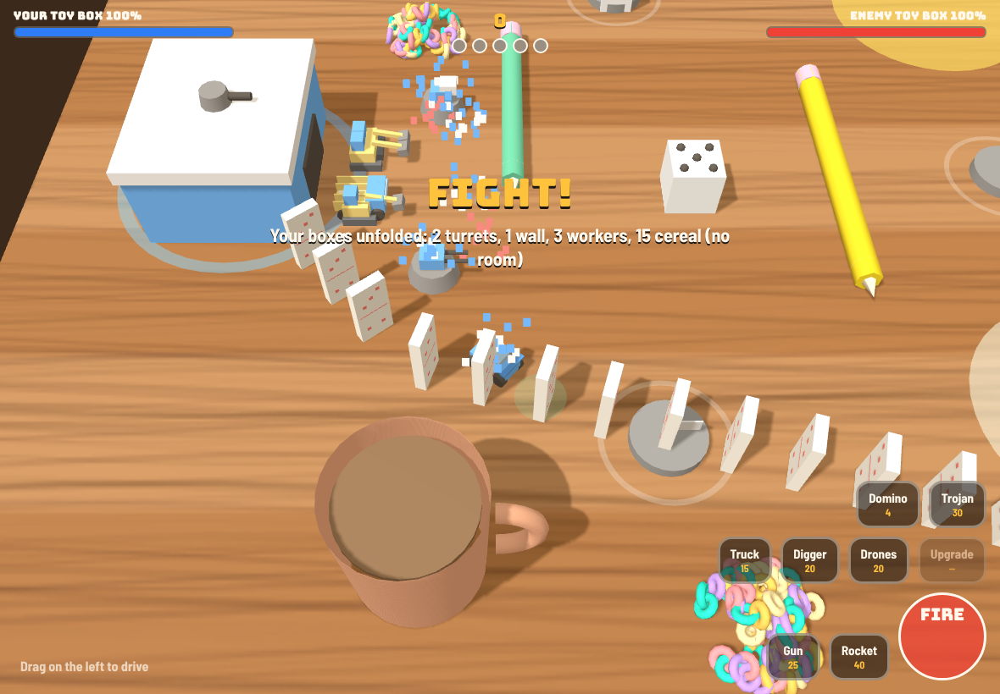

Level 1 now starts as a short race. It teaches driving before building, and the boxes you
drop become your base. `LEVELS[0].race = { laps: 2 }` turns it on; levels 2 and 4 are untouched.
Everything lives in one block of `index.html` headed "Level 1 race opening" (just above `step`).

**Phases.** `state.phase` is `'race'` (the 3-2-1 start hold, then racing), `'countdown'`
(BATTLE! banner and 3 kettle clicks) or `'battle'` (everything as before; every other level
is `'battle'` from the start). `update()` hands `'race'` and `'countdown'` to `raceUpdate(dt)`
and returns, so **no economy, enemy commander, shooting, raids, boss or tricks run during the
race**. `reset()` calls `cleanupRace()`, then `startRace(L.race)`, and skips the usual starting
trucks and diggers for a race level (`startBattle` spawns them). While racing, `body.racing`
hides every build and fight button and the cereal counter; the race HUD (`#raceHud`:
"Lap 1/2 · 2nd of 4 · Carrying: Gun turret", plus a **Skip race** button), the **Drop** button
(`#bDrop`) and a gold arrow to the next gate (`#gateArrow`, `raceArrow`) show instead.
Keys: WASD or arrows to drive, **Z drops** (in battle Z still uses an item). All the build keys and
buttons are ignored until the battle starts (see the guards in the `keydown` handler and `tap`).

**Track** (`RACE_HALF`, `raceTrack`). 23 corner points for half a lap, repeated turned half a circle
(`-x, -z`), rounded with 3 passes of Chaikin smoothing and resampled every 2.5 units: 166 points, length
about 414. Start/finish is at (-48, 0), heading north. It goes round the NW book (west lane at x -70),
along the top, dips through the pencil gap (the "inner box" between the two pencils), then
east lane x 48, round the SE book, and back through the south dip. Level 1's blocks are point-symmetric,
so the track is too. **Checked against the real level:** at least 4.1 from every obstacle, at least 10.1 from every
level-run domino, 15.6 from both run buttons (the domino runs sit in the NE and SW, so the track goes
south of the blue run and north of the red one). The patches are soft: it grazes the juice and cereal edges
only at the dips.

**Gates** (`RACE_GATES`, `buildGate`): 8 gates, `[x, z, half width]`, snapped to the nearest track point.
Two posts with gold balls, a bunting line (one vertex-coloured mesh), a chequered strip on the start line.
The next gate's strip pulses gold and its balls glow. A gate counts when a car crosses its line (the
signed distance along the track turns from negative to positive) within half-width + 1.2 sideways
(`gateCheck`), and only in order. `c.passed` counts gates; 16 passes finish 2 laps.

**Cars.** You (a Racer, `state.player`) and 3 red rivals (`R.rivals`; plain objects with `kind: 'racer'`, **not in
`entities`**, so nothing targets them). Rivals follow the track with `steer()` and Racer stats
(speed 24 × `k`, `k` = 0.99 / 0.96 / 0.93), easing off in tight corners (`speedF`), a lane offset of -1, 0 or 1,
and a rubber band (up to +8% when behind you, -4% when ahead). If one sits still for 1.5 s it is lifted back onto the
track. Red 3 is a "bully": when you carry a box and it is within 18, it rams you. Measured with a
perfect-line autopilot: you lap in about 18 s, the rivals in about 25 s. A real player is slower than the autopilot.
Cars bump each other in `raceCollide`.

**Boxes** (`RACE_SPOTS`, `makeCrate`, `crateIcon`). 8 boxes on or beside the track: 2 gun, 2 wall,
2 truck, 1 rocket, 1 digger. A cardboard box with a tape band and a small toy on top (gun, rocket, sugar cubes,
truck, digger). Drive over an idle box to carry it (`pickUp`): one at a time, it rides on the roof, and your top speed
drops 15% (`RACE_CARRY_SLOW`; measured 24 → 20.4). The spot grows a new box 10 s later (`RACE_RESPAWN`).
**Drop** (`dropCrate`) leaves it behind you, tinted in your team colour; dropped boxes can't be picked
up again. **Ram** (`raceCollide`, `knockOff`): hitting a car of the other team that carries a box at 7 or more
units/s (`RACE_RAM`) knocks the box off, grey again and loose, and the rammer gets 1.8 s head start to grab it.
Red rivals pick up any box close to the line, then drop it when within 8 of a spot near their toy box (80%)
or a spot further out (20%); `RACE_RED_DROPS`, `RACE_RED_ELSE`.

**The switch** (`finishRace`, `startBattle`, `unfoldCrate`). The first car to make 16 passes ends the race: BATTLE!
banner with the result, three kettle clicks (`sfx('tick')`), a growing screen shake, then every dropped box and every
box still being carried (where its car is) unfolds for its team:
gun → `makeTurret('gun')`, rocket → `makeTurret('rocket')`, wall → a 3 × 7 sugar-cube block (`block(..., 'sugar')` into `levelRoot`, `navDirty = true`),
truck or digger → `spawnWorker`. A turret or wall that fails `canPlace` is first nudged up to 7 units
(`findDropSpot`, which solves boxes dropped close together); if nothing fits it pays 15 cereal (`RACE_COIN`) and
the banner says so. Prizes: the winner's team +30 cereal (`RACE_PRIZE`); the last-place car's team gets a free
gun turret near its home. Then the 3 rival cars are removed, the usual starting truck and digger for each side are
spawned, **`state.time = 0`** (so raids, boss, `nextLayer`, `nextHijack`, domino runs and stars time the battle only) and the phase is `'battle'`.
Loose and un-dropped boxes just vanish.

**Skip race** (`skipRace`): `startBattle(true)`. Unfolds whatever is already dropped or carried, sends you home to
(-52, 0) and gives no prizes. With no boxes it is exactly the old level 1 start.

**Tested in Chromium** (Playwright, level 1): rivals alone finish 2 laps in about 50 s; an autopilot player
picks up, carries and drops boxes (Z and the button), carried speed is 20.4 against 24; ramming at 22 units/s knocks a box
off and the rammer picks it up (both ways), a slow bump does not; a crafted finish unfolded 2 turrets, 1 wall, 3 workers and
15 cereal for blue, and gun, rocket (carried), wall, truck, digger for red, plus the last-place gift; an idle player came last
and got the free gun; Skip with no boxes gave the old start (2 trucks and diggers, 25 cereal, 2 domino runs); 4 minutes of
battle afterwards ran the normal economy, the enemy army and turrets, and the tricks (`nextLayer` 180, `nextHijack` 150
at the start); levels 2 and 4 start in `'battle'` with no race UI; no page errors.

**Known limits.** The ideal lap is about 18 s, short of the 25 to 35 s target (the table is small); only a casual player
reaches 25. Rivals ignore dropped boxes of yours. Dropped boxes are not solid. There is no sound on pickup for rivals.

## 5. Known problems (fix first)

1. ~~**Edge of the table**~~ **Fixed 31 Oct:** the car was always kept on the table; the camera showed the dark beyond. It now stays over the table.
2. ~~**Building is unclear**~~ **Fixed 31 Oct:** a build ghost (green or red circle) shows where a turret will go.
3. ~~**Sound**~~ **Done 1 Nov:** toy sounds made in code: a click per weapon, thumps, a cereal crunch, a pour, a build ratchet, a capture fanfare, win and lose tunes, and an engine hum that follows your speed. M mutes.
4. **Hard start:** new players struggle in the first minute (Harry: "starts off really hard, but you get the knack"). It needs a gentler first two minutes, or a short tutorial.
5. ~~**No level select or progress saving.**~~ **Done 1 Nov:** 6 level buttons, stars, saved on the device.
6. **Cereal is solid piles.** Harry wants loose bits you push with a bulldozer into hoppers.

## 6. What to build next, in order

| # | Job | Why | Done when |
|---|---|---|---|
| 0 | **Race-then-battle opening** (DESIGN.md, "The twist"): **built for level 1 (2 Nov)**, see "Level 1 race opening" | Harry's big idea; teaches driving first | level 1 starts as a 2-lap race with boxes; dropped boxes become your base. Still to do: the other levels |
| 1 | ~~Table edge + build ghost~~ done 31 Oct | stops the two worst frustrations | you can't fall into the void unless the design says so; you can see where a turret will go before buying |
| 2 | Sound pass | toys must *sound* like toys | each weapon, impact, pickup and build has its own clicky toy sound (Web Audio, generated in code); the kettle click counts down |
| 3 | Game feel ("juice") | makes every hit satisfying | screen shake on big hits, hit-flash, cereal bursting out of wrecks, wheels kicking crumbs |
| 4 | First-two-minutes tutorial | keeps new players | a new player builds a truck, a digger and a turret in the first 2 minutes without reading the text |
| 5 | Loose cereal + hoppers + bulldozer | Harry's idea; physical and fun | cereal bits can be pushed; a hopper turns pushed cereal into money |
| 6 | ~~Level select + saving~~ done 1 Nov | reason to come back | the title card shows 6 levels; stars saved on the device |
| 7 | ~~Level 2: Pencil case~~ done 1 Nov (no bulldozer yet) | second resource (paperclips) | paperclips, pushable erasers, raids every 90 s, the Stapler boss at 4:00. Balance is untested by a human: playtest it (target 8 to 12 minutes) |
| 8 | Two players on one iPad | Micro Machines spirit | one player at each end of the screen |

## 7. Questions still open (Harry's call: taste)

- Name on the title screen: *Baguettes & Ballistics* (chosen); is *Mealtime Mayhem* the campaign name? (Assumed yes.)
- Should falling off the table be a feature (respawn) or a wall?
- Cartoon or realistic sound?

## 8. Screenshot recipe

```js
// node shoot.js  (needs Playwright; Chromium with --use-gl=swiftshader)
const { chromium } = require('playwright');
const b = await chromium.launch({ args: ['--use-gl=swiftshader', '--enable-unsafe-swiftshader'] });
const p = await b.newPage({ viewport: { width: 1180, height: 820 } });
await p.goto('file://' + process.cwd() + '/index.html');
await p.click('#play'); await p.waitForTimeout(30000);
await p.screenshot({ path: 'shots/3-economy.png' });
```

## 9. Specialists to train (for an award winner)

| Specialist | Owns | First task |
|---|---|---|
| **Game-feel / "juice"** | shake, impact, particles, timing | items 3 and 1 |
| **Sound designer** | toy sounds made in code, music, the kettle countdown | item 2 |
| **Level designer** | the six kitchen levels, hazards, pacing | level 2 paper plan |
| **Economy and balance** | costs, enemy commander, difficulty curve | item 4; keep a balance sheet |
| **Enemy AI** | commander strategy, personalities per level (greedy, turtle, raider) | three commander styles |
| **Touch-controls and UX** | iPad thumbs, build ghost, menus, readable for dyslexia | item 1 build ghost |
| **Playtester** | plays every build on iPad, writes "what was annoying in the first 60 seconds" | every release |
| **Technical artist** | toys from shapes, lighting (morning sun, fridge light), keeping it 60 fps on iPad | performance budget |

Each specialist works from this file and DESIGN.md, changes one thing at a
time, and shows a screenshot or short clip before and after.

## Fixes, 1 Nov 2026 evening (Harry: "it kept crashing when the Stapler came out, and the Stapler got stuck")

- **Crash, most likely memory:** every shot, every spark and every cereal loop
  made a fresh three.js shape and colour that was never freed, so a long fight
  (busiest at 4:00, when the boss comes) kept growing until an iPad tab gave up.
  Now shots, sparks and cereal loops use shared shapes (`shared`, `sparkGeo`,
  `basicMat`), dead models and spills are freed (`disposeTree`), and sparks are
  capped when 400 are already flying. Measured over 2 minutes of heavy fighting
  on level 2: shapes in memory stayed about 900 (before: climbed from 2,500 to
  4,500 and kept going).
- **Stapler stuck:** routes were allowed right along the table edge, where the
  big boss can't fit, so it wedged against the edge at the top of the table.
  The route grid now keeps a margin from the table edge. And if the Stapler
  hasn't moved 3 units in 3 seconds it **stomps**: hops up to 12 units towards
  its target, hurting your cars nearby (25), with a shake. Tested: it now
  marches over, snaps turrets, reaches your toy box and dies to defence.

## The Gumball Machine and battle items (level 2; Harry's ideas)

- A gumball machine mid-table (`LEVELS[1].gumball`, `placeGumball` finds a
  clear spot). Ram your side of it (from the left, at speed) to pay 10 cereal
  and spin (`spinGumball`, `PRIZES`). 2.5 s between spins per side.
- **Prizes:** turret level-up, 30 s toy-box shield (hits do a fifth), turbo
  (+45% top speed), double damage, gumball armour (hits on your car halved),
  40 cereal, a free truck, a dud (whoopee cushion), and **items**.
- **Items, Mario Kart style** (`ITEMS`, `giveItem`, `useItem`, `itemsUpdate`):
  carry one, use it with the Use button or Z. Butter pat and jam blob drop
  behind you (butter spins a car out, jam nearly stops it; the dropper gets 1 s
  to drive clear, then they catch anyone). Marble fires ahead, bounces off
  walls and the table edge, hits the first car for 40 and spins it. Wasp homes
  on their nearest car for 45. Sherbet fizz blasts cars within 10 away (15).
- **The enemy plays too:** from 0:45 a car sometimes goes to ram their side
  (`gumball.spot`), and they use items when one of their cars is within 22 of
  you (`state.redItems`).
- Tested: 12 spins gave a spread of prizes and items; marble did 40, butter
  spun a car, the enemy spun the machine.

## Bosses explain themselves (2 Nov 2026; Harry: "not sure what the duck was doing")

- While a boss is alive, their toy box sits in a **bubble shield** and takes
  half damage (`bossShield`, the check in `hurt`). Killing the boss pops it.
- A big **banner** when a boss arrives and when it dies says exactly that
  (`banner`), and a red **arrow** at the screen edge points to the boss when
  it's off-camera (`#bossArrow`, in `render`). Works for the Stapler and the
  Rubber Duck.

## The Sink, round two (2 Nov 2026; Harry: "the sink wasn't big enough" and "you can't get on the ferries")

- The channel is now 42 wide (x -21 to 21, was 26); the bridge is 7 wide.
  Piles, the sponge and the knife moved out to the new banks.
- **Ferry bug:** a ferry stopped so far out that a car pressed against the
  bank was just outside the distance that counted as aboard, so it never
  carried you. Ferries are now bigger (radius 5.5), dock at x ±17 so the cap
  overlaps the bank by 1.5, wait 4 s at each bank, and carry anything on the
  cap. Tested: drove on from the bank, rode across, drove off the far side.
- `buildLevelRun` also tries spots further out along the banks (x ±30, ±38),
  so the wider water still has room for both domino runs (9 dominoes each).
- **Tuning after Harry won the Sink in 3:16** (before the Duck even came):
  the Duck now arrives at 2:30 (was 4:00) and toy boxes have 2,000 (was
  1,500). An idle-player sim still loses its box at about 2:40, so the enemy
  isn't weak; Harry starved it by killing its trucks.
- The title screen now scrolls when the card is taller than the screen (long
  level text pushed PLAY off the bottom of an 800×600 screen).

