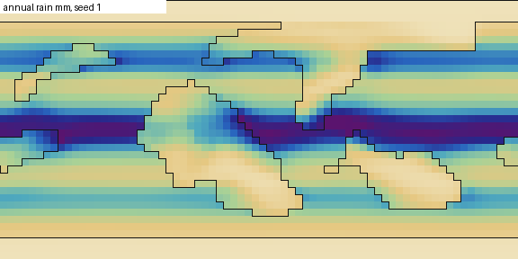
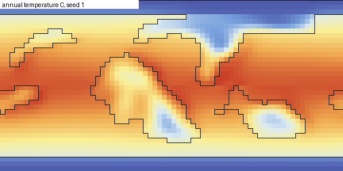
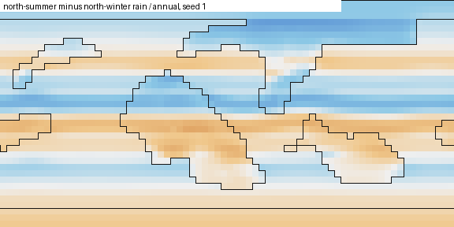
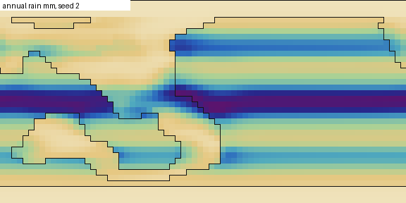
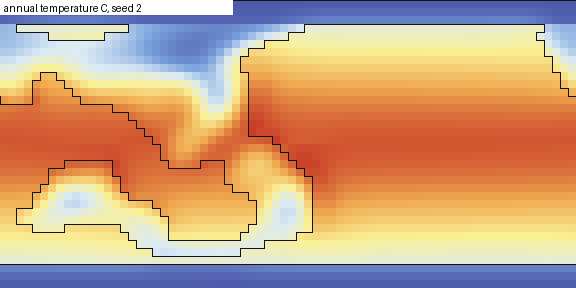
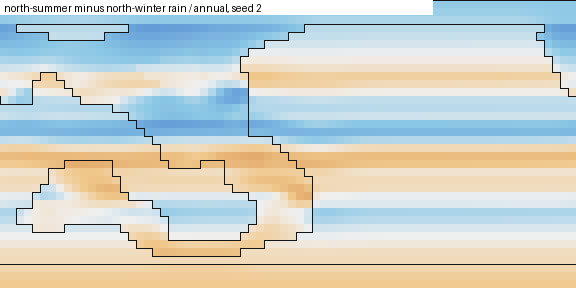
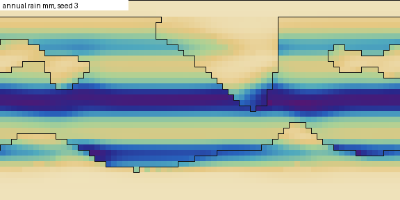
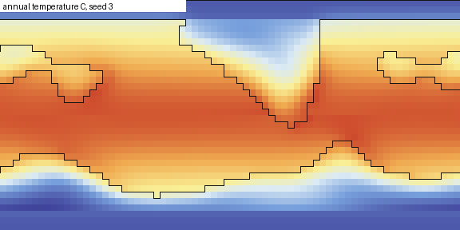
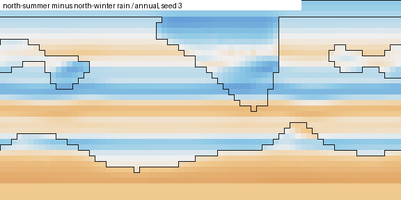

# Climate model report (globe/climate.py)

A headless, deterministic, numpy-only monthly climate for the invented planet (72 x 36 grid). It reuses `planet.py` (land, ice, the noise field) and `circulation.py` (the SST field with warm and cool currents). The reasoning, sources and confidence tags are in `research/WATER_AND_RAIN_REAL_WORLD.md`. Run it:

```
python3 globe/climate.py --seeds 1,2,3      # writes globe/climate_maps/*.png and prints a line per seed
python3 globe/test_climate.py               # 34 checks, about a minute
```

## Tests: 34 ok, 0 failed

| Group | What is checked | Result |
|---|---|---|
| Closure | global evaporation equals global rain to 0.1 percent (actual about 3e-8); land P = ET + Q + dS with storage change under 15 mm a year; no negative rain, evaporation or runoff | ok |
| Size sanity | scale factor f (how far the rain pattern had to be stretched to match evaporation) between 0.5 and 2; global rain 700 to 1400 mm | ok (f = 0.97 to 1.23 over 60 seeds, global rain 1130 to 1230 mm) |
| Belts, Earth spin and tilt | wet equator, dry subtropics, wet mid-latitudes on 6 of 6 seeds; driest zonal row 15 to 40 degrees from the equator in both hemispheres | ok (32.5 degrees both sides, seed 7) |
| Spin | Hadley edge wider when slower, narrower when faster; dry belt moves poleward when slow and equatorward when fast | ok (spin 0.5: edge 54, dry belt 57.5; spin 1: 30 and 32.5; spin 2: 18 and 17.5) |
| Tilt | no tilt: ITCZ does not move (0.0 degrees) and no seasons at 50 degrees; 23 degrees: range 14.5; 45 degrees: range 38.5 | ok |
| Mountains | on an invented test world with a 2800 m ridge across the westerlies, the windward side is over 1.3 times wetter than the lee side, the lee is drier than open sea at the same latitude, and removing the ridge shrinks the gap | ok |
| Seasons | tropical rain centroid is north in July and south in January; northern tropical land wetter in northern summer and southern tropical land in northern winter; mid-latitude sea wettest in the cool half | ok |
| Islands | every cool-latitude (48 to 64 degrees) coast cell on seed 7 gives annual rain 600 to 3600 mm, 60 to 320 rain days, mean temperature 2 to 17 C, freeze days under 120, fog days under 150, gale days under 120, ET no more than PET, and rain = ET + runoff within 30 mm | ok |
| Lens | Ghyben-Herzberg 41:1, thicker with width and recharge, narrower minimum width with more rain, 1 km island with 350 mm recharge and K 10 m/day gives 15 to 60 m | ok |
| Determinism | same inputs, same hash; 60 seeds all run, finite, closure under 0.1 percent every time | ok |

## Headline numbers (seed 1, Earth spin and tilt)

| Latitude | Zonal rain mm/yr | Ocean evaporation mm/yr (zonal, all cells) | Air temp C |
|---|---|---|---|
| 82 S | 19 | 0 | -20 |
| 52 S | 855 | 1021 | 10 |
| 22 S | 462 | 896 | 21 |
| 8 S | 2636 | 1769 | 24 |
| 8 N | 2924 | 1976 | 24 |
| 22 N | 576 | 1245 | 23 |
| 38 N | 616 | 1013 | 17 |
| 52 N | 1425 | 993 | 9 |
| 68 N | 217 | 501 | -1 |

The pattern is the Earth pattern: about 2600 to 2900 mm at the equator, 450 to 600 in the subtropics, 850 to 1400 at 50 degrees, little at the poles. Global rain 1145 mm (Earth about 1000). Land: P 570, ET 449, runoff 118 mm (Earth land about 750, 490, 300; the planet has big ice caps and dry interiors so land is drier).

Island sample (ocean cell at 50 N, 2100 m of invented hills nearby not included; sea cell values): 926 to 2130 mm a year depending on the cell, wettest three months start September, driest three start February to April, 0 to 60 freeze days, 6 to 30 fog days. Wet maritime cell at 52.5 N: 1590 mm, 225 rain days, ET 533, runoff 1060, recharge 356 mm, gale days about 30, fog 27, freeze 0.

## Maps (three seeds)

Each seed has annual rain (mm), annual temperature (C) and the wet-season shift (northern-summer rain minus northern-winter rain, divided by annual rain: blue means wetter in northern summer, orange wetter in northern winter).

| Seed | Rain | Temperature | Wet-season shift |
|---|---|---|---|
| 1 |  |  |  |
| 2 |  |  |  |
| 3 |  |  |  |

What the maps show. Rain is in bands (equator wet, subtropics dry, mid-latitudes wet), broken up by land: continental interiors and the lee sides of high ground are drier, windward coasts and mountains wetter. The shift map shows summer-wet tropical land and winter-wet mid-latitude ocean.

## What is solid, what is a toy, what is invented

Solid physics: insolation from tilt; Clausius-Clapeyron moisture; latent heat and the energy limit (global rain = global evaporation); Hadley edge gets narrower with faster spin; the ITCZ follows the warm surface and the sun; rain from rising air; rain shadow from sinking air; P = ET + Q + dS; Ghyben-Herzberg 40:1.

Toy (directions right, amounts within about a factor of 1.5 to 2, untested against data): the scaling exponent for spin (-0.7); Gaussian belt widths and heights; the marine moisture decay (3500 km); orographic efficiency (30 percent); wind fields; storm-track strength from the temperature drop; the SST anomaly factor; gale and fog formulas for islands; soil bucket numbers; the land temperature fit `27.5 - 38 sin^2(lat)`.

Invented: the planet, its mountains (made from the land noise), the SST field (it makes the island sea warm: about 13 C mean at 52 N, against about 9 to 10 C in the real North Atlantic), and everything about the continents.

Honest weak points: rain bands are too regular (no real eddies, no ENSO-type variability); the rain size is set by the global budget, so the model cannot say whether a different planet would be wetter overall (it cannot change the total); only one storm track per hemisphere (fast-spin planets would have more); no monsoon on small continents; no tropical cyclones; no stratocumulus decks; closure is by construction on the magnitude (the real check is that f stays near 1, and that evaporation was computed independently); an island is treated as a sea cell with a bucket, not as a 3D landform (no per-hill rain; use the research note's rain-by-altitude rule for that).

## What I could not verify

Page fetches to usgs.gov, metoffice.gov.uk and wikipedia.org were blocked in this session, so all sources in the research note are search summaries or textbook knowledge, tagged High/Medium/Low there. Not checked against real station data: any monthly or annual value of the model.
