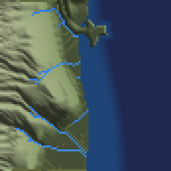
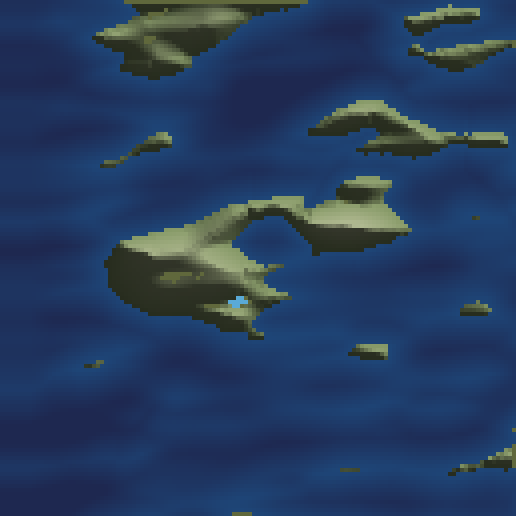
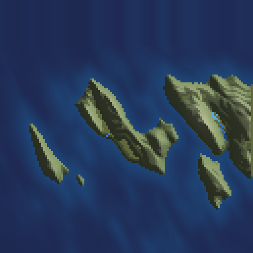
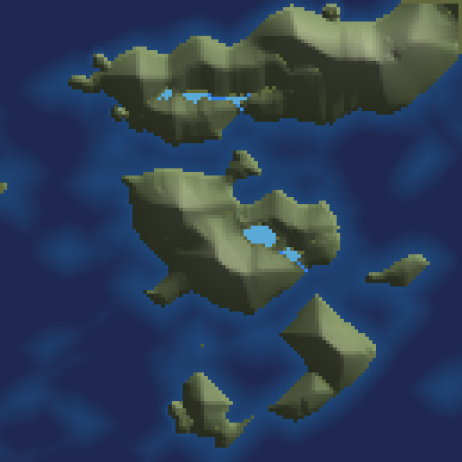

# Hydrology report (generated by landform/hydrology.py; do not edit by hand)

Method: Priority-Flood with epsilon, D8 receivers, accumulation, channel threshold 800 m2, runoff 0.7 of 2000 mm a year (TUNING), Strahler order from the receiver graph. Windows are the 12 exported worlds (256 m, 2 m cells; volcanic 258 m, 3 m cells). Maps in landform/hydrology_maps/. Legend of the ASCII maps: ~ sea, . : ^ land low/mid/high, O lake, 1..9 river by Strahler order, wet ground (high wetness index, flat).

## Table, all 12 exported windows

| seed | rock | land % | land cells draining out | river heads | max order | channel length m | mouths | steep-step cells | lakes | lake area m2 | biggest catchment m2 | its mean flow L/s | bankfull width m | no uphill (filled / dry land) | all reach sea or edge | secs |
|---|---|---|---|---|---|---|---|---|---|---|---|---|---|---|---|---|
| 153 | gneiss | 15 | 60 | 0 | 0 | 0 | 0 | 0 | 1 | 36 | 0 | 0.00 | 0.00 | yes | yes (1 sea, 0 edge) | 0.1 |
| 147 | gneiss | 20 | 102 | 1 | 1 | 8 | 1 | 1 | 1 | 20 | 884 | 0.04 | 0.04 | yes | yes (2 sea, 0 edge) | 0.1 |
| 62 | gneiss | 17 | 38 | 0 | 0 | 0 | 0 | 0 | 1 | 24 | 0 | 0.00 | 0.00 | yes | yes (1 sea, 0 edge) | 0.1 |
| 139 | sandstone | 18 | 47 | 2 | 1 | 19 | 2 | 2 | 1 | 32 | 1092 | 0.05 | 0.05 | yes | yes (3 sea, 0 edge) | 0.1 |
| 23 | sandstone | 17 | 82 | 0 | 0 | 0 | 0 | 0 | 1 | 28 | 0 | 0.00 | 0.00 | yes | yes (1 sea, 0 edge) | 0.1 |
| 174 | sandstone | 24 | 43 | 3 | 1 | 21 | 3 | 3 | 1 | 128 | 988 | 0.04 | 0.04 | yes | yes (4 sea, 0 edge) | 0.1 |
| 56 | basalt | 31 | 34 | 3 | 2 | 29 | 2 | 4 | 5 | 312 | 2144 | 0.10 | 0.07 | yes | yes (8 sea, 0 edge) | 0.1 |
| 99 | basalt | 18 | 69 | 0 | 0 | 0 | 0 | 0 | 0 | 0 | 0 | 0.00 | 0.00 | yes | n/a (no river or lake) | 0.1 |
| 106 | basalt | 26 | 9 | 1 | 1 | 33 | 1 | 1 | 2 | 92 | 2516 | 0.11 | 0.07 | yes | yes (3 sea, 0 edge) | 0.1 |
| 4 | volcanic | 51 | 174 | 12 | 2 | 545 | 6 | 55 | 0 | 0 | 7677 | 0.34 | 0.12 | yes | yes (12 sea, 0 edge) | 0.0 |
| 2 | volcanic | 51 | 183 | 7 | 2 | 361 | 5 | 26 | 6 | 387 | 10980 | 0.49 | 0.15 | yes | yes (12 sea, 1 edge) | 0.0 |
| 5 | volcanic | 65 | 233 | 8 | 2 | 459 | 5 | 50 | 2 | 387 | 5967 | 0.26 | 0.11 | yes | yes (5 sea, 5 edge) | 0.0 |

Reading: one window is about 6.6 ha. The largest mean flow in any window is about 0.5 L/s (half a litre a second: a trickle you can step over); the biggest catchments are one hectare or less. Steep-step cells are channel cells that drop 0.5 m or more at over 19 degrees (waterfall candidates, counted per cell, not per fall). These are rills and burns, not rivers. See the note, section 5, for the window size a real river needs.

## Flood test (rain pulse on the largest catchment of each world)

Pulse 10 mm/h for 30 min over a gaussian footprint (sigma 90 m) centred on the catchment, versus the same pulse 600 m away. Quick part 30 percent (travel time along the flow path, then a 10 min store), slow part 20 percent (6 h store). TUNING all.

| seed | catchment cells | peak Q L/s | time of peak after rain start min | back to half peak after min | peak with rain 600 m away L/s | volume out / in |
|---|---|---|---|---|---|---|
| 147 | 221 | 0.71 | 30 | 12 | 0.0000 | 1.000 |
| 139 | 273 | 0.88 | 30 | 11 | 0.0000 | 1.000 |
| 174 | 247 | 0.80 | 29 | 12 | 0.0000 | 1.000 |
| 56 | 536 | 1.66 | 29 | 12 | 0.0000 | 1.000 |
| 106 | 629 | 1.99 | 29 | 13 | 0.0000 | 1.000 |
| 4 | 853 | 5.58 | 31 | 15 | 0.0000 | 1.000 |
| 2 | 1220 | 7.61 | 30 | 14 | 0.0000 | 1.000 |
| 5 | 663 | 4.22 | 30 | 12 | 0.0000 | 1.000 |

## Maps (ASCII, 2 cells per column, 4 per row)

### seed 4 (volcanic, volcanic coast, gentle landing on the flank of a cone)



```
^^%^^^::%%%%%%%%%%..%%............~~~~~~~~~~~~~~~~~~~~~~~~~~~~~~~
^^^^^^:::::::::::...1.%.%.........~~~~~~~~~~~~~~~~~~~~~~~~~~~~~~~
^^^^^^:::::::1111111.11.%%........~~~~~~~~~~~~~~~~~~~~~~~~~~~~~~~
^^^^^^::::::1:::::....%1..........~~~~~~~~~~~~~~~~~~~~~~~~~~~~~~~
^^^^^^:::::::::::::....12...........~~~~~~~~~~~~~~~~~~~~~~~~~~~~~
^^^^^^^^:::::::::::...1..22..............~~~~~~~~~~~~~~~~~~~~~~~~
^^^^^^^^::::::::::::...%%%222......%......~~~~~~~~~~~~~~~~~~~~~~~
^^^^^^^^^^::::::::::......%%12~~~......~~~~~~~~~~~~~~~~~~~~~~~~~~
^^^^^^^^^^^:::::::::...%%%..%%~~~~~..~~~~~~~~~~~~~~~~~~~~~~~~~~~~
^^^^^^^^^^^::::::::::.....%%..~~~~~.~~~~~~~~~~~~~~~~~~~~~~~~~~~~~
^^^^^^^^^^^::::::::::...%%.....~~~~~~~~~~~~~~~~~~~~~~~~~~~~~~~~~~
^^^^^^^^^^::::::::::::...%.....~~~~~~~~~~~~~~~~~~~~~~~~~~~~~~~~~~
^^^^^^^^^::::::::::::2222222222~~~~~~~~~~~~~~~~~~~~~~~~~~~~~~~~~~
^^^^^^^^^:::::::::122::........~~~~~~~~~~~~~~~~~~~~~~~~~~~~~~~~~~
^^^^^^^:::::::11122:::::...%%%.~~~~~~~~~~~~~~~~~~~~~~~~~~~~~~~~~~
^^^^^^^::::111222::::::::....11~~~~~~~~~~~~~~~~~~~~~~~~~~~~~~~~~~
^^^^^^^:::::::1:::::::::::...%%.~~~~~~~~~~~~~~~~~~~~~~~~~~~~~~~~~
^^^^^^:::::::::::::::::::::......~~~~~~~~~~~~~~~~~~~~~~~~~~~~~~~~
^^^^^^::::::::::::::::::::::.....~~~~~~~~~~~~~~~~~~~~~~~~~~~~~~~~
^^^^^:::::::::::::::::::::::.....~~~~~~~~~~~~~~~~~~~~~~~~~~~~~~~~
^^^::::::::1::::::::::::::::...%%~~~~~~~~~~~~~~~~~~~~~~~~~~~~~~~~
^^^^^::::::1111:::::::::::......11~~~~~~~~~~~~~~~~~~~~~~~~~~~~~~~
^^^:::::::::1112::::::::......%11.~~~~~~~~~~~~~~~~~~~~~~~~~~~~~~~
::::::::::::::::222:........111...~~~~~~~~~~~~~~~~~~~~~~~~~~~~~~~
::::::::::::::::::.22.....%%......~~~~~~~~~~~~~~~~~~~~~~~~~~~~~~~
::::::1111:::::::....22222%.......~~~~~~~~~~~~~~~~~~~~~~~~~~~~~~~
::::::::::11::::..........22%%.%%.~~~~~~~~~~~~~~~~~~~~~~~~~~~~~~~
^::::::::::1222.............22%%%.~~~~~~~~~~~~~~~~~~~~~~~~~~~~~~~
^^::::::::::::22222222%.%....222%.~~~~~~~~~~~~~~~~~~~~~~~~~~~~~~~
^^::::::::::::........22222222222%~~~~~~~~~~~~~~~~~~~~~~~~~~~~~~~
^^::::::::::::..................2~~~~~~~~~~~~~~~~~~~~~~~~~~~~~~~~
^::::::::::::...%%%%.............~~~~~~~~~~~~~~~~~~~~~~~~~~~~~~~~
:::::%%%%%%%%%%%..%%%%%%%%%%%%%%%~~~~~~~~~~~~~~~~~~~~~~~~~~~~~~~~
```

### seed 153 (gneiss, archipelago, start island 154 m)



```
~~~~~~~~~~~~~~~~%%%%%%%%%%%%%%%%%%%%%%%~~~~~~~~~~~~~~~~......~~~~
~~~~~~~~~~~~~~~....%%:::::^:::....~~~~~~~~~~~~~~~~~.::::.....~~~~
~~~~~~~~~~~~..::::%%::::::::..~~~~~~~~~~~~~~~~~~~~~....~~~~~~...%
~~~~~~~~~~~~~....::::::.....~~~~~~~~~~~~~~~~~~~~~~~.............%
~~~~~~~~~~~~~~~..:::::...~~~~~~~~~~~~~~~~~~~~~~~~~~~~~.......~~~~
~~~~~~~~~~~~~~~~~~~..~~~~~~~~~~~~~~~~~~~~~~~~~~~~~~~~~~~~~~~~~~~~
~~~~~~~~~~~~~~~~~~~~~~~~~~~~~~~~~~~~~~~~~~~~..:..~~~~~~~~~~~~~~~~
~~~~~~~~~~~~~~~~~~~~~~~~~~~~~~~~~~~~~~~~..::::::.....~~~~~~~~~~~~
~~~~~~~~~~~~~~~~~~~...~~~~~~~~~~~~~~~~~..::.......::::..........~
~~~~~~~~~~~~~~~~......~~~~~~~~~~~~~~~~~~~~~~~....:::::..........~
~~~~~~~~~~~~~....~~~~~~~~~~~~~~~~~~~~~~~~~~~~~~~~~~~.~~~~~~~~~~~~
~~~~~~~~~~~~~~~~~~~~~~~~~~~~~~~~~~~~~~~~~~~.......~~~~~~~~~~~~~~~
~~~~~~~~~~~~~~~~~~~~~~~~~~~~~~~~~~.....~~~..::::..~~~~~~~~~~~~~~~
~~~~~~~~~~~~~~~~~~~~~~~~~~~...:::::::...:::%::::..~~~~~~~~~~~~~~~
~~~~~~~~~~~~~~~~~~~~~.....:::::...~~..:^^^^^^^^^::..~~~~~~~..~~~~
~~~~~~~~~~~~~~~.:::::::::::::..~~~~~~~.::::::::::...~~~~~~~~~~~~~
~~~~~~~~~~~~~..::^^^^^^^^^^:::...~~~~~~.......~~~~~~~~~~~~~~~~~~~
~~~~~~~~~~~~~..:::^^%%%%%%^^^^::....~~~~~~~~~~~~~~~~~~~~~~~~~~~~~
~~~~~~~~~~~~~~..:::^^^%^^^^^::::.....~~~~~~~~~~~~~~~~~~~~~~~~~~~~
~~~~~~~~~~~~~~~...::::::::%%:OOO.....~~~~~~~~~~~~~~~~~~~~~....~~~
~~~~~~~~~~~~~~~~~~~........::::..~~~~~~~~~~~~~~~~~~~~~~~~~....~~~
~~~~~~~~~~~~~~~~~~~~~~~~~~~~......~~~~~~~~~~~~~~~~~~~~~~~~~~~~~~~
~~~~~~~~~~~~~~~~~~~~~~~~~~~~~~~~~~~~~~~~~~~~.....~~~~~~~~~~~~~~~~
~~~~~~~~~~~...~~~~~~~~~~~~~~~~~~~~~~~~~~~~~~~....~~~~~~~~~~~~~~~~
~~~~~~~~~~~~~~~~~~~~~~~~~~~~~~~~~~~~~~~~~~~~~~~~~~~~~~~~~~~~~~~~~
~~~~~~~~~~~~~~~~~~~~~~~~~~~~~~~~~~~~~~~~~~~~~~~~~~~~~~~~~~~~~~~~~
~~~~~~~~~~~~~~~~~~~~~~~~~~~~~~~~~~~~~~~~~~~~~~~~~~~~~~~~~~~~~~~~~
~~~~~~~~~~~~~~~~~~~~~~~~~~~~~~~~~~~~~~~~~~~~~~~~~~~~~~~~~~~~~~~~%
~~~~~~~~~~~~~~~~~~~~~~~~~~~~~~~~~~~~~~~~~~~~~~~~~~~~~~~~~~~~~~~.%
~~~~~~~~~~~~~~~~~~~~~~~~~~~~~~~~~~~~~~~~~~~~~~~~~~~~~~~~~~.....:%
~~~~~~~~~~~~~~~~~~~~~~~~~~~~~~~~~~~~~~~~~~~...~~~~~~~~~~....~~~.~
~~~~~~~~~~~~~~~~~~~~~~~~~~~~~~~~~~~~~~~~~~~~~~~~~~~~~~~~~~~~~~~~~
~~~~~~~~~~~~~~~~~~~~~~~~~~~~~%%%~~~~~~~~~~~~~~~~~~~~~~~~~~~~~~~~~
```

### seed 139 (sandstone, plain, start island 106 m)



```
~~~~~~~~~~~~~~~~~~~~~~~~~~~~~~~~~~~~~~~~~~~~~~~~~~~~~~~~~~~~~~~~~
~~~~~~~~~~~~~~~~~~~~~~~~~~~~~~~~~~~~~~~~~~~~~~~~~~~~~~~~~~~~~~~~~
~~~~~~~~~~~~~~~~~~~~~~~~~~~~~~~~~~~~~~~~~~~~~~~~~~~~~~~~~~~~~~~~~
~~~~~~~~~~~~~~~~~~~~~~~~~~~~~~~~~~~~~~~~~~~~~~~~~~~~~~~~~~~~~~~~~
~~~~~~~~~~~~~~~~~~~~~~~~~~~~~~~~~~~~~~~~~~~~~~~~~~~~~~~~~~~~~~~~~
~~~~~~~~~~~~~~~~~~~~~~~~~~~~~~~~~~~~~~~~~~~~~~~~~~~~~~~~~~~~~~~~~
~~~~~~~~~~~~~~~~~~~~~~~~~~~~~~~~~~~~~~~~~~~~~~~~~~~~~~~~~~~~~~~~~
~~~~~~~~~~~~~~~~~~~~~~~~~~~~~~~~~~~~~~~~~~~~~~~~~~~~~~~~~~~~~~~~~
~~~~~~~~~~~~~~~~~~~~~~~~~~~~~~~~~~~~~~~~~~~~~~~~~~~~~~~~~~~~~~~~~
~~~~~~~~~~~~~~~~~~~~~~~~~~~~~~~~~~~~~~~~~~~.~~~~~~~~~~..~~~.~~~~~
~~~~~~~~~~~~~~~~~~~~~~~.:.~~~~~~~~~~~~~~~~..........~..::..%...~~
~~~~~~~~~~~~~~~~~~~~~~..::..~~~~~~~~~~~~~~..:::::::::..:::::::..%
~~~~~~~~~~~~~~~~~~~~~..%:::::.~~~~~~~~~~~~..:::%%^:%%:::::::::::%
~~~~~~~~~~~~~~~~~~~...:%%::^^^:.~~~~~~~~~~~..::%%^^^%::::::^^^^:%
~~~~~~~~~~~~~~~~~~~~.:^^:%::^^^..~~~~~~~~~~~..:^%^^^^:O%:::^^^%^%
~~~~~~~~~~~~~~~~~~~~~.:^^%%::^^:..~~~~~~~.~~~~..:^^^^^OOO:::^^^^%
~~~~~~~~..~~~~~~~~~~~~.:::%%:::%:..~~~~..%.%.~~~.:^^^^^%11.::^^^%
~~~~~~~~.::.~~~~~~~~~~~~..%11%:::::....::.%...~~~~.:^^^:.1..::^^%
~~~~~~~~.:::.~~~~~~~~~~~~~~....%%.:::.%::::...~~~~~..::::...:::%%
~~~~~~~~~.:::.~~~~~~~~~~~~~~~~..%%%%%:::::..~~~~~~~~~..::...::%%%
~~~~~~~~~..:::..~~~~~~~~~~~~~~~..%%%.::::..~~~~~~~~......~~..:::%
~~~~~~~~~~.::::...~~~~~~~~~~~~~~~~....:::..~~~~~~~~.::...~~~..::%
~~~~~~~~~~~.:::...~~~~~~~~~~~~~~~~~~~~.....~~~~~~~~.::::.~~~~...%
~~~~~~~~~~~~..:..~~~..~~~~~~~~~~~~~~~~~~~~~~~~~~~~~..::::.~~~~~.%
~~~~~~~~~~~~~~~.~~~~..~~~~~~~~~~~~~~~~~~~~~~~~~~~~~~..:^::.~~~~~~
~~~~~~~~~~~~~~~~~~~~~~~~~~~~~~~~~~~~~~~~~~~~~~~~~~~~~.::::..~~~~~
~~~~~~~~~~~~~~~~~~~~~~~~~~~~~~~~~~~~~~~~~~~~~~~~~~~~~..:..~~~~~~~
~~~~~~~~~~~~~~~~~~~~~~~~~~~~~~~~~~~~~~~~~~~~~~~~~~~~~~~..~~~~~~~~
~~~~~~~~~~~~~~~~~~~~~~~~~~~~~~~~~~~~~~~~~~~~~~~~~~~~~~~~~~~~~~~~~
~~~~~~~~~~~~~~~~~~~~~~~~~~~~~~~~~~~~~~~~~~~~~~~~~~~~~~~~~~~~~~~~~
~~~~~~~~~~~~~~~~~~~~~~~~~~~~~~~~~~~~~~~~~~~~~~~~~~~~~~~~~~~~~~~~~
~~~~~~~~~~~~~~~~~~~~~~~~~~~~~~~~~~~~~~~~~~~~~~~~~~~~~~~~~~~~~~~~~
~~~~~~~~~~~~~~~~~~~~~~~~~~~~~~~~~~~~~~~~~~~~~~~~~~~~~~~~~~~~~~~~~
```

### seed 56 (basalt, stepped plateaus, start island 122 m)



```
~~~~~~~~~~~~~~~~~~~~~~~~~~~~~~~~~~~~~~~~...~~...~~~~~~~.%%%%%%%%%
~~~~~~~~~~~~~~~~~~~~~~~~~~~~~~~~~~~~~..:::::..%........:::::::%%%
~~~~~~~~~~~~~~~~~~~~~~~~~~~...~~~~~..:::^^^^^::::::::::^^^^^::::%
~~~~~~~~~~~~~~~~~~.....~....::......::::^^^^^^^^^^^^^^^^^^^^^::.%
~~~~~~~~~~~~~.....::::...::::::::::::::%%:^^^^^^^^^^^^^^^^^:::...
~~~~~~~~~~......:::^:::::::::::::::::::::::^%^^^^^^^^^^^^:::...~~
~~~~~~~~~~.......:::::%OO%OOOO::%%%1%%%::::::::::::::^::::...~~~~
~~~~~~~~~~~~~~~~...::%OO::OOOO11OOO...::.:::::::::...::....~~~~~~
~~~~~~~~~~~~~~~~..%..::::::::::...................~~~...~~~~~~~~~
~~~~~~~~~~~~~~~~~~..............~~~~~~~~~~~~~~~~~~~~~~~~~~~~~~~~~
~~~~~~~~~~~~~~~~~~~~~~~......~~~~..~~~~~~~~~~~~~~~~~~~~~~~~~~~~~~
~~~~~~~~~~~~~~~~~~~~~~~~~~~~~~~~.....~~~~~~~~~~~~~~~~~~~~~~~~~~~~
~~~~~~~~~~~~~~~~~....................~~~~~~~~~~~~~~~~~~~~~~~~~~~~
%.~~~~~~~~~~~~~~~....::::::::.....~~~~..~~~~~~~~~~~~~~~~~~~~~~~~~
~~~~~~~~~~~~~~~~~~..:::^^^^^::::...............~~~~~~~~~~~~~~~~~~
~~~~~~~~~~~~~~~~~~~.:::^^^^^:::.%....:::::......~~~~~~~~~~~~~~~~~
~~~~~~~~~~~~~~~~~~~...::::::::::::OOOOO:::::::..~~~~~~~~~~~~~~~~~
~~~~~~~~~~~~~~~~~~~~...::::::^^^::%OOOO%O%::%:..~~~~~~~~~~~~~~~~~
~~~~~~~~~~~~~~~~~~~~~~...:::^^^^^^:::::1OOO.....~~~~~~~......~~~~
~~~~~~~~~~~~~~~~~~~~~~~...:::^^^^^^^^::::.11~~~~~~~.........~~~~~
~~~~~~~~~~~~~~~~~~~~........:::::::::::...~~~~~~~~~.......~~~~~~~
~~~~~~~~~~~~~~~~~~~~~.....~~....::::....~~~....~~~~~~~~~~~~~~~~~~
~~~~~~~~~~~~~~~~~~~~~~~~~~~~~~~~.....~~~~~..::..~~~~~~~~~~~~~~~~~
~~~~~~~~~~~~~~~~~~~~~~~~~~~~~~~~~~~~~~~~...:::::...~~~~~~~~~~~~~~
~~~~~~~~~~~~~~~~~~~~~~~~~~~~.~~~~~~~~~~...::::::::...~~~~~~~~~~~~
~~~~~~~~~~~~~~~~~~~~~~~~~~~~~~~~~~~~~~~~~...:::::::..~~~~~~~~~~~~
~~~~~~~~~~~~~~~~~~~~~~~~~~~..~~~~~~~~~~~~~~...::::..~~~~~~~~~~~~~
~~~~~~~~~~~~~~~~~~~~~~~~~~.....~~~~~~~~~~....%%....~~~~~~~~~~~~~~
~~~~~~~~~~~~~~~~~~~~~~~~...:::...~~~~~~...:::...~~~~~~~~~~~~~~~~~
~~~~~~~~~~~~~~~~~~~~~~~~.%%:::...~~.~~........~~~~~~~~~~~~~~~~~~~
~~~~~~~~~~~~~~~~~~~~~~~~~.%%..%.....~~~~~.~~~~~~~~~~~~~~~~~~~~~~~
~~~~~~~~~~~~~~~~~~~~~~~~~~~~......~~~~~~~~~~~~~~~~~~~~~~~~~~~~~~~
~~~~~~~~~~~~~~~~~~~~~~~~~~~~~~~~~~~~~~~~~~~~~~~~~~~~~~~~~~~~~~~~~
```

All 12 PNG maps: hydrology_maps/seedNNNN.png (blue lines = rivers by order, cyan = lakes, olive = wet flat ground).

## Scale demo (INVENTED terrain, not from the landform tool)

Synthetic islands (a radial cone and a horseshoe with one gap, each grown by stream-power erosion), peak 300 m before erosion, to see what a bigger island yields and what the headless pass costs here (numpy plus a python heap, one thread). Mean rain 2000 mm, runoff 0.7.

| terrain | grid | cell m | side km | pass time s | river heads | max Strahler | channel km | mouths | biggest catchment km2 | its mean flow m3/s | bankfull width m |
|---|---|---|---|---|---|---|---|---|---|---|---|
| radial cone, eroded | 192 x 192 | 40 | 7.7 | 0.2 | 164 | 3 | 117 | 90 | 2.42 | 0.11 | 2.2 |
| horseshoe (one gap), eroded | 192 x 192 | 40 | 7.7 | 0.1 | 142 | 4 | 86 | 41 | 19.48 | 0.86 | 6.2 |
| horseshoe (one gap), eroded | 256 x 256 | 40 | 10.2 | 0.3 | 329 | 5 | 157 | 125 | 35.85 | 1.59 | 8.5 |

(The terrain is first grown by 60 steps of stream-power erosion, about 8 to 15 s each here; "pass time" is the hydrology analysis alone.) Map of the 192 x 192 horseshoe: hydrology_maps/invented_horseshoe.png.

Flood on the horseshoe, biggest catchment 12178 cells = 19.5 km2: uniform storm 6 mm/h for 3 h (quick store 3 h, slow store 48 h, hillslope 0.08 m/s, channel 0.8 m/s; TUNING): peak 5.53 m3/s (mean flow 0.86, so 6.4x), peak 4.7 h after the storm began, back to half peak 3.2 h after the peak, volume out / in 0.966.

Channel threshold in the demo is 0.04 km2 (4 ha), a mid value for wet cool ground (TUNING). Island sizes here are the point: only the horseshoe, one big catchment of about 20 km2, makes a stream wide enough (6 m bankfull) to read as a river.
