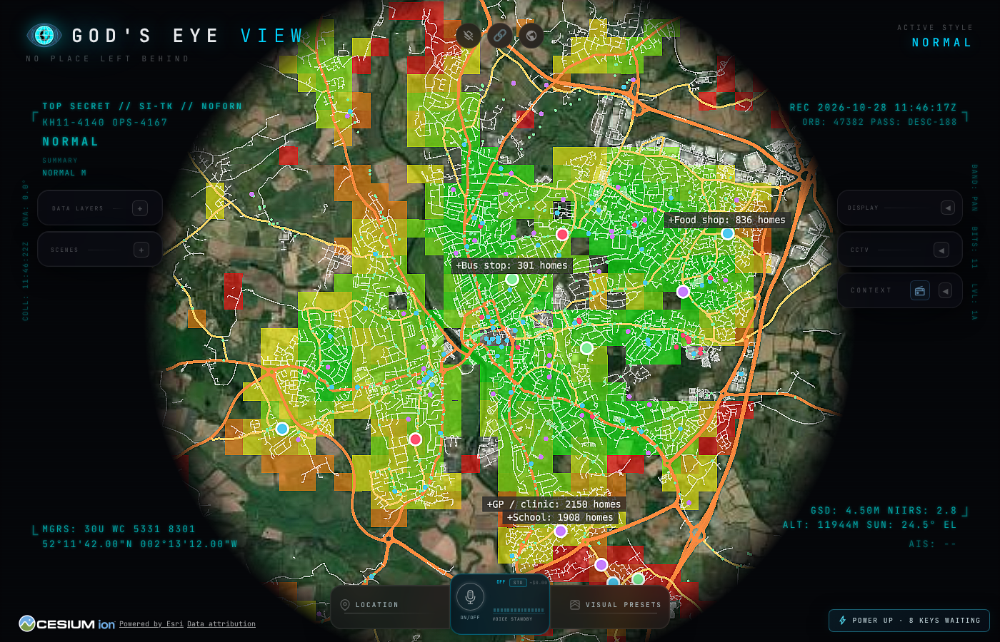
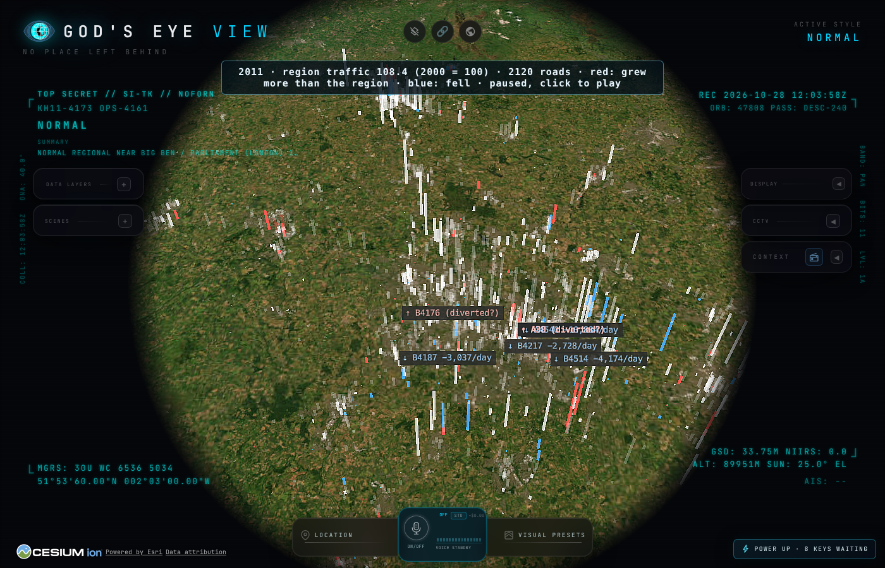

# Planner co-design log

House rule: for every idea Harry adds, the AI working on it adds one of its
own. It can be something different, as long as it makes the town
easier to understand or nicer to live in.

## Built

| Who | Idea | Where |
|---|---|---|
| Harry | Map the hometown (Worcester) on the globe: roads, homes, shops, schools, GPs, bus stops | `osm.js`, `layer.js` |
| Harry | Show where living there is hard: walking time to everyday services, scored per neighbourhood | `access.js` |
| CAIRN | **Severance / detour ratio**: how much further you walk than the straight line. High values point to places a river, railway or big road cuts off, where a footbridge or crossing would help most | `access.js` (`detour`, `mostSeveredCells`) |
| Harry | Suggest where shops (and schools, GPs, bus stops) should go | `sites.js`, drawn as labelled markers |
| CAIRN | **"What if" without editing**: score the town with proposed roads or shops added on top | `analyseAccess(..., { extraRoads, extraPlaces })` |
| CAIRN | **Best single change**: re-score the whole town for every suggested site and name the one change that lifts it most | `rankChanges` in `sites.js`, `bestSingleChange` in `summary.json` |
| Harry | See the Midlands as one organism: how traffic has grown, shifted and been diverted over the years | `traffic.js`, `trafficLayer.js` (time-lapse 2000–2025) |
| CAIRN | **Diversion detector**: a road whose real counted traffic fell sharply while a nearby road's rose over the same years, beyond the regional trend. It finds roadworks and new roads from their fingerprint | `findDiversions` in `traffic.js` |
| Harry | Make it about human happiness and health; see how people move (walking, cycling, commuting) | `census.js` (Census 2021 households and travel to work), cycling time-lapse |
| Harry | Every answer should raise new questions that unlock more of the map | `questions.json` + **?**/**✓** markers on the layer |
| CAIRN | **Questions as curriculum**: open questions carry the data that would answer them, so any AI (or PatchTown resident) can pick one up as its next task | "The question loop" in AGENTS.md |
| CAIRN | **Need-weighted sites**: rank where a service should go by the need of the households it would reach (bad health, over-65s, deprivation, no car), not just how many | `attachNeed` in `census.js`, `suggestSites(..., { byNeed: true })` |
| CAIRN | **Best new footbridge**: try short links across the river away from existing crossings and keep the one that saves the most walking time | `bestNewCrossing` in `river.js` |
| CAIRN | **Bus or walk**: door-to-door time by bus (walk to stop, average wait from the real timetable, ride, walk) vs walking, per household | `buses.js`, `scripts/planner-gtfs.py` |
| Harry | Corner shops, County Hall, empty shops and New Worcester all help each other | `food` command (FSA register), empty shops on the map, `scenarios.js` |
| CAIRN | **Scenario scorecard with "who gains"**: every scenario says which households get closer to what, by how much, and how many have no car | `compareScenarios` / `gains` in `scenarios.js`, `npm run planner -- scenarios` |
| Harry | Build it as a set of tools that work together to answer bigger questions, not scripts for specific ones | `model.js` + `tools.js` + `ask` plans |
| CAIRN | **Plans as data**: a question is a JSON list of tool calls, saved with its result, so anyone (or any AI) can re-run, check or extend the reasoning | `public/planner/<town>/plans/` |
| Harry | Map first, ask questions later | `atlas.js` + `atlas` command, theme panel, deprivation / crime / collisions / schools / prices / planning layers |
| CAIRN | **Atlas by compass**: every layer, mapped or wanted, sorted by what it says about a good day, so the gaps are visible and anyone can fill one | `src/planner/atlas.js` |
| CAIRN | **Census-weighted homes**: OSM says where buildings are, the census says how many households live in each neighbourhood. Sharing one over the other makes every score count real households | `attachCensus` in `census.js` |

> Current figures live in NEW_WORCESTER.md; the sections below are the log as it happened.

## Correction: official GP practices (28 Oct 2026)

Checking OpenStreetMap's GP surgeries against the NHS list showed it **missed
three practices** (including Severn Valley Medical Practice, 21,893 patients,
on the west bank), misplaced St Johns House by ~700 m, and **counted hospital
departments as GPs** (A&E, oncology, diabetes centre and others at
Worcestershire Royal). `npm run planner -- gps` now loads the 9 official
practices (list size, GP Patient Survey, location) and they replace OSM's.

What changed: GP within 15 min 42% (was 46%); the west/east river gap is 26 vs
20.5 min (was 31 vs 16); Lower Wick 27 min (was 38); the Malvern Road health
hub idea is **withdrawn** (a large practice is already there). The real gap is
**St Peters** (41 min around Foxglove Road), where every suggested site now
lands. What held: GP distance still shows no link to health (t = 0.8).
Figures below this section are from before the correction unless stated.

## First questions answered by plans alone (28 Oct 2026)

**Who finds everyday life hardest to reach, and are they the people who need it most?** (`plans/everyday-access-and-need.json`, 17 steps, 2 s)
- Everyday minutes = bus-or-walk to a GP + walk to food + walk to a school, per neighbourhood.
- **Need goes with *shorter* distances** (t = −4.7): Worcester's most deprived, least healthy, car-less neighbourhoods are closer to everyday services, not further. Car-less households are nearer even after age and deprivation (t = −2.3); their average GP trip is 14 min vs 18.6 for all.
- Hardest to reach in the city: St Peters (014A–C, Arran Place), Henwick (006C, Cecilia Place), Perdiswell (001B, St Anne's Road), Warndon Villages (003C Rye Place, 008C Collings Avenue), Lower Wick (012E). Mostly newer, better-off suburbs.
- GP by bus or walking: west bank 21 min, east 17.

**Do takeaways go with bad health once deprivation and age are allowed for?** (`plans/takeaways-and-health.json`)
- No (t = −1.5); deprivation (t = 21) and age (t = 4.8) explain 86%.
- Corner shops follow car-less households (t = 6.9) and, with cars allowed for, *not* deprivation (t = −3.4). It's about cars.

## High streets, County Hall and the first scenarios (28 Oct 2026)

- **Food businesses** (Food Standards Agency, 546 in Worcester; 111 small food shops vs 30 in OSM). Outside the city centre, small food shops are ~3.5x as common in the most deprived third (2.4 vs 0.7 per 1,000 households) and follow car-less households most closely (r = 0.36). **Takeaways show no link with deprivation** (r = 0.02).
- **Empty shops:** 35 mapped in OSM, ~27 in the city centre (incl. the former Debenhams); a closed Costcutter on Ambleside Drive, Warndon.
- **Scenarios** (all vs Worcester today, official GPs):

| Scenario | Town score | Who gains |
|---|---|---|
| St Peters GP (Bath Road) | +1.7 | 7,877 households save ~19 min to a GP (744 without a car) |
| County Hall homes + health hub | +1.2 | 6,620 save ~10 min to a GP; the 600 new homes are 0.7 min from it |
| County Hall health hub | +0.8 | 6,620 households save ~10 min to a GP (607 without a car) |
| County Hall homes (600, illustrative) | +0.1 | New residents would be ~30 min from a GP |
| Reopen Ambleside Drive shop | +0.0 | 289 households save ~1.4 min to a shop (71 without a car) |

## First real run: Worcester (OpenStreetMap, 28 Oct 2026)

- First pass: 26,086 mapped homes, overall score 71/100.
- **With Census 2021 weights: 54,807 households** (of 55,909 in the 78 neighbourhoods). Overall score **70/100**. Within the walking target: food shop 79%, school 76%, **GP 46%**, bus stop 77%.
- How Worcester gets to work (Census 2021, of those who travel): **car 78%**, walk 13%, cycle 3%, bus 2%, train 1%. 29% work mainly from home.
- Worst served: the southern edge (Kempsey Road / Norton, around Pear Tree Drive and Church Lane) and Whittington (Gilmour Drive).
- Most cut off: Lyppard Grange in the Warndon Villages. Its winding cul-de-sacs make walks 2–2.6× the straight line.
- Best single change: a GP near Norton Road, St Peters (+3,899 households within 15 min with census weights; town 69.6 → 71.4).
- Biggest food-shop gap: Plantation Drive, Lyppard Grange (+836 homes).

## Health check: does a far GP mean worse health? (28 Oct 2026)

64 neighbourhoods inside Worcester city. Census 2021 general health, age,
deprivation and disability, compared with each neighbourhood's
household-weighted walk to the nearest GP.

- **No sign that GP walking distance affects health.** After allowing for age and deprivation, an extra minute's walk shows −0.014 points of "bad health" (t = −1.1, i.e. nothing). Disability is the same (t = −1.3).
- **Deprivation explains almost everything.** Bad health vs share of deprived households: r = 0.91. With age added, the model explains 87% of the differences.
- **The far-from-GP areas are better off and older.** GP walk vs deprivation r = −0.33; vs over-65s r = +0.53. These are suburbs where most people drive.
- **The Norton Road GP (best single change) would mostly help healthier, less deprived households:** ~3,200 in St Peters/Norton (Worcester 013A, 014A–D), bad health 2–5% vs 4.8% city average. Some of them are older (24–26% over 65 in 014A and 014D).
- **Worst health is in deprived neighbourhoods 7–18 min from a GP:** Worcester 002D (Selsey Close, 11.3% bad health, 41% deprived), 002B (Windermere Drive), 009A (Dines Green), 005B (Cherwell Close).
- **A different, real gap: older people far from a GP.** Worcester 012E (Lower Wick, Montreal Close) and 012D (St Peters, Cormorant Rise): 34–35% over 65 and a 35–38 min walk.

Limits: self-reported health, one point in time, 64 areas; distance is not
GP capacity (patients per GP is the next data to add, from NHS Digital); and
most people don't walk to their GP. A finding to discuss, not a verdict.

**Follow-ups (question loop):**
- Lower Wick (q5): 15% of households have no car (city 20%), so roughly 1 in 7 relies on a 38-minute walk or the bus. Next: how often buses run (q7).
- Ranked by need (q6), the best GP site moves from Norton Road (St Peters) to **Malvern Road, St John's (WR2)**, then Henwick, west of the Severn. Next: is the west side cut off by the river (q8)?
- Corner shops (q9): the most deprived third of neighbourhoods has ~1.7x the convenience shops per household. The likelier reason is car ownership (33% no car vs 11%), not money as such. Weak signal, thin OSM data.
- **River (q8):** the Severn splits Worcester into a west bank (14,303 households) and an east bank (40,301), with 6 walkable crossings and 2 for cars. West-bank households walk **31 min** to a GP on average vs 16 min on the east; for 37% the nearest GP is across the river. The best new footbridge found (Church Lane, WR2) saves under a minute per household. A GP at Malvern Road (west bank) cuts the west's average to **24 min**; one at Norton Road barely moves it. **The gap is services on the west bank, not crossings.** Next: could a west-bank health hub work there (q14)?
- **Buses (q7):** Tuesday 3 Nov 2026 timetable, 506 stops, 2,029 trips. 54% of Worcester households have a stop with 4+ buses an hour within 5 min. Lower Wick (012E): only 11%; a GP trip is 38 min walking, ~30 by bus. **With a GP at Malvern Road, Lower Wick walks it in ~16 min**, quicker than any bus today. Busiest stop: The Cross, 53 buses an hour.

## Midlands traffic, 2000–2025 (DfT, 4,513 count points)

- Regional traffic index (2000 = 100): 117 in 2019, **88 in 2020** (lockdown), back to 101 in 2021 and a record **119.5 in 2025**.
- Biggest detected diversion: 2010→2011 in Birmingham, the A4540 lost ~10,900 vehicles/day while the A38 0.4 km away gained ~19,000.
- Others: A453 → A4540 in Birmingham 2011–13 (~7,800/day), A5035 → A500 in Stoke-on-Trent 2006–08 (~3,600/day).
- Cycling (DfT cyclist counts, 2000 = 100): fell to ~66–70 in the mid-2000s, back to 110 in 2019, **peaked at 129 in 2020** (lockdown), and settled around 98 by 2025.
- These are leads to check against what was happening on the ground (roadworks, new junctions, closures), not proof.

## Survey, checked fairly (29 Oct 2026)

- **Harry:** re-run the survey per resident + worker, to split real links from the city-centre distortion.
- **CAIRN adds:** a daytime population (residents + jobs) on every area, `count` per daytime population, and `survey` with `exclude`, so any AI can repeat the check. Next: split crime against people from shop crime (q31).
- Result: the corner shop / pub / takeaway / crime links (~0.9) were the centre's few residents. Surviving: crime with car-less households and deprivation; bad health with deprivation, income and violence.

## Migration in the whole picture (29 Oct 2026)

- **Harry:** see how immigration, including the small boats, fits with everything else, without making it the only thing.
- **CAIRN adds:** migration counted per neighbourhood from the census (never per person), Home Office asylum support per council since 2014, and a plan that controls for car-less households and deprivation, so the link isn't read off a raw correlation. Next: what helps newcomers settle (q33) and where Worcester's growth comes from (q34).

## Data plan, wave 1 (29 Oct 2026)

- **Harry:** a stronger plan: find every free source before going further; then yes to wave 1.
- **CAIRN adds:** one stats-file shape for every per-area source (`stats.js`) and a `stats` command with a function per source (`scripts/planner-sources.mjs`), so a new dataset is one function and reaches every tool. Wave 1: 12 sources in one run. Next: wave 2, and a closer look at Warndon (q35) and what Dines Green does right (q36).

## Next

0. **GP capacity.** NHS Digital patients-registered-per-practice and GP workforce, so access means "can get an appointment", not just distance. Then score need (health, age, deprivation) against access.

1. **Housing sites.** Candidates near services and outside Environment Agency flood zones (Severn/Teme). Needs the flood-zone data.
2. **Real movement, counted not tracked.** ONS census travel-to-work flows and DfT traffic counts.
3. **Simulated residents.** About 100,000 synthetic people matching the census. Run a day, find the jams, check them against the traffic counts, then try changes.
4. **Roadworks history.** Street Manager open data (England, 2020 onwards) to confirm diversions against real works.
5. **Near-live speeds.** National Highways WebTRIS sensors (M5 by Worcester, 15-minute data).
6. **Draw a road in the app.** Click to propose a link and see the before/after scores live.
